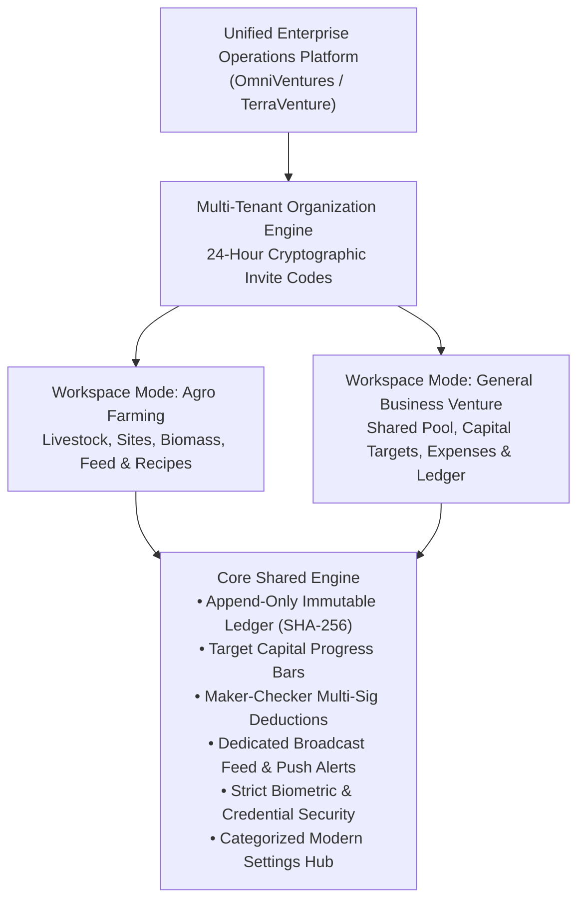
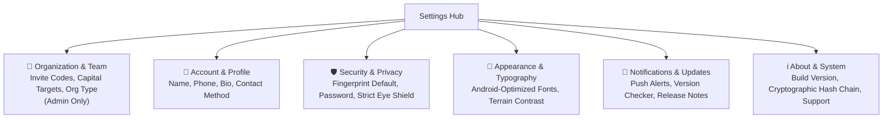
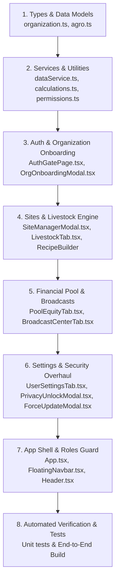

# Production-Grade Architecture & Upgrade Implementation Plan
**Platform:** Multi-Tenant Enterprise Operations Platform (Agro-Farming & General Business Ventures)  
**Target Environment:** Android PWA & Native Capacitor (Cross-Platform Web/Mobile)  
**Status:** Comprehensive Architecture & Implementation Specification  

---

## 1. Executive Summary & Dual-Core Architecture

This plan establishes a comprehensive roadmap to transition the application from an early-stage prototype into an enterprise-grade platform. The upgraded platform serves two primary use cases with equal elegance:



### Key Strategic Upgrades
1. **Name & Universal Scope:** Rebrand to **OmniVentures** (or **TerraVenture Operations**), allowing organizations to operate either as an **Agricultural Enterprise** (with livestock, feed, and farm site modules) or a **General Business Venture / Capital Pool** (for shared group investments, member commitments, purchase approvals, and cash deductions).
2. **Complete Removal of "Syndicate" Nomenclature:** Replace all instances of `syndicate` across UI labels, data structures, roles (`ORG_ADMIN`, `MEMBER`, `TREASURER`), and Firestore schemas with clean modern terminology (`Organization`, `Cooperative`, `Enterprise`, `Member`).
3. **Invitation Code System (24-Hour Expiration):** Eliminate the manual admin approval queue. New members join immediately by entering an active 24-hour cryptographic invite code created and manually refreshed by the organization admin.
4. **Member Target Contribution & Progress Bars:** Configurable capital targets per member (e.g., $1,000 monthly or self-paced) with interactive visual progress tracking and equity analytics.
5. **Farm Sites Full CRUD:** Complete administrative ability to add, view, edit, update GPS/operator details, and safely delete/archive sites with immutable audit trails.
6. **Flexible Livestock Recipe & Checkpoint Builder:** Replace rigid hardcoded broiler/goat schedules with a dynamic checkpoint engine featuring full CRUD, custom date pickers, target weights, custom feeding rations, reusable templates, and mathematical growth curves.
7. **Dedicated Broadcast Center:** A standalone, social-feed-style announcement hub with photo attachments, severity tiers, and unread badge telemetry.
8. **Role Isolation:** Completely hide the Roles/User Management tab and sensitive governance controls from regular members.
9. **Categorized Settings Redesign:** Android Material 3-inspired categorized settings hub with icons, titles, and preview subtitles; default fingerprint biometric authentication; strict privacy unlock without bypass loopholes; and a permanent fix for the password configuration bug.
10. **High-Contrast Update Modal:** Crisp, theme-aware styling with black text and clear version badges.

---

## 2. Gap Analysis & Production Innovations

| Area | Current Limitation | Upgraded Production Solution | Innovation / Value Added |
| :--- | :--- | :--- | :--- |
| **Branding & Scope** | Hardcoded to "Agro Planner" and "Syndicate"; cannot serve non-farming groups. | Dual-Mode Workspace (`AGRO_FARMING` vs `GENERAL_VENTURE`); "Syndicate" eliminated. | One unified platform serves both agricultural cooperatives and general investment ventures. |
| **Onboarding** | Unapproved users get stuck in `PendingApprovalLobby`; high friction. | 24-Hour Cryptographic Invitation Code (`ORG-XXXXXX`) refreshed manually in settings. | Zero-friction self-service join; reduces Firestore read costs to a single indexed lookup. |
| **Capital Pool** | Flat contribution lists; no way to track agreed member commitments. | Configurable Target Capital per Member (monthly or flexible) with live progress bars. | Transparent accountability; members see exactly how close each participant is to their agreed goal. |
| **Farm Sites** | Immutable once created; no edit or delete capability. | Full Admin CRUD (Edit Name, Region, GPS, Operator; Archive/Delete with validation). | Operational flexibility as sites expand, relocate, or reassign operators. |
| **Livestock Checkpoints** | Rigid hardcoded broilers/goats milestones; users cannot adjust days or rations. | Custom Recipe Builder: Full CRUD on checkpoints, custom date pickers, reusable templates. | Farm operators can design and execute their exact proprietary raising protocols. |
| **Ledger & Broadcasts** | Broadcasts cramped inside a sub-tab; alerts do not stand out. | Dedicated Broadcast Center page with rich media cards, acknowledgments, and push dispatch. | Critical field updates (vaccinations, deliveries, urgent notices) reach all members immediately. |
| **Roles & Permissions** | Roles tab exposed in navbar for non-admins; security controls visible. | Strict role-based rendering; non-admins never see Roles tab or governance options. | True enterprise access control adhering to least-privilege principles. |
| **Settings UX** | Giant uncategorized wall of options; typography not optimized for Android. | Categorized Hub with icons, titles, preview snippets; Android-optimized font & terrain styles. | Clean, accessible mobile UX matching native Android system settings. |
| **Biometric Security** | Biometric optional; hide/show numbers can be bypassed by typing new password. | Fingerprint set as default; 1st-login prompt; privacy modal strictly requires existing credentials. | True Zero-Trust security; prevents unauthorized bystanders from unmasking financials. |
| **Password Status** | UI often falsely reports "Password Not Configured" after setting. | Synchronous multi-store verification (`localStorage`, member record, session providers). | Reliable account linking across Google OAuth and Email/Password. |

---

## 3. Detailed Architectural Specifications

### 3.1 Dual-Mode Multi-Tenant Organization Model

```typescript
// src/types/organization.ts

export type OrganizationType = 'AGRO_FARMING' | 'GENERAL_VENTURE';

export interface Organization {
  id: string; // 'org-xxxxxx'
  name: string; // e.g., 'Green Valley Poultry' or 'Apex Ventures'
  type: OrganizationType;
  adminMemberId: string;
  adminEmail: string;
  createdAt: string;
  updatedAt: string;
  
  // 24-Hour Expiring Invitation Code
  currentInviteCode: string; // e.g., 'APX-7492'
  inviteCodeCreatedAt: string;
  inviteCodeExpiresAt: string; // ISO string 24h from generation
  
  // Member Capital Contribution Rules
  defaultTargetContributionUsd: number;
  contributionPaceDefault: 'MONTHLY' | 'MILESTONE' | 'FLEXIBLE';
  currency: string; // 'USD'
  currencySymbol: string; // '$'
  
  // Feature Toggles (Adaptive per workspace type)
  features: {
    livestockModule: boolean; // default true for AGRO_FARMING, false for GENERAL_VENTURE
    farmSitesModule: boolean;
    feedInventoryModule: boolean;
    multiSigApprovals: boolean;
    publicAuditVerifier: boolean;
  };
}

export interface InviteCodeLookup {
  code: string;
  orgId: string;
  orgName: string;
  orgType: OrganizationType;
  adminName: string;
  expiresAt: string;
}
```

#### Cost-Efficient 24-Hour Invitation Architecture
1. **Creation/Refresh:** When the Org Admin opens Organization Settings and clicks **"Generate New Invitation Code"**:
   - Generates a cryptographically randomized 6-8 character alphanumeric code (e.g. `VTR-8391`).
   - Sets `inviteCodeExpiresAt = new Date(Date.now() + 24 * 60 * 60 * 1000).toISOString()`.
   - Writes to `organizations/{orgId}` and `/invite_codes/{code}`.
   - Any prior code document for this organization in `/invite_codes` is cleaned up.
2. **Member Redemption:**
   - When an unassigned user signs in, they are presented with:
     - **Option A: "Create New Organization"** (Become Admin).
     - **Option B: "Join Existing Organization"** (Input Invitation Code).
   - The user inputs the code. The client reads `/invite_codes/{enteredCode}` (a single 1-document read).
   - Validation checks:
     `if (!doc.exists() || new Date() > new Date(doc.data().expiresAt)) throw new Error('Invitation code is invalid or has expired after 24 hours. Please request a fresh code from your administrator.');`
   - If valid, the user's member profile is immediately stamped with `orgId`, `role: 'MEMBER'`, and `approvalStatus: 'APPROVED'`. They enter the workspace immediately.

---

### 3.2 Member Target Contribution & Progress System

```typescript
// Updated src/types/agro.ts

export interface OrgMember {
  id: string;
  orgId: string;
  uid?: string;
  email?: string;
  fullName: string;
  phoneOrEmail: string;
  phone?: string;
  jobTitle?: string;
  bio?: string;
  role: 'ORG_ADMIN' | 'TREASURER' | 'MEMBER' | 'GROUND_OPERATOR';
  approvalStatus: 'APPROVED' | 'SUSPENDED';
  authProviders?: string[];
  hasPasswordSetup?: boolean;
  passwordVerifierHash?: string;
  assignedLocationId?: string;
  
  // Capital Commitment Configuration
  targetContributionUsd: number; // e.g., $1,000 agreed target
  contributionPace: 'MONTHLY' | 'MILESTONE' | 'FLEXIBLE';
  monthlyAgreedAmountUsd?: number;
  
  joinedAt: string;
  updatedAt?: string;
  active: boolean;
}

export interface MemberContributionProgress {
  member: OrgMember;
  targetUsd: number;
  totalContributedUsd: number;
  remainingUsd: number;
  progressPercentage: number;
  isGoalMet: boolean;
  lastContributionDate?: string;
}
```

#### Mathematical Progress Tracking
$$\text{Progress \%} = \min\left(100, \text{round}\left(\frac{\text{Total Contributed}}{\text{Target Amount}} \times 100\right)\right)$$
$$\text{Remaining Usd} = \max\left(0, \text{Target Amount} - \text{Total Contributed}\right)$$

Visual representation in the **Pool Tab**:
- Global Org Capital Meter: Displays aggregate funds collected vs total organization capital goal.
- Per-Member Cards: Dual progress bars showing the user's progress toward their personal target, plus their percentage ownership share of total pooled assets.

---

### 3.3 Farm Site Full CRUD Architecture

#### 1. Data Service Operations
```typescript
// src/services/dataService.ts extensions

public updateLocation(params: {
  locationId: string;
  name: string;
  region: string;
  gpsCoordinates: string;
  primaryOperatorName: string;
  actor: OrgMember;
}): FarmLocation {
  // Validate admin authority
  if (!PERMISSIONS.canAddLocations(params.actor.role)) {
    throw new Error('Access Denied: Only Organization Admins can modify farm sites.');
  }
  
  const updatedLoc: FarmLocation = {
    ...targetLoc,
    name: params.name.trim(),
    region: params.region.trim(),
    gpsCoordinates: params.gpsCoordinates.trim(),
    primaryOperatorName: params.primaryOperatorName.trim(),
    updatedAt: new Date().toISOString(),
  };
  
  // Log chained immutable audit event
  const audit = this.createChainedAuditEvent({
    actor: params.actor,
    locationId: updatedLoc.id,
    locationName: updatedLoc.name,
    eventType: 'SITE_UPDATED',
    severity: 'INFO',
    title: `Farm Site Updated: ${updatedLoc.name}`,
    message: `Site details modified by ${params.actor.fullName}. GPS: ${updatedLoc.gpsCoordinates}.`,
    referenceEntityId: updatedLoc.id,
  });
  
  // Save and persist to cloud
  ...
}

public deleteLocation(params: {
  locationId: string;
  actor: OrgMember;
}): { success: boolean; message: string } {
  // Check dependency references (active animals or assets)
  const activeLivestock = this.state.livestockEntries.filter(
    (l) => l.locationId === params.locationId
  );
  if (activeLivestock.length > 0) {
    throw new Error(`Cannot delete site: There are ${activeLivestock.length} active animal batches registered to this location. Please reassign or harvest them first.`);
  }
  
  // Audit log and remove
  ...
}
```

#### 2. User Interface Modal (`SiteManagerModal.tsx`)
- Integrated into Header location dropdown and Overview tab.
- Allows Org Admins to click an edit pencil or trash can next to each site.
- Form fields: Site Name, Region / District, GPS Coordinates (with "Use My Current Device GPS" button), and Primary Ground Operator name.

---

### 3.4 Flexible Livestock Recipe & Checkpoint Builder

#### 1. Data Schema
```typescript
// src/types/agro.ts

export type CheckpointCategory =
  | 'VACCINE'
  | 'FEED_TRANSITION'
  | 'WEIGHT_CHECK'
  | 'BIOSECURITY'
  | 'MEDICATION'
  | 'GENERAL_TASK';

export interface AnimalCheckpoint {
  id: string;
  dayTarget: number; // e.g. Day 1, Day 7, Day 14, Day 42
  scheduledDate: string; // Exact calendar date via HTML5 DatePicker (YYYY-MM-DD)
  title: string;
  category: CheckpointCategory;
  targetWeightKg?: number;
  feedPhase?: string;
  instructions?: string;
  completed: boolean;
  completedAt?: string;
  completedNote?: string;
  reminderStatus: 'SCHEDULED' | 'DUE_TODAY' | 'OVERDUE' | 'COMPLETED';
}

export interface FarmRecipeTemplate {
  id: string;
  orgId: string;
  name: string; // e.g., 'Commercial 42-Day Broiler Standard', 'Hardy Boer Goat 8-Month'
  species: string;
  recommendedDurationDays: number;
  targetSaleWeightKg: number;
  checkpoints: Omit<AnimalCheckpoint, 'id' | 'completed' | 'completedAt' | 'reminderStatus' | 'scheduledDate'>[];
  isCustomOrgRecipe: boolean;
  createdAt: string;
}
```

#### 2. Workflow in `LivestockTab.tsx`
1. **Dynamic Species Entry:** Non-restricted text input with auto-complete suggestions from existing org stock or presets.
2. **Recipe Selection & Customization:**
   - Dropdown: "Select Recipe Template" (or "Start Blank").
   - Interactive checkpoint list where users can:
     - ➕ **Add Checkpoint:** Choose Relative Day or Pick Calendar Date; select category, target weight, feed phase, instructions.
     - ✏️ **Edit Checkpoint:** Tweak any day, vaccine name, or weight on the fly.
     - 🗑️ **Delete Checkpoint:** Remove steps that don't apply to their farm setup.
     - 💾 **"Save as Organization Template"**: Save custom recipes so the whole team can reuse them on future batches.
3. **Advanced Growth Projections & Mathematical Calculations:**
   - Calculates target daily weight gain based on user-entered start and sale weights.
   - Plots actual weigh-ins against the user's custom checkpoints rather than rigid hardcoded curves.
   - Real-time countdown to target harvest date with calendar synchronization.

---

### 3.5 Dedicated Broadcast Center Page

#### 1. Navigation & Routing
- In `App.tsx` and `FloatingNavbar.tsx`, split the previous combined Audit tab into two clear views:
  1. **Broadcasts Tab (`BROADCASTS`)**: Live communications hub for all field updates, animal milestones, and receipts.
  2. **Audit Ledger Tab (`LEDGER`)**: Cryptographic SHA-256 chain inspector and financial audit logs.

#### 2. Broadcast Center UI Component (`BroadcastCenterTab.tsx`)
- **Composer Card:**
  - Headline input, detailed message body, site tagging, severity selector (`URGENT_GROUND`, `MILESTONE`, `INFO`).
  - High-resolution photo upload with client-side compression.
- **Broadcast Feed:**
  - Rich social-card layout.
  - Author badge, avatar, timestamp, site tag.
  - Image lightbox modal on tap.
  - "Mark as Read / Acknowledged" button.
  - Real-time unread badge counter in header.
- **Hardware Push Dispatch:** Invokes `dispatchSystemNotification` so backgrounded Android devices trigger an immediate alert with sound and vibration.

---

### 3.6 Strict Biometric & Credential Security Overhaul

#### 1. Eliminating the Privacy Shield Bypass
- **The Issue Diagnosed:** In `PrivacyUnlockModal.tsx`, when credentials were not configured or detected, the modal allowed switching to `setupMode`, enabling anyone to type an arbitrary password and immediately unmask numbers.
- **The Strict Fix:**
  - `PrivacyUnlockModal.tsx` strictly permits unlocking **only** via:
    1. Hardware Fingerprint Sensor (`verifyDeviceBiometric()`).
    2. Verified Account Password (`dataService.verifyMemberPassword(activeMember, passwordInput)`).
  - Inline password creation inside the unlock modal is completely removed.
  - If a user has neither set up, the modal displays: *"Privacy lock is active. Please configure credentials inside your authenticated account settings to unmask numbers."* with a direct link to Settings (requiring session authentication).

#### 2. Default to Fingerprint & First-Login Onboarding
- Default privacy preference initialized to `'biometric'`.
- After successful registration or login:
  - If the device supports biometrics and the user has not yet enrolled, an onboarding modal appears:
    *"Enable Fingerprint Quick-Unlock? Unlock your account and unmask financial numbers instantly with your Android fingerprint."*
  - Buttons: **"Enable Fingerprint"** (calls `enrollDeviceBiometric()`) and **"Maybe Later"**.

#### 3. Diagnosis & Fix: "Password Always Says Not Configured"
- **Root Cause:**
  1. `UserSettingsTab.tsx` only evaluated `isPasswordLinked` from `activeMember.hasPasswordSetup || linkedProviders.includes('password')`.
  2. Google OAuth sessions defaulted `providers` to `['google.com']`.
  3. When `setupOrUpdatePasswordForCurrentUser` completed, the local credentials were saved to `localStorage`, but `activeSession.providers` in memory and the active member prop did not immediately reflect `hasPasswordSetup: true` until full app reload or cloud re-fetch.
- **Resolution:**
  - `isPasswordLinked` checks:
    ```typescript
    const isPasswordLinked = Boolean(
      activeMember.hasPasswordSetup ||
      Boolean(activeMember.passwordVerifierHash) ||
      Boolean(getStoredLocalCredentials()[activeMember.email || '']?.verifierHash) ||
      linkedProviders.includes('password')
    );
    ```
  - `setupOrUpdatePasswordForCurrentUser` immediately mutates `activeSession.providers` to include `'password'`, updates `hasPasswordSetup: true` in the state snapshot, and dispatches a synchronous listener update.

---

### 3.7 Categorized Settings Hub Redesign

Instead of a single continuous scroll, `UserSettingsTab.tsx` is organized into clean, categorized sections with leading icons, category titles, and preview descriptions:



#### Category Structure
1. **🏢 Organization & Cooperative (Admin Only)**
   - *Preview:* "Manage organization details, 24-hr invitation code, and capital targets."
   - Controls: Organization Name, Mode (`AGRO_FARMING` vs `GENERAL_VENTURE`), Target Contribution per Member ($), Active 24-hr Invitation Code with One-Tap Copy and "Refresh Code" button.
2. **👤 Personal Profile**
   - *Preview:* "Update your display name, contact phone, and personal bio."
   - Controls: Full Name, Phone, Job Title, Bio, Preferred Contact.
3. **🛡️ Security & Credentials**
   - *Preview:* "Fingerprint biometrics, account password, and privacy shield settings."
   - Controls: Default Biometric Toggle, Fingerprint Enrollment / Test, Email & Password setup/update, Eye-Shield behavior selection.
4. **🎨 Appearance & Typography (Android-Optimized)**
   - *Preview:* "Customize font rendering and background terrain for mobile readability."
   - Controls: High-contrast typography options (Clean Modern Sans, High-Contrast Grotesk, Monospace Telemetry), Terrain contrast (Subtle, Standard, Off for OLED power-saving).
5. **🔔 Notifications & Cloud Sync**
   - *Preview:* "Configure device push notifications and verify cloud sync."
   - Controls: Push notification permissions toggle, Cloud Force-Sync trigger, Check for Updates button.
6. **ℹ️ About & Developer Info**
   - *Preview:* "System version, ledger verifier integrity, and developer contact."
   - Controls: Version badge, Developer brand info, release notes trigger.

> [!NOTE]
> All administrative controls (Organization Code, Target Capital configuration, User Roles, and Master Resets) are strictly guarded: non-admin members do not see these cards or sections.

---

### 3.8 High-Contrast Update Modal & Badges Fix

In `ForceUpdateModal.tsx` and version displays:
- Replace dark slate backgrounds (`bg-slate-900`, `bg-slate-950`) with clean, theme-aware card surfaces.
- All badge text formatted with high-contrast, black/dark slate text (`text-slate-950 font-black`) over solid bright pill badges:
  - `Installed: v1.0.4`: Light slate badge with black text.
  - `Latest: v1.0.4`: Emerald accent badge with deep forest/black text.
  - `Min Required: v1.0.3`: Amber accent badge with deep dark text.
- Release notes box rendered with crisp white/cream background, solid border, and `#0F172A` body text.

---

## 4. Implementation Steps & File Modifications



### Detailed File Mapping

#### A. Files to Create

| File Path | Purpose |
| :--- | :--- |
| `src/types/organization.ts` | Data interfaces for `Organization`, `OrganizationType`, `InviteCodeLookup`, and feature flags. |
| `src/components/OrgOnboardingModal.tsx` | First-time onboarding screen allowing users to either "Create New Organization" or "Join with 24-Hr Code". |
| `src/components/SiteManagerModal.tsx` | Full CRUD management modal for farm locations/sites (Add, Edit, Delete/Archive with dependency validation). |
| `src/components/RecipeBuilderModal.tsx` | Custom livestock milestone/checkpoint recipe creator with date pickers, target weights, and reusable templates. |
| `src/components/BroadcastCenterTab.tsx` | Dedicated full-page broadcast and field notification hub with media lightbox and acknowledgment tracking. |
| `src/components/FirstLoginBiometricPrompt.tsx` | Post-login prompt asking users to enable hardware fingerprint unlock as default. |
| `src/utils/organization.test.ts` | Unit tests for 24-hr invitation code generation, validation, expiration, and multi-tenant isolation. |
| `src/utils/checkpoints.test.ts` | Unit tests for custom checkpoints CRUD, weight gain mathematics, and date scheduling. |

#### B. Files to Modify

| File Path | Required Changes |
| :--- | :--- |
| `src/types/agro.ts` | • Replace `SyndicateMember` with `OrgMember`.<br/>• Replace `totalSyndicatePool` / `totalSyndicateNav` with `totalPool` / `totalNav`.<br/>• Add `targetContributionUsd` and `contributionPace` to member.<br/>• Add `AnimalCheckpoint` and `FarmRecipeTemplate` interfaces.<br/>• Add `orgId` to all state entities. |
| `src/utils/permissions.ts` | • Replace `SYNDICATE_ADMIN` with `ORG_ADMIN`.<br/>• Remove hardcoded primary admin email restriction; base admin checks on `member.role === 'ORG_ADMIN' && member.orgId === activeOrg.id`.<br/>• Add permissions for site updating, site deletion, recipe customization, and invite code refreshing. |
| `src/services/dataService.ts` | • Implement 24-hr invitation code lifecycle: `createOrRefreshInviteCode(orgId)` and `joinOrganizationWithCode(code)`.<br/>• Implement `updateLocation` and `deleteLocation` with chained audit logging.<br/>• Implement `saveCustomRecipeTemplate`, `addCheckpointToLivestock`, `updateLivestockCheckpoint`, `deleteLivestockCheckpoint`.<br/>• Fix `setupOrUpdatePasswordForCurrentUser` to immediately reflect configured status in session and state.<br/>• Remove "syndicate" strings from all log generators and audit messages. |
| `src/utils/calculations.ts` | • Upgrade `computeMemberEquities` to calculate target contribution progress percentages, remaining balances, and pace.<br/>• Upgrade `generateGrowthProjectionData` to consume dynamic checkpoints instead of hardcoded broiler arrays. |
| `src/components/ForceUpdateModal.tsx` | • Overhaul color palette to match application theme: high-contrast black text (`#0F172A`), bright pill badges, clear contrast on mobile displays. |
| `src/components/PrivacyUnlockModal.tsx` | • Remove inline password setup bypass loophole.<br/>• Strictly require valid fingerprint sensor authentication or verified account password.<br/>• Set fingerprint as preferred default. |
| `src/components/LivestockTab.tsx` | • Replace hardcoded broiler/goat milestone schedules with dynamic checkpoints.<br/>• Integrate custom date picker, weight projection mathematics, and recipe template selection.<br/>• Add CRUD actions (Add, Edit, Delete) to individual checkpoints on each animal card. |
| `src/components/PoolEquityTab.tsx` | • Add member target contribution progress bars with percentage completion and remaining commitment.<br/>• Adapt terminology to Organization Capital Pool.<br/>• Display organization 24-hr invitation code in quick-share card for admins. |
| `src/components/UserSettingsTab.tsx` | • Restructure into clean categorized hub with leading icons, category titles, and preview subtitles.<br/>• Hide Roles, Security governance, and Organization admin settings from non-admin users.<br/>• Fix password configuration status check.<br/>• Add Android-optimized typography and terrain styling controls. |
| `src/components/FloatingNavbar.tsx` | • Strictly omit Roles tab for non-admins.<br/>• Integrate dedicated Broadcasts tab.<br/>• Adapt tabs dynamically if workspace mode is `GENERAL_VENTURE` (hide livestock tab if unused). |
| `src/components/Header.tsx` | • Display active Organization Name and Workspace Mode badge.<br/>• Site selector with "Manage Sites (CRUD)" modal trigger for admins.<br/>• Update notification drawer to sync with dedicated Broadcasts center. |
| `src/App.tsx` | • Remove `PendingApprovalLobby` gate in favor of code-based invitation onboarding.<br/>• Route dedicated Broadcasts view and Ledger view.<br/>• Enforce role checks preventing unauthorized access to `USERS` tab.<br/>• Trigger `FirstLoginBiometricPrompt` on fresh authentication. |
| `firestore.rules` | • Update rules to validate multi-tenant `orgId` boundaries.<br/>• Allow site updates and deletes by `ORG_ADMIN`.<br/>• Allow single-document lookup on `/invite_codes/{code}`. |

---

## 5. Verification & Testing Strategy

### 5.1 Automated Unit & Integration Tests

Run tests via `cmd /c "npm run test"` or `cmd /c "npx tsx src/utils/<test-file>.ts"`:

1. **`permissions.test.ts`**:
   - Verify `ORG_ADMIN` has full privileges within their organization.
   - Verify `MEMBER` and `GROUND_OPERATOR` cannot access Roles tab, cannot manage members, and cannot edit farm sites.
   - Verify non-admin cannot access organization invite code or master ledger reset.
2. **`organization.test.ts` (New)**:
   - Test invitation code generation (randomness, length, 24-hour expiration timestamp).
   - Test code validation: valid code admits member; expired code (>24h) throws descriptive error.
   - Test admin manual code refresh: updates code and invalidates prior code.
3. **`checkpoints.test.ts` (New)**:
   - Test adding custom checkpoints with arbitrary calendar dates.
   - Test editing and deleting checkpoints on an active livestock batch.
   - Test mathematical weight curve interpolation based on custom user milestones.
4. **`calculations.test.ts`**:
   - Verify member target capital contribution calculation (percentage, remaining amount, goal met status).
   - Verify financial summary integrity (Left Money = Total Pool - Approved Expenses + Reinvested Sales).
5. **Typecheck & Build**:
   - `cmd /c "npm run lint"` (`tsc --noEmit`) to guarantee zero TypeScript type errors.
   - `cmd /c "npm run build"` to verify Vite production bundling and PWA service worker generation.

### 5.2 Manual End-to-End Test Matrix

| Step | Test Action | Expected Result |
| :--- | :--- | :--- |
| **1. Update Badge Contrast** | Open Update Modal on mobile viewport. | All text is high-contrast black (`#0F172A`), badges are clearly legible with solid backgrounds, no dark-on-dark unreadable elements. |
| **2. Syndicate Removal** | Full-text search across entire workspace for `syndicate`. | Zero occurrences found; replaced with Organization / Venture / Member. |
| **3. Farm Site CRUD** | Admin clicks "Edit Site" or "Delete Site" in Header/Overview. | Edit updates site details and logs audit event; delete validates zero active batches and removes site cleanly. |
| **4. Checkpoint Customization** | Register new livestock -> add custom checkpoints with date picker -> save custom template -> delete a checkpoint on existing batch. | Checkpoints update dynamically; growth charts plot against custom targets; full CRUD operations succeed. |
| **5. 24-Hr Invite Code** | Admin generates code in Settings -> New user inputs code on registration. | User is admitted immediately without approval delay; test code with expired timestamp fails with clean alert. |
| **6. Capital Target Progress** | Set member target to $1,000 -> log $600 contribution. | Progress bar shows 60% with $400 remaining; upon reaching $1,000, shows "Goal Met" badge. |
| **7. Dedicated Broadcasts** | Post urgent ground broadcast with photo -> check unread count -> mark read. | Broadcast displays in dedicated feed; unread badge clears; push alert triggered on device. |
| **8. Role Visibility** | Sign in as regular `MEMBER`. | Roles tab is absent from navigation; visiting settings hides all administrative and security governance sections. |
| **9. Categorized Settings** | Navigate to Settings tab. | Clean categorized cards with icons and preview subtitles; fingerprint prompt tested; password status correctly displays "Configured & Active". |
| **10. Privacy Shield Bypass Fix** | Attempt to unmask numbers without authenticating credentials. | Setup bypass is impossible; strictly requires fingerprint or existing password. |
| **11. Dual-Mode Workspace** | Create General Business Venture organization. | Livestock tab is gracefully adapted/hidden; focus shifts to pooled funds, shared purchases, and expense deductions. |

---

## 6. Execution Roadmap

- **Step 1:** Types, Data Models & Nomenclature Cleanup (Eliminate "Syndicate", introduce `Organization`, `AnimalCheckpoint`).
- **Step 2:** DataService & Calculations Engine Update (Sites CRUD, 24-hr Invite Code, Target Progress, Dynamic Checkpoints).
- **Step 3:** Authentication & Onboarding Gate (Code-based onboarding, First-login fingerprint modal).
- **Step 4:** UI Overhaul (Livestock Recipe Builder, Site Manager Modal, Dedicated Broadcast Center, Pool Target Bars).
- **Step 5:** Settings & Security Refactor (Categorized Hub, Password status diagnosis fix, Strict Privacy Unlock, High-contrast Update Modal).
- **Step 6:** Roles & Access Control Enforcement (Strict tab and section filtering).
- **Step 7:** Full Automated & Build Verification (`tsc`, Vite build, test suite execution).
