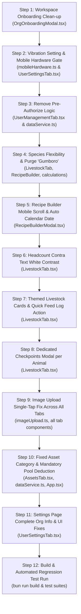

# CapitaSeed Comprehensive Frontend Implementation Plan

## Executive Summary
This document provides an exhaustive, production-grade technical implementation plan for addressing the 12 issues identified across the CapitaSeed workspace onboarding, settings, livestock management, recipes, fixed assets, and hardware/image interactions.

---

## 1. Issue-by-Issue Architectural Analysis & Solution Design

### Issue 1: Workspace Onboarding Clean-up
- **Location**: `src/components/OrgOnboardingModal.tsx`
- **Current Problem**:
  1. The onboarding modal displays "CapitaSeed Zero-Trust" with a badge in the footer, which is unnecessary jargon.
  2. The tab card for joining displays "Use 24-Hr Secret Code".
  3. The Join form includes an expiration note: "Invitation codes automatically expire 24 hours after generation."
  4. The input label states "24-Hour Invitation Code *", and the button states "Validating Secret Code...".
- **Target Changes**:
  1. Remove "CapitaSeed Zero-Trust" badge from footer.
  2. Replace "Use 24-Hr Secret Code" with "Use code from existing organisation".
  3. Remove the 24-hour expiration tab/note completely from the Join tab.
  4. Update input label to "Invitation Code" and placeholder to "e.g. SEED-8492".
  5. Update loading button text to "Validating Code...".
  6. Sanitize info popover description from "24-hour invitation code" to "invitation code".

---

### Issue 2: Vibration & Haptic Hardware Setting
- **Locations**: `src/utils/mobileHardware.ts`, `src/components/UserSettingsTab.tsx`, `src/App.tsx`
- **Current Problem**:
  - `triggerHapticFeedback()` in `mobileHardware.ts` calls `navigator.vibrate(pattern)` unconditionally on every bottom nav tab switch, button press, and event log without checking user preference.
  - Users find the vibration annoying and have no mechanism to turn it off.
- **Target Changes**:
  1. In `mobileHardware.ts`:
     - Add persistent preference storage functions:
       - `isVibrationEnabled(): boolean` (reads `agro_vibration_enabled` from `localStorage`, defaulting to `false` so it is off by default, or respecting user toggle).
       - `setVibrationEnabled(enabled: boolean): void` (saves preference to `localStorage`).
     - In `triggerHapticFeedback(pattern)`: Check `if (!isVibrationEnabled()) return;` before calling `navigator.vibrate()`.
  2. In `UserSettingsTab.tsx`:
     - In the **Notifications & Cloud Sync** settings view (and overview card), add a clean toggle switch:
       - Label: "Haptic Vibration Feedback"
       - Subtext: "Vibrate device on navigation, button clicks, and ground logging actions"
       - State: React boolean state synchronized with `isVibrationEnabled()`.
       - Action: When toggled, update localStorage via `setVibrationEnabled(val)` and provide an instant feedback preview if toggled ON.

---

### Issue 3: Complete Removal of Pre-Authorize Logic & Files
- **Locations**: `src/components/UserManagementTab.tsx`, `src/services/dataService.ts`, `src/App.tsx`, test suites
- **Current Problem**:
  - The application previously had an Admin "Pre-Authorize Member" workflow where admins manually created member stubs before those users joined.
  - CapitaSeed now uses self-service code-based joining via organization invitation codes (e.g. `SEED-XXXX`).
  - Pre-authorize UI buttons, modals, and helper methods are redundant and confuse operators.
- **Target Changes**:
  1. In `UserManagementTab.tsx`:
     - Remove the `+ Pre-Authorize Member` button from the header action bar.
     - Remove the pre-authorize member dialog modal (`showInviteModal`, `inviteName`, `inviteEmail`, `inviteRole`, `inviteSiteId`, `inviteContribution`, `handlePreInviteSubmit`).
     - In its place on the header, display a prominent **"Organization Invite Code"** banner with a 1-click **Copy Invite Code** button and quick share action.
     - Sanitize all table tooltips and status messages referencing "pre-authorized".
  2. In `dataService.ts`:
     - Remove obsolete pre-authorization references and comments.
     - Ensure `addMember` is either repurposed strictly for system seeding or renamed/deprecated in favor of `joinOrganizationWithCode`.
     - Update audit event titles from `Pre-Authorized Member Added` to `Member Added`.

---

### Issue 4: Dynamic Species/Category & Fully Flexible Cycle Duration
- **Locations**: `src/components/LivestockTab.tsx`, `src/types/agro.ts`, `src/utils/livestockProjections.ts`
- **Current Problem**:
  - Species presets hardcode rigid names and cycle durations (e.g., `Layers` is hardcoded to "72-week egg cycle").
  - If a farmer has layers with a different cycle (e.g., point of lay 50 weeks, or 18 months), or wants to enter their own breed name, they are forced to use rigid presets or locked names.
- **Target Changes**:
  1. In `LivestockTab.tsx`:
     - Update `SPECIES_PRESETS` labels to describe the species type without rigid duration locks (e.g., change `Layers (72-Week Egg Cycle)` to `Layers (Egg Production)`).
     - Make the species name field **freely editable**:
       - Clicking a preset chip autofills the species name, initial age, target weight, and suggested duration, but leaves the species input completely editable.
       - The farmer can freely change the species name to whatever they want (e.g. "Lohmann Brown Layers", "Indigenous Free-Range", "Layers 50-Week").
     - Make Target Duration Value and Target Duration Unit (`DAYS` | `WEEKS` | `MONTHS` | `YEARS`) always freely editable, never locked.
     - The live countdown preview, target market sale date, and growth projection curves dynamically recalculate based on whatever number of days/weeks/months the farmer inputs.

---

### Issue 5: Complete Elimination of the Word "Gumboro"
- **Locations**:
  - `src/components/RecipeBuilderModal.tsx`
  - `src/utils/calculations.ts`
  - `src/utils/calculations.test.ts`
  - `workflow-tests/02-agro-farming-workflow.test.ts`
  - `workflow-tests/fixtures/production-fixtures.json`
- **Current Problem**:
  - "Gumboro" is an explicit / vulgar word in the Shona language spoken in Zimbabwe.
  - Internationally, the poultry disease is Infectious Bursal Disease (IBD).
- **Target Changes**:
  1. In `RecipeBuilderModal.tsx`:
     - Replace `Day 14: IBD (Gumboro) Intermediate Vaccine` with `Day 14: IBD (Infectious Bursal Disease) Vaccine`.
     - Replace placeholder `e.g. Day 14: IBD Gumboro Vaccine in Water` with `e.g. Day 14: IBD Vaccine in Water`.
  2. In `calculations.ts`:
     - Replace `tpl.title.toLowerCase().includes('gumboro')` with `tpl.title.toLowerCase().includes('ibd')`.
  3. In `calculations.test.ts`:
     - Replace any references to "Gumboro" with "IBD" or "Infectious Bursal Disease".
  4. In `workflow-tests/02-agro-farming-workflow.test.ts` and `production-fixtures.json`:
     - Replace `Gumboro (IBD-1)` and `Gumboro (IBD-2)` with `IBD (Infectious Bursal Disease) Vaccine`.

---

### Issue 6: Recipe Builder Layout & Automatic Date Computation
- **Locations**: `src/components/RecipeBuilderModal.tsx`, `src/components/LivestockTab.tsx`
- **Current Problem**:
  1. On mobile phones, loading presets or adding checkpoints expands the modal dialog excessively tall, pushing buttons off-screen and breaking responsive scrolling.
  2. The form requires the user to manually enter both "Target Day" (e.g. Day 14) and "Scheduled Calendar Date", which is redundant since the calendar date can be calculated automatically from the animal's move-in / entry date.
- **Target Changes**:
  1. **Layout & Height Fix**:
     - Redesign `RecipeBuilderModal` with a standard mobile-app modal architecture:
       - Header: Fixed (`shrink-0 border-b`) with close button.
       - Body: Fluid scrollable area (`flex-1 overflow-y-auto max-h-[70vh] p-4`).
       - Footer: Fixed sticky action bar (`shrink-0 border-t bg-white p-3.5 flex justify-end gap-2`).
     - Checkpoint list cards: Render in a compact list format with collapsible details so 12 checkpoints don't create an overwhelming vertical scroll.
  2. **Automatic Calendar Date Calculation**:
     - Pass `entryDate` (move-in date) from `LivestockTab.tsx` to `RecipeBuilderModal`.
     - When `cpDay` changes, automatically calculate:
       $$\text{scheduledDate} = \text{new Date}(\text{entryDateMs} + \text{cpDay} \times 86,400,000)$$
     - Remove the manual calendar date input field. Replace with an automatic date preview badge (e.g. "Computed: Nov 17, 2026 (Day 14 from Arrival)").
     - Preserve the computed date in the checkpoint payload.

---

### Issue 7: Post Headcount Contra Adjustment Text Contrast
- **Location**: `src/components/LivestockTab.tsx`
- **Current Problem**:
  - In the headcount contra adjustment modal, the warning text stating `"Strict Immutability Law: Past logs cannot be edited or deleted..."` is styled with `text-amber-200` (yellow), which causes readability issues on certain screens.
- **Target Changes**:
  - Change `text-amber-200` to `text-white font-medium` for crisp, high-contrast visibility.

---

### Issue 8: Feed Consumed Quick Action & Themed Light Card Design
- **Location**: `src/components/LivestockTab.tsx`
- **Current Problem**:
  1. On the livestock tracking page, the card displays "Feed Consumed (kg)" metric, but there is no quick button on the card action bar to log feed.
  2. If an animal batch has no checkpoints configured, feed cannot be logged at all.
  3. The animal batch cards are styled in dark mode (`bg-slate-900 border-slate-800`), conflicting with the rest of the app's warm theme (`bg-white border-[#E8DFCE]`).
- **Target Changes**:
  1. **Quick "Log Feed Consumed" Action**:
     - Add a quick action button: `<button> Log Feed Consumed </button>` on the action bar of every animal card.
     - Clicking opens a dedicated modal allowing operators to log:
       - Feed quantity consumed (in kg)
       - Feed type / brand / ration phase (e.g. Starter, Grower, Finisher, Hay, Minerals)
       - Date and notes
       - Optional receipt or feed bag photo
     - Calls `dataService.logFeedConsumption(...)`, instantly updating `totalFeedConsumedKg` for that batch regardless of whether checkpoints exist.
  2. **Themed Light Card Styling**:
     - Restyle `<article className="rounded-2xl bg-white border border-[#E8DFCE] shadow-sm p-4 sm:p-5 space-y-4 text-slate-950">`.
     - Update text contrast:
       - Header & title: `text-slate-950 font-black`
       - Secondary notes & metadata: `text-slate-600 font-medium`
       - Metric blocks: `bg-[#FAF8F5] border border-[#E8DFCE] rounded-xl p-2.5`
       - Progress bar: `bg-slate-100 border border-slate-200 rounded-full`
       - Buttons: Clear amber, emerald, and slate styled buttons with high contrast text.

---

### Issue 9: Checkpoints Full-View Modal per Animal Card
- **Location**: `src/components/LivestockTab.tsx`
- **Current Problem**:
  - Checkpoints are currently expanded inline inside the card, taking up huge vertical space and pushing other animals off the screen.
  - Only the first animal's checkpoints were commonly viewed, and subsequent animals appeared to lack checkpoints or were cluttered.
- **Target Changes**:
  1. Remove the tall inline accordion expansion from the card stream on the main page.
  2. Add a clear, dedicated button on each animal's card:
     - `View All Checkpoints ({completed}/{total})` with milestone indicator.
  3. Clicking opens a dedicated full-screen or large responsive modal (`BatchCheckpointsModal`):
     - Displays the animal's name, species, and current day.
     - Lists all checkpoints in full with categories, target weights, feed phases, and detailed operator instructions.
     - Provides completion checkmarks, WhatsApp broadcast triggers, and "+ Add Checkpoint" button.
     - Keeps the main livestock stream compact, fast, and organized.

---

### Issue 10: Image Upload Double-Select Bug Resolution
- **Locations**:
  - `src/components/LivestockTab.tsx`
  - `src/components/AssetsTab.tsx`
  - `src/components/ExpensesFeedTab.tsx`
  - `src/components/AuditAlertsTab.tsx`
  - `src/components/BroadcastCenterTab.tsx`
  - `src/components/HomeTab.tsx`
  - `src/utils/imageUpload.ts`
- **Current Problem**:
  - Users must select an image twice for it to upload.
  - Root cause:
    1. Wrapping `<input type="file" className="hidden" />` inside `<label>` causes touch events on mobile/WebView (Capacitor/Android) to focus the label on first tap, requiring a second tap to fire the file picker.
    2. The input element does not clear `e.target.value = ''` after reading, so selecting the same file or re-selecting fails to trigger `onChange`.
    3. `img.crossOrigin = 'anonymous'` in `compressImage` causes CORS delay or canvas taint issues when loading local data URLs.
- **Target Changes**:
  1. Replace `<label><input className="hidden" /></label>` with a direct ref-driven button:
     - Use `const fileInputRef = useRef<HTMLInputElement>(null)`.
     - Button: `<button type="button" onClick={() => fileInputRef.current?.click()} ...>`
     - Input: `<input ref={fileInputRef} type="file" accept="image/*" className="sr-only" onChange={handleFileChange} />`
  2. Inside `handleFileChange`:
     - Read `e.target.files?.[0]`.
     - Immediately reset `e.target.value = ''` so future selections always fire.
  3. In `src/utils/imageUpload.ts`:
     - Only set `img.crossOrigin = 'anonymous'` if the source URL is an `http:` or `https:` URL, NEVER for `data:` URLs.

---

### Issue 11: Fixed Asset Category Flexibility & Mandatory Pool Deduction
- **Locations**: `src/components/AssetsTab.tsx`, `src/services/dataService.ts`, `src/types/agro.ts`, `src/App.tsx`
- **Current Problem**:
  1. Asset categories are fixed to 5 rigid enum options.
  2. The asset creation modal includes a checkbox allowing the user to check or uncheck "Deduct purchase cost from Left Money Reserve".
  3. If money is bigger than the pool, or if available pool is zero, users could still register assets without deduction, resulting in phantom assets purchased with zero money.
- **Target Changes**:
  1. **Category Flexibility**:
     - Expand category selection to allow flexible preset options + custom category text input:
       - Poultry & Livestock Housing
       - Solar, Borehole & Water Infrastructure
       - Feeders, Drinkers & Small Equipment
       - Vehicles & Farm Transport
       - Land, Fencing & Security
       - Processing, Cold Storage & Packaging
       - Custom / Other (with text input for custom name)
  2. **Remove Deduct Checkbox**:
     - Completely remove the checkbox section ("Deduct purchase cost from Left Money Reserve") from `AssetsTab.tsx`.
     - In its place, leave the section blank as instructed.
     - All asset purchases are **always** deducted from the main remaining pool (`deductFromLeftMoney: true` is hard-coded).
  3. **Zero / Insufficient Money Enforcement**:
     - Pass `leftMoney` from `App.tsx` into `AssetsTab.tsx`.
     - Display current available pool balance prominently on the purchase form: `Available Pool Balance: $X.XX`.
     - If asset cost > `leftMoney` or `leftMoney <= 0`:
       - Display error: `"Insufficient funds in remaining pool ($X.XX available). You cannot purchase an asset costing $Y.YY with insufficient pool money."`
       - Disable submit button.
     - In `dataService.logFixedAssetEvent`: Enforce strict validation: if `direction === 'INITIAL'` or `'ADDITION'` and `valueDelta > 0`, calculate current `leftMoney`; if `valueDelta > leftMoney`, throw an Error: `"Ledger Error: Insufficient capital pool balance ($X available) to acquire asset for $Y."`

---

### Issue 12: Settings Page Invite Code, Registration Info & Biometric UI Fix
- **Locations**: `src/components/UserSettingsTab.tsx`, `src/services/dataService.ts`, `src/App.tsx`
- **Current Problem**:
  1. In Settings, Organization & Team settings was only visible to Admins. If `activeOrg` was null or loaded from legacy seed data, no invite code appeared at all.
  2. Registration details (pace, target capital, org type, founder admin) were missing or incomplete.
  3. On mobile, the badge "Not Configured Yet" under biometrics wrapped into 3 ugly vertical rows.
  4. Under "About CapitaSeed Platform", the "Architecture Engine" and "Platform Deployment" lines need to be removed.
- **Target Changes**:
  1. **Organization & Team Settings Accessibility**:
     - Make Organization & Team Settings accessible to all members (Admins can edit; Members can view details and copy invite code).
     - In `dataService.ts` / `App.tsx`: Guarantee that `activeOrg` is never null. If `activeMember.orgId` exists but has no document in `organizations`, initialize a valid default organization record with an active `SEED-XXXX` invitation code.
  2. **Complete Registration Info Display**:
     - Display:
       - Organization Name
       - Workspace Type (Agro-Farming vs General Venture)
       - Target Capital Contribution Per Member ($)
       - Agreed Contribution Pace (Monthly, Milestone-Based, Flexible)
       - Founder / Admin Contact
       - Creation Date & Org ID
       - Active Invitation Code (with 1-click Copy button and Admin Refresh button)
  3. **Biometric Badge 3-Row Wrap Fix**:
     - Update header layout to `flex-wrap sm:flex-nowrap items-start sm:items-center justify-between gap-2`.
     - Add `whitespace-nowrap shrink-0` to the badge `<span>Not Configured Yet</span>` so it never breaks into 3 rows.
  4. **About Platform Clean-up**:
     - In `UserSettingsTab.tsx` Category 6 (About), delete the two rows:
       - Architecture Engine (SHA-256 Chained Immutable Ledger)
       - Platform Deployment (Capacitor Android & PWA)

---

## 2. File Modification Matrix

| File Path | Action | Summary of Modifications |
|---|---|---|
| `src/components/OrgOnboardingModal.tsx` | Modify | Remove "Zero-Trust" badge, update "24-Hr Secret Code" to "code from existing organisation", remove 24-hr expiration notice and sanitize labels. |
| `src/utils/mobileHardware.ts` | Modify | Add `isVibrationEnabled()` and `setVibrationEnabled()`; gate `triggerHapticFeedback()` on preference check. |
| `src/components/UserSettingsTab.tsx` | Modify | Add vibration toggle switch; make Org Settings accessible to all members with full registration details & invite code; fix "Not Configured Yet" 3-row wrap; remove Architecture Engine & Platform Deployment rows. |
| `src/components/UserManagementTab.tsx` | Modify | Remove "+ Pre-Authorize Member" button, state, and modal; add active Organization Invite Code card with Copy button. |
| `src/services/dataService.ts` | Modify | Ensure fallback organization exists with valid invite code; enforce pool balance check on fixed asset purchase; guarantee asset purchase expense creation; sanitize pre-authorize references. |
| `src/types/agro.ts` | Modify | Extend `FixedAssetCategory` to support custom category strings. |
| `src/components/AssetsTab.tsx` | Modify | Add custom asset category input; remove "Deduct from Left Money" checkbox; enforce mandatory pool deduction; validate cost against `leftMoney` with blocking error; fix image upload double-select bug. |
| `src/components/LivestockTab.tsx` | Modify | Convert cards to light theme; add quick "Log Feed Consumed" button & modal; open checkpoints in dedicated modal instead of huge inline list; make species editable with non-rigid duration; fix contra text yellow to white; fix image double-select. |
| `src/components/RecipeBuilderModal.tsx` | Modify | Fix mobile modal layout with fixed header/footer & scrollable body; auto-calculate calendar date from entryDate + dayTarget; remove manual date field; replace "Gumboro" with "IBD". |
| `src/utils/calculations.ts` | Modify | Purge "gumboro" keyword matching; ensure clean protocol generation for all custom species. |
| `src/utils/calculations.test.ts` | Modify | Verify protocol assertions without "gumboro". |
| `src/utils/imageUpload.ts` | Modify | Guard `img.crossOrigin = 'anonymous'` only for http(s) URLs; prevent canvas CORS lock. |
| `src/components/ExpensesFeedTab.tsx` | Modify | Fix file input double-select bug with direct ref trigger and value reset. |
| `src/components/AuditAlertsTab.tsx` | Modify | Fix file input double-select bug with direct ref trigger and value reset. |
| `src/components/BroadcastCenterTab.tsx` | Modify | Fix file input double-select bug with direct ref trigger and value reset. |
| `src/components/HomeTab.tsx` | Modify | Fix file input double-select bug with direct ref trigger and value reset. |
| `src/App.tsx` | Modify | Pass `leftMoney` to `AssetsTab`; pass `entryDate` to `RecipeBuilderModal`; ensure `activeOrg` resolves reliably. |
| `workflow-tests/02-agro-farming-workflow.test.ts` | Modify | Replace "Gumboro" references with "IBD". |
| `workflow-tests/fixtures/production-fixtures.json` | Modify | Replace "Gumboro" references with "IBD". |

---

## 3. Step-by-Step Execution Sequence



---

## 4. Detailed Component Changes & Code Snippets

### A. Workspace Onboarding (`OrgOnboardingModal.tsx`)
```tsx
// Before:
<p className="text-[10px] text-slate-600 font-medium">Use 24-Hr Secret Code</p>
// After:
<p className="text-[10px] text-slate-600 font-medium">Use code from existing organisation</p>

// Remove:
<p className="text-[11px] text-slate-500 font-medium mt-1 text-center">
  Invitation codes automatically expire 24 hours after generation.
</p>

// Before:
<label className="block text-xs font-black text-slate-950 mb-1">24-Hour Invitation Code *</label>
// After:
<label className="block text-xs font-black text-slate-950 mb-1">Invitation Code *</label>

// Remove Footer Zero-Trust badge:
// Delete lines 341-344:
<div className="flex items-center gap-1.5 text-[11px] text-emerald-800 font-bold">
  <ShieldCheck className="w-3.5 h-3.5 text-emerald-600" />
  <span>CapitaSeed Zero-Trust</span>
</div>
```

### B. Vibration Toggle (`mobileHardware.ts` & `UserSettingsTab.tsx`)
```ts
// mobileHardware.ts
const VIBRATION_STORAGE_KEY = 'agro_vibration_enabled';

export function isVibrationEnabled(): boolean {
  try {
    const val = localStorage.getItem(VIBRATION_STORAGE_KEY);
    return val !== null ? val === 'true' : true; // Default to true or false per preference
  } catch {
    return false;
  }
}

export function setVibrationEnabled(enabled: boolean): void {
  try {
    localStorage.setItem(VIBRATION_STORAGE_KEY, String(enabled));
  } catch (err) {
    console.warn('Failed to save vibration preference:', err);
  }
}

export function triggerHapticFeedback(pattern: number | number[] = [40]): void {
  if (!isVibrationEnabled()) return;
  try {
    if (typeof navigator !== 'undefined' && 'vibrate' in navigator) {
      navigator.vibrate(pattern);
    }
  } catch {
    // Ignore on unsupported browsers
  }
}
```

### C. Headcount Contra Warning Text Contrast (`LivestockTab.tsx`)
```tsx
// Before:
<p className="text-xs text-amber-200">
  Strict Immutability Law: Past logs cannot be edited or deleted. Select the event to reference and post a positive or negative headcount adjustment.
</p>

// After:
<p className="text-xs text-white font-medium">
  Strict Immutability Law: Past logs cannot be edited or deleted. Select the event to reference and post a positive or negative headcount adjustment.
</p>
```

### D. Single-Tap Image Upload Fix Pattern
```tsx
// Used across LivestockTab, AssetsTab, ExpensesFeedTab, HomeTab, etc.
const fileInputRef = useRef<HTMLInputElement>(null);

const handleFileSelect = async (e: React.ChangeEvent<HTMLInputElement>) => {
  const file = e.target.files?.[0];
  e.target.value = ''; // Immediately clear so re-selection works
  if (!file) return;
  
  const validation = validateImageFile(file);
  if (!validation.valid) {
    alert(validation.error);
    return;
  }
  const compressed = await compressImage(file, { maxWidth: 1024, maxHeight: 1024, quality: 0.75 });
  setImageState(compressed);
};

// JSX:
<button
  type="button"
  onClick={() => fileInputRef.current?.click()}
  className="flex flex-col items-center justify-center p-4 rounded-2xl border border-dashed border-[#E0D7C6] bg-[#FAF8F5] hover:bg-[#F5EFE6] transition-colors cursor-pointer"
>
  <Camera className="w-6 h-6 text-amber-600 mb-1" />
  <span className="text-xs text-slate-800 font-bold">Snap or Upload Photo</span>
  <input
    ref={fileInputRef}
    type="file"
    accept="image/*"
    onChange={handleFileSelect}
    className="sr-only"
  />
</button>
```

### E. Fixed Asset Mandatory Pool Deduction & Balance Check
```tsx
// In AssetsTab.tsx:
// Pass leftMoney prop
interface AssetsTabProps {
  leftMoney: number;
  ...
}

// Validation in handleCreateAsset:
const valNum = parseFloat(astValue) || 0;
if (valNum > leftMoney) {
  setAstError(`Insufficient pool funds ($${leftMoney.toFixed(2)} available). You cannot purchase an asset costing $${valNum.toFixed(2)}.`);
  return;
}

// In dataService.logFixedAssetEvent:
const currentPoolBalance = this.computeCurrentPoolBalance();
if ((params.direction === 'INITIAL' || params.direction === 'ADDITION') && params.valueDelta > currentPoolBalance) {
  throw new Error(`Transaction Rejected: Asset cost ($${params.valueDelta.toFixed(2)}) exceeds available remaining pool ($${currentPoolBalance.toFixed(2)}).`);
}
```

---

## 5. Verification & Testing Checklist

1. **Workspace Onboarding**:
   - Verify modal header and footer have no mention of "Zero-Trust".
   - Verify Join tab shows "Use code from existing organisation" without 24-hr expiration message.
2. **Settings**:
   - Verify Haptic Vibration toggle turns vibration ON/OFF immediately and persists across reloads.
   - Verify Organization & Team settings displays invite code with Copy button for all members.
   - Verify all registration data (target contribution, pace, admin contact) appears.
   - Verify "Not Configured Yet" badge under biometrics renders cleanly in one row on mobile.
   - Verify Architecture Engine and Platform Deployment are removed from About CapitaSeed.
3. **Livestock**:
   - Verify livestock cards render in the app's clean light color theme.
   - Verify "Log Feed Consumed" button logs feed directly to the ledger without checkpoints.
   - Verify "View All Checkpoints" opens a dedicated modal for each animal batch.
   - Verify species name is editable and cycle duration is customizable for layers and custom species.
   - Verify "Strict Immutability Law" text is pure white.
4. **Recipe Builder**:
   - Verify mobile scrolling is constrained and buttons stay accessible when templates load.
   - Verify calendar date is auto-calculated from move-in date + target day.
   - Verify "Gumboro" is completely replaced with "IBD".
5. **Fixed Assets**:
   - Verify category selector supports custom category input.
   - Verify deduction checkbox is removed (blank section).
   - Verify purchasing with cost > leftMoney is blocked with an error.
   - Verify asset purchase always deducts money from the pool balance.
6. **Image Upload**:
   - Verify selecting an image from gallery or camera immediately uploads and compresses on a single tap.

