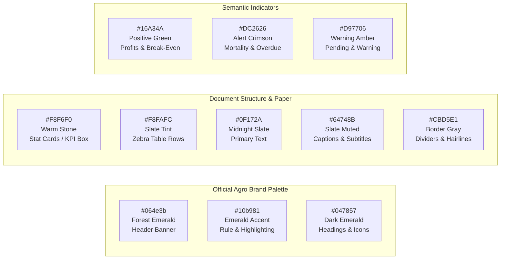

# Document 02: PDF Design, Branding & Layout System

## 1. Visual Identity & Brand Philosophy

Agro Planner and Capital Seed represent trusted, audit-grade enterprise intelligence. The generated PDF documents must look like official financial statements, institutional certificates, and veterinary compliance documents issued by a tier-1 agritech platform.

### Design Principles:
1. **Crisp Vector Fidelity**: Text, lines, and borders are drawn using native PDF vector commands (`jspdf`), ensuring razor-sharp rendering on 4K desktop screens, tablets, and laser printouts.
2. **Cohesive Institutional Branding**: Unified presence of the official Agro Planner Sprout AP Monogram alongside custom organization tenant data.
3. **Information Density with Breathability**: Clean grids, high-contrast typography, and dedicated stat cards that give executives instant answers in 5 seconds.
4. **Certified Authenticity**: Cryptographic hash stamps, verification badges, and formal signatory blocks that convey regulatory authority.

---

## 2. Master Palette & Typography Specifications

All colors are mapped to exact sRGB color triples for `jspdf` fill, stroke, and text methods:



### Color Mapping Table
| Variable Name | Hex Code | RGB Array `[R, G, B]` | Usage in PDF Generation |
| :--- | :--- | :--- | :--- |
| `COLOR_PRIMARY_DARK` | `#064e3b` | `[6, 78, 59]` | Primary header banner, table header rows, major title blocks. |
| `COLOR_PRIMARY_ACCENT`| `#10b981` | `[16, 185, 129]` | Accent horizontal rules, callout border highlights, badges. |
| `COLOR_PRIMARY_MEDIUM`| `#047857` | `[4, 120, 87]` | Section subtitles, KPI primary values, badge borders. |
| `COLOR_WARM_STONE` | `#f8f6f0` | `[248, 246, 240]`| KPI stat card background, callout box background. |
| `COLOR_ZEBRA_ROW` | `#f8fafc` | `[248, 250, 252]`| Alternating table body row shading. |
| `COLOR_TEXT_PRIMARY` | `#0f172a` | `[15, 23, 42]` | Table body text, section headers, key value pairs. |
| `COLOR_TEXT_MUTED` | `#64748b` | `[100, 116, 139]`| Table headers, captions, metadata subtitles, footer disclaimer. |
| `COLOR_BORDER` | `#e2e8f0` | `[226, 232, 240]`| Table cell grid lines, footer separation rule. |
| `COLOR_DANGER` | `#dc2626` | `[220, 38, 38]` | Mortalities, deficit variance, overdue credit warning badge. |
| `COLOR_SUCCESS` | `#16a34a` | `[22, 163, 74]` | Goal met, break-even achieved, settled invoice badge. |

### Typography Scale (Standard A4 Portrait, mm)
* **Standard Page Dimensions**: 210 mm width × 297 mm height.
* **Margins**: Left = 14 mm, Right = 14 mm (Usable content width = 182 mm).
* **Font Family**: Standard Type 1 `helvetica` (Universal cross-platform PDF rendering with zero external font loading overhead).
  * **Document Master Title**: 16–18 pt, Bold, `#064e3b` or White (if inside header banner).
  * **Section Headings**: 12–14 pt, Bold, `#064e3b`.
  * **Subsection / Table Headers**: 8.5–9 pt, Bold, `#ffffff` (on dark header) or `#0f172a`.
  * **Body / Cell Text**: 8–8.5 pt, Normal, `#0f172a`.
  * **Captions & Metadata**: 7–7.5 pt, Normal, `#64748b`.
  * **Footer & Page Numbers**: 7 pt, Normal, `#64748b`.

---

## 3. Brand Header Architecture

Every exported document features a dual-brand hierarchy:
1. **Agro Planner & Capital Seed Platform Identity** (Permanent App Brand).
2. **Tenant Organization Identity** (Dynamic Client Brand).

### Header Layout Structure (Top 45 mm of Page 1)

```
+-----------------------------------------------------------------------------------------+
| [LOGO]  AGRO PLANNER // CAPITAL SEED                 OFFICIAL VERIFIED ENTERPRISE REPORT|  <- Height: 24mm (Dark Emerald)
|         INTELLIGENT FARMING & VENTURE SYSTEMS                           CONFIDENTIAL    |
+-----------------------------------------------------------------------------------------+
| [ACCENT RULE: 2mm EMERALD #10b981]                                                      |
+-----------------------------------------------------------------------------------------+
|  GREEN VALLEY FARMING & AGRO SYNDICATE                           [AGRO-FARMING BADGE]   |  <- Y: 34mm
|  Paddock: East Paddock Block B | Org ID: ORG-GVF-9021 | Contact: admin@greenvalley.co   |
|  Report Generated: 2026-11-06 02:30 AM | Prepared By: T. Moyo (Org Admin)               |
+-----------------------------------------------------------------------------------------+
```

### Logo Embedding Strategy
* The official brand logo is the **Organic Sprout AP Monogram** defined in `src/components/BrandLogos.tsx`.
* It is embedded at the top-left of the banner at coordinates `x: 12mm, y: 4mm, width: 16mm, height: 16mm`.
* **Zero Network Dependency**: The pre-rendered 512×512 PNG asset (`public/icon.png`) is bundled as an optimized base64 string directly inside the PDF service module (`src/services/pdf/assets/brandLogoBase64.ts`), guaranteeing 100% offline generation in remote rural fields with zero HTTP requests.

---

## 4. Stat Cards & Executive KPI Blocks

To deliver instant executive summaries without forcing readers to comb through dense tables, key metrics are presented in **horizontal KPI summary blocks** positioned immediately above the main tables.

### Layout Geometry
* Position: Full usable width (182 mm), height 22–26 mm.
* Background: Filled rectangle with `COLOR_WARM_STONE` (`#f8f6f0`), corner radius: 2.5 mm.
* Border: Optional 0.3 mm hairline in `#e2e8f0`.
* Cell Layout: 3 to 5 equal-width columns.

```
+-----------------------------------------------------------------------------------------+
| ACTIVE HEADCOUNT     TARGET SALE DATE     FEED CONSUMED      PROJECTED REVENUE  MARGIN  |
| 1,450 birds          2026-11-28           48.5 Bags (2.4T)   $8,700.00          +38.2%  |
| -50 mortalities      22 days remaining    FCR: 1.62          $6.00/bird avg     Healthy |
+-----------------------------------------------------------------------------------------+
```

---

## 5. Table Architecture with `jspdf-autotable`

All tables use `jspdf-autotable` configured with standardized enterprise styling:

```typescript
autoTable(doc, {
  startY: currentY,
  head: [tableHeaders],
  body: tableRows,
  theme: 'grid',
  headStyles: {
    fillColor: [6, 78, 59],       // Dark Forest Emerald
    textColor: [255, 255, 255],   // Pure White
    fontSize: 8,
    fontStyle: 'bold',
    halign: 'left',
    cellPadding: 2.5,
  },
  bodyStyles: {
    textColor: [15, 23, 42],      // Slate 900
    fontSize: 7.5,
    cellPadding: 2.2,
  },
  alternateRowStyles: {
    fillColor: [248, 250, 252],   // Slate 50 Zebra Tint
  },
  columnStyles: {
    // Currency, quantities, and dates are right-aligned or centered
    0: { cellWidth: 24 },                     // Date column
    1: { cellWidth: 'auto' },                 // Description / Category
    2: { halign: 'right', cellWidth: 26 },    // Quantity / Headcount
    3: { halign: 'right', cellWidth: 28 },    // Financial Amount ($)
    4: { halign: 'center', cellWidth: 24 },   // Status Badge
    5: { halign: 'left', cellWidth: 26 },     // Hash / Actor
  },
  margin: { left: 14, right: 14 },
  tableLineColor: [226, 232, 240],
  tableLineWidth: 0.15,
});
```

---

## 6. Footer, Multi-Page Pagination & Sign-off Blocks

### Standard Multi-Page Numbering
Multi-page reports (e.g. 10-page audit trails or complex runway plans) dynamically stamp total pages using `doc.getNumberOfPages()` in a post-render pass:

```typescript
const totalPages = doc.getNumberOfPages();
for (let i = 1; i <= totalPages; i++) {
  doc.setPage(i);
  const pageHeight = doc.internal.pageSize.getHeight();
  const pageWidth = doc.internal.pageSize.getWidth();
  
  // Separation rule
  doc.setDrawColor(226, 232, 240);
  doc.setLineWidth(0.2);
  doc.line(14, pageHeight - 14, pageWidth - 14, pageHeight - 14);

  // Left: Institutional Disclaimer
  doc.setFontSize(7);
  doc.setFont('helvetica', 'normal');
  doc.setTextColor(100, 116, 139);
  doc.text('Agro Planner - Confidential & Certified Farm Intelligence Export', 14, pageHeight - 9);

  // Center: Cryptographic Verifier Notice
  doc.text('Tamper-Evident SHA-256 Ledger Verified', pageWidth / 2, pageHeight - 9, { align: 'center' });

  // Right: Page Counter
  doc.text(`Page ${i} of ${totalPages}`, pageWidth - 14, pageHeight - 9, { align: 'right' });
}
```

### Institutional Signatory Blocks (Invoices, Loan Contracts & Authorizations)
For legal contracts (Credit Sales, Outgrower Loans, Multi-Sig Vouchers):
```
+-----------------------------------------+   +-----------------------------------------+
| Prepared & Disbursed By:                |   | Customer / Debtor Acknowledgment:       |
|                                         |   |                                         |
| _______________________________________ |   | _______________________________________ |
| Authorized Signature                    |   | Customer Signature                      |
| Name: _________________________________ |   | Name: _________________________________ |
| Date: ____ / ____ / 2026                |   | Date: ____ / ____ / 2026                |
+-----------------------------------------+   +-----------------------------------------+
```

