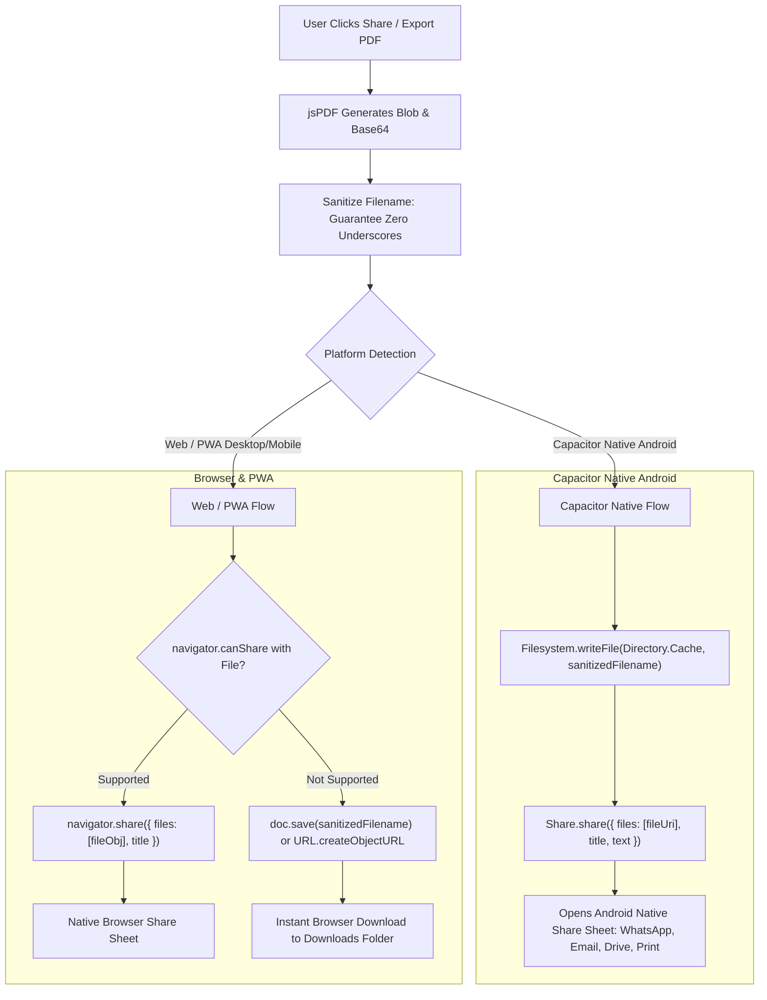

# Document 03: Filename Sanitization & Multi-Platform Sharing Architecture

## 1. The Strict Zero-Underscore Rule

### User Specification:
> *"making sure the output names must not inslude the underscores on their file names, we need to share some parts of the business like the plans, purchased sales etc depending on the type of business, and the exports must be comprehensive"*

### Rationale:
1. **User Requirement & Visual Elegance**: Underscores look like unformatted raw database dumps (`org_name_batch_01_report.pdf`). Clean, hyphen-separated or space-separated names (`Green-Valley-Farming-Batch-04-Report-2026-11-06.pdf`) look professional and publication-ready.
2. **Mobile Share Sheet Usability**: WhatsApp, Gmail, Telegram, and Google Drive truncate and misrender file paths containing underscores on certain Android skins.
3. **URL & File URI Safety**: Web URLs and mobile file URIs treat hyphens as natural word boundaries, whereas underscores are often hidden by link underlines or mangled by auto-linkers.

---

## 2. Filename Sanitization Engine

A dedicated, pure TypeScript sanitizer `sanitizePdfFilename` will be implemented in `src/utils/pdfFilename.ts`.

### Sanitization Algorithm:
1. **Convert Underscores**: Replace every occurrence of `_` with a hyphen `-`.
2. **Strip Illegal Filesystem Characters**: Remove or replace all prohibited characters (`/`, `\`, `:`, `*`, `?`, `"`, `<`, `>`, `|`).
3. **Normalize Whitespace & Hyphens**: Collapse multiple spaces into a single space, collapse consecutive hyphens (`--+`) into a single hyphen (`-`), and trim surrounding whitespace.
4. **Ensure Safe Extension**: If `.pdf` is missing or in uppercase (`.PDF`), enforce lowercase `.pdf`.
5. **Runtime Guard Assertion**: If any underscore is detected after the pipeline, an error is thrown or safe replacement is forced to guarantee zero defects.

### Reference Implementation & Unit Specification

```typescript
/**
 * src/utils/pdfFilename.ts
 * Strictly sanitizes PDF export file names, guaranteeing ZERO underscores.
 */

export interface FormatFilenameOptions {
  orgName?: string;
  documentType: string;
  entityName?: string;
  date?: string | Date;
}

export function sanitizePdfFilename(rawName: string): string {
  if (!rawName || typeof rawName !== 'string') {
    return 'Agro-Planner-Document.pdf';
  }

  // 1. Mandatory Rule: Replace ALL underscores with hyphens
  let clean = rawName.replace(/_/g, '-');

  // 2. Strip filesystem reserved characters
  clean = clean.replace(/[/\\:*?"<>|#%&{}\\$!'@+`=]/g, '-');

  // 3. Normalize spaces and multiple consecutive hyphens
  clean = clean.replace(/\s+/g, '-').replace(/-+/g, '-');

  // 4. Trim leading and trailing hyphens/spaces
  clean = clean.replace(/^-+|-+$/g, '').trim();

  // 5. Ensure lowercase .pdf extension
  if (!clean.toLowerCase().endsWith('.pdf')) {
    clean = clean + '.pdf';
  } else if (!clean.endsWith('.pdf')) {
    clean = clean.slice(0, -4) + '.pdf';
  }

  // 6. Final safety check: HARD ASSERTION against underscores
  if (clean.includes('_')) {
    clean = clean.replace(/_/g, '-');
  }

  return clean;
}

export function buildExportFilename(options: FormatFilenameOptions): string {
  const parts: string[] = [];

  if (options.orgName) {
    parts.push(options.orgName);
  } else {
    parts.push('Agro-Planner');
  }

  parts.push(options.documentType);

  if (options.entityName) {
    parts.push(options.entityName);
  }

  const dateStr = options.date
    ? typeof options.date === 'string'
      ? options.date.split('T')[0]
      : options.date.toISOString().split('T')[0]
    : new Date().toISOString().split('T')[0];

  parts.push(dateStr);

  const rawCombined = parts.join('-');
  return sanitizePdfFilename(rawCombined);
}
```

### Standardized Filename Examples (Zero Underscores Guaranteed)

| Document Category | Target Filename |
| :--- | :--- |
| **Livestock Batch** | `Green-Valley-Farming-Batch-04-Broilers-Lifecycle-Report-2026-11-06.pdf` |
| **Flock Health** | `Green-Valley-Farming-Batch-04-Vaccination-Certificate-2026-11-06.pdf` |
| **Site Comparison** | `Green-Valley-Farming-Site-Paddock-Comparison-Report-2026-11-06.pdf` |
| **Feed Inventory** | `Green-Valley-Farming-Feed-Inventory-Burn-Rate-2026-11-06.pdf` |
| **Stock Inventory** | `Apex-Wholesale-Stock-Inventory-Valuation-2026-11-06.pdf` |
| **Stock Movement** | `Apex-Wholesale-Goods-Received-Note-GRN-104-2026-11-06.pdf` |
| **Credit Sale Invoice** | `Green-Valley-Farming-Invoice-CSALE-4019-Braai-Butchery-2026-11-06.pdf` |
| **Loan Agreement** | `Green-Valley-Farming-Loan-Agreement-Chitepo-Outgrower-2026-11-06.pdf` |
| **Runway Plan** | `Apex-Fund-Executive-Runway-Plan-Q4-Expansion-2026-11-06.pdf` |
| **9-Pillars Balance Sheet** | `Green-Valley-Farming-9-Pillars-Balance-Sheet-2026-11-06.pdf` |
| **Audit Certificate** | `Green-Valley-Farming-Cryptographic-Audit-Certificate-2026-11-06.pdf` |

---

## 3. Multi-Platform Sharing Engine

The app is deployed as a dual-target codebase:
* **Mobile App**: Capacitor 8+ on Android (running in WebView).
* **Web / PWA**: Progressive Web App running in modern mobile and desktop browsers.

A unified sharing coordinator `shareOrDownloadPdf` in `src/services/pdf/pdfShareCoordinator.ts` provides intelligent runtime environment detection:



### Complete Implementation Contract

```typescript
/**
 * src/services/pdf/pdfShareCoordinator.ts
 */
import { Capacitor } from '@capacitor/core';
import { Filesystem, Directory } from '@capacitor/filesystem';
import { Share } from '@capacitor/share';
import type { jsPDF } from 'jspdf';
import { sanitizePdfFilename } from '../../utils/pdfFilename';
import { nativeHaptics } from '../../native/haptics';

export interface SharePdfOptions {
  doc: jsPDF;
  rawFilename: string;
  title: string;
  subject?: string;
  onSuccess?: () => void;
  onError?: (err: Error) => void;
}

export async function shareOrDownloadPdf(options: SharePdfOptions): Promise<boolean> {
  const filename = sanitizePdfFilename(options.rawFilename);

  try {
    // 1. Haptic feedback on document completion
    nativeHaptics.impactLight();

    // 2. Mobile Native Execution (Capacitor Android)
    if (Capacitor.isNativePlatform()) {
      const base64Data = options.doc.output('datauristring').split(',')[1];

      // Save to temporary cache directory with ZERO underscores in path
      const writeResult = await Filesystem.writeFile({
        path: filename,
        data: base64Data,
        directory: Directory.Cache,
        recursive: true,
      });

      // Launch native Android share sheet
      await Share.share({
        title: options.title,
        text: options.subject || `Certified export from Agro Planner: ${filename}`,
        url: writeResult.uri,
        dialogTitle: `Share ${options.title}`,
      });

      options.onSuccess?.();
      return true;
    }

    // 3. Web Share API Execution (Mobile Chrome / Safari on PWA)
    if (typeof navigator !== 'undefined' && navigator.share && navigator.canShare) {
      const pdfBlob = options.doc.output('blob');
      const file = new File([pdfBlob], filename, { type: 'application/pdf' });

      if (navigator.canShare({ files: [file] })) {
        await navigator.share({
          files: [file],
          title: options.title,
          text: options.subject || `Agro Planner Export: ${filename}`,
        });
        options.onSuccess?.();
        return true;
      }
    }

    // 4. Standard Browser Fallback: Instant File Download
    options.doc.save(filename);
    options.onSuccess?.();
    return true;
  } catch (error: any) {
    // User aborting share sheet is not an error
    if (error?.message?.includes('abort') || error?.name === 'AbortError') {
      return false;
    }
    console.error('Failed to export or share PDF:', error);
    options.onError?.(error);
    // Ultimate fallback: direct download
    options.doc.save(filename);
    return false;
  }
}
```

---

## 4. UI Touchpoints & User Experience

### Share Sheet Modal / Action Bar
* Export actions will display a dual-action option:
  1. **"Share PDF"** (Primary): Launches native share sheet with WhatsApp, Email, Drive, and Bluetooth.
  2. **"Direct Download"** (Secondary): Saves file directly to local storage.
* Visual indicators: Spinning progress indicator ("Generating vector PDF..."), followed by haptic success confirmation.

