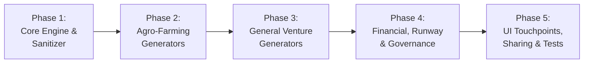

# Document 05: Implementation Phases & Verification Roadmap

## 1. Phased Engineering Roadmap

The implementation is broken down into 5 focused phases to ensure modular development, clean separation of concerns, and rigorous automated testing at every step:



---

### Phase 1: Core Engine, Branding & Zero-Underscore Sanitizer
* **Deliverables**:
  1. `src/utils/pdfFilename.ts`: Implement `sanitizePdfFilename` and `buildExportFilename` with a strict assertion against underscores (`/[^_]/`).
  2. `src/utils/pdfFilename.test.ts`: Comprehensive test suite verifying all edge cases (spaces, slashes, uppercase, unicode, double underscores) always output hyphen-separated filenames.
  3. `src/services/pdf/assets/brandLogoBase64.ts`: Optimized base64 asset of the official Sprout AP Monogram logo.
  4. `src/services/pdf/core/pdfTheme.ts`: Color palette constants, font sizes, margins, and geometric spacing definitions.
  5. `src/services/pdf/core/pdfDocumentBuilder.ts`: Shared base document builder establishing standard header banners, tenant metadata, stat cards, and multi-page footers.
  6. `src/services/pdf/pdfShareCoordinator.ts`: Hybrid Capacitor Native, Web Share API, and download fallback engine.

---

### Phase 2: Agro-Farming Document Generators
* **Deliverables**:
  1. `src/services/pdf/generators/agro/batchLifecyclePdf.ts`:
     * Full batch lifecycle summary, headcount reconciliation, age countdowns, mortality rate, feed consumed, FCR, and profit margin analysis.
  2. `src/services/pdf/generators/agro/vaccinationPdf.ts`:
     * Flock / Herd Health and Vaccination Compliance Certificate with checkpoint completion stamps and veterinary inspection notes.
  3. `src/services/pdf/generators/agro/siteComparisonPdf.ts`:
     * Cross-site comparative performance matrix (density, expenses, mortality %, harvest yield across farm locations/paddocks).
  4. `src/services/pdf/generators/agro/feedInventoryPdf.ts`:
     * Feed inventory balance sheet, stock-in history, daily burn rate, remaining days of buffer, and reorder warnings.

---

### Phase 3: General Venture Document Generators
* **Deliverables**:
  1. `src/services/pdf/generators/general/stockInventoryPdf.ts`:
     * Complete SKU catalog, unit costs, selling prices, quantities on hand, total inventory asset value, reorder warnings.
  2. `src/services/pdf/generators/general/stockMovementPdf.ts`:
     * Goods Received Note (GRN) and dispatch delivery waybill tracking inventory inflows, customer dispatches, transfers, and damage adjustments.
  3. `src/services/pdf/generators/general/expenditureVoucherPdf.ts`:
     * Multi-signature operational expenditure authorization voucher with category breakdown, notes, and approval signatures.

---

### Phase 4: Shared Financial, Runway & Governance Generators
* **Deliverables**:
  1. `src/services/pdf/generators/shared/invoicePdf.ts`:
     * Commercial customer invoice and credit statement of account with down-payment deposits, installment schedules, and date extensions.
  2. `src/services/pdf/generators/shared/debtLiabilityPdf.ts`:
     * Creditor liability contract and repayment schedule (supplier credit, equipment financing, director advances).
  3. `src/services/pdf/generators/shared/loanAgreementPdf.ts`:
     * Outgrower / partner loan contract and recovery statement with collateral terms and recovery installments.
  4. `src/services/pdf/generators/shared/runwayReportPdf.ts`:
     * Replacing `window.print()` in `RunwayReport.tsx` with an executive audit-grade Runway Capital Plan & Variance Recovery Report.
  5. `src/services/pdf/generators/shared/equityCertificatePdf.ts`:
     * Syndicate Partner Capital Equity Certificate detailing gross contributions, contra adjustments, net equity %, and implied NAV value.
  6. `src/services/pdf/generators/shared/balanceSheetPdf.ts`:
     * Comprehensive 9-Pillars Institutional Balance Sheet and solvency valuation statement.
  7. `src/services/pdf/generators/shared/auditCertificatePdf.ts`:
     * Cryptographic SHA-256 Tamper-Evident Audit Certificate with unbroken previous/current hash verification stamps.

---

### Phase 5: UI Touchpoints, Sharing Sheets & Automated Verification
* **Deliverables**:
  1. `src/components/ui/PdfExportButton.tsx`:
     * Reusable, accessible UI component featuring dual actions: "Share PDF" and "Download PDF", with loading spinner and haptic feedback.
  2. Integration across screens:
     * `BatchDetailScreen.tsx`: Add "Export Lifecycle Report" and "Export Health Certificate" actions.
     * `SaleDetailScreen.tsx`: Add "Share Commercial Invoice" action.
     * `DebtDetailScreen.tsx`: Add "Share Creditor Statement" action.
     * `LoanDetailScreen.tsx`: Add "Share Loan Contract" action.
     * `RunwayReport.tsx`: Upgrade print button to generate the executive vector PDF.
     * `FeedInventoryScreen.tsx`: Add "Export Feed Audit" action.
     * `StockInventoryScreen.tsx`: Add "Export Stock Catalog" action.
     * `SiteCompareScreen.tsx`: Add "Export Site Comparison" action.
     * `PoolEquityTab.tsx`: Add "Export Equity Certificate" action.
     * `FinancialSummaryScreen.tsx`: Add "Export 9-Pillars Balance Sheet" action.
     * `AuditLedgerScreen.tsx`: Add "Export Audit Trail Certificate" action.
  3. Automated Tests:
     * `src/services/pdf/pdfExport.test.ts`: Automated unit test running all 10 document generators, asserting valid page counts, non-empty byte arrays, and asserting `expect(filename).not.toMatch(/_/)`.

---

## 2. Verification & Acceptance Criteria

| Checkpoint | Requirement | Verification Method |
| :--- | :--- | :--- |
| **AC-01: Zero Underscores** | All output filenames must never contain an underscore (`_`). | Automated unit test running 100+ random inputs against `sanitizePdfFilename`. |
| **AC-02: Offline Generation** | PDFs generate without internet access (remote paddocks). | Generator tests run with simulated zero network connectivity. |
| **AC-03: Vector Clarity** | Text and tables remain crystal clear at 400% zoom. | Direct vector drawing via `jspdf` + `jspdf-autotable`. |
| **AC-04: Brand Integration** | Sprout AP logo and tenant details present on every page header. | Visual inspection and automated document page object checks. |
| **AC-05: Native Share Sheet** | Capacitor Android opens WhatsApp/Email share sheet with valid file URI. | Test on Capacitor Android runtime with `@capacitor/share` and `@capacitor/filesystem`. |
| **AC-06: File Size Limit** | Exported PDF size must remain under 120 KB per document. | File byte measurement in automated generator test. |
| **AC-07: React 19 Harmony** | Zero peer dependency warnings or runtime reconciler errors. | `npm test` and Vite build execute cleanly. |

---

## 3. Test Automation Blueprint

The test file `src/services/pdf/pdfExport.test.ts` will be integrated into `npm test`:

```typescript
import { test } from 'node:test';
import assert from 'node:assert/strict';
import { sanitizePdfFilename, buildExportFilename } from '../../utils/pdfFilename';

test('Strict Zero-Underscore Rule: sanitizes all filenames', () => {
  const dirtyInputs = [
    'Green_Valley_Farming_Batch_04_Report_2026_11_06',
    'Apex_Ventures_Runway_Plan_Q4__Final',
    'Credit_Sale__Invoice_CSALE_901_John_Doe',
    '___Leading_and_Trailing___Underscores___',
    'Normal Name With Spaces And_Underscore.pdf',
  ];

  for (const input of dirtyInputs) {
    const clean = sanitizePdfFilename(input);
    assert.ok(!clean.includes('_'), `Filename "${clean}" must not contain underscores!`);
    assert.ok(clean.endsWith('.pdf'), `Filename "${clean}" must end with .pdf`);
  }
});

test('FormatFilename: generates standardized clean filenames without underscores', () => {
  const result = buildExportFilename({
    orgName: 'Green_Valley_Agro',
    documentType: 'Batch_Report',
    entityName: 'Broilers_04',
    date: '2026-11-06',
  });

  assert.equal(result, 'Green-Valley-Agro-Batch-Report-Broilers-04-2026-11-06.pdf');
  assert.ok(!result.includes('_'));
});
```

