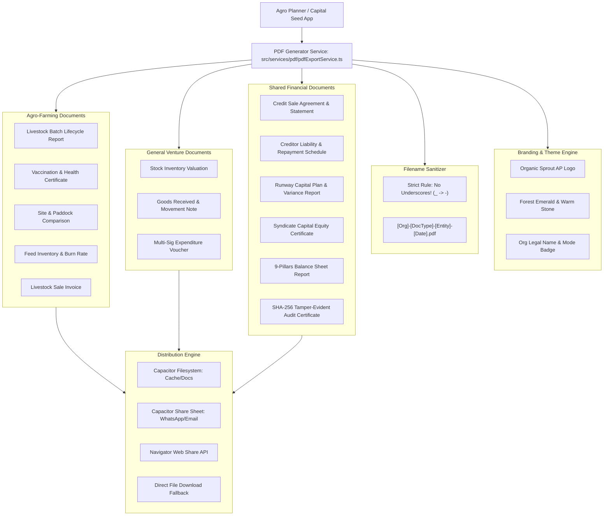

# Agro Planner & Capital Seed: Enterprise PDF Export & Sharing System
## Comprehensive Master Implementation Plan

> **Status:** APPROVED FOR IMPLEMENTATION  
> **Target Directory:** `plans/pdf-export-and-sharing-plan/`  
> **Target Version:** Agro Planner v2.4+  
> **Supported Engines:** Web PWA, Android Capacitor Native  
> **PDF Engine Selected:** `jspdf` (v4.x) + `jspdf-autotable` (v5.x)  
> **Primary Rule:** **Zero Underscores in Export Filenames (`/[^_]/`)**

---

## Executive Summary

Agro Planner (and the Capital Seed platform) operates in two distinct business modes:
1. **Agro-Farming (`AGRO_FARMING`)**: Specializing in livestock lifecycles (broilers, layers, goats, cattle, pigs, sheep), feed inventory burn rates, mortality/harvest records, vaccination protocols, paddock/site comparisons, and agricultural credit sales.
2. **General Venture (`GENERAL_VENTURE`)**: Specializing in commercial wholesale/retail trade, inventory SKU tracking, stock movements, multi-signature expenditure authorizations, and equipment leasing.

Both business types share an immutable financial foundation: 9-pillar balance sheets, capital contribution pools, partner equity distributions, debtor receivables (credit sales), creditor liabilities (loans/debts), cryptographic SHA-256 audit trails, and the runway capital planning engine.

This implementation plan defines the end-to-end architecture for generating **audit-grade, beautifully branded, vector-sharp PDF documents** directly on-device (100% offline-capable), with **seamless 1-click sharing** via native Android share sheets (WhatsApp, Email, Drive, Print) and browser download fallbacks.

---

## Key Pillars of the System

| Pillar | Specification | Guarantee |
| :--- | :--- | :--- |
| **Engine & Plugins** | `jspdf` + `jspdf-autotable` | Zero peer-conflict with React 19, fully offline, vector-sharp text & tables, tiny file footprint (20–90 KB). |
| **App Branding** | Official Sprout AP Monogram (`BrandLogos.tsx`), Deep Forest Emerald (`#064e3b`), Emerald Accent (`#10b981`), Warm Stone (`#FBF9F5`). | High-resolution embedded vector/PNG brand mark on every document header with official certificate styling. |
| **Org Branding** | Dynamic Legal Name, Org ID, Operating Mode Badge, Farm Site/Branch, Admin/Contact Details, Custom Currency Symbol (`$`, `€`, `£`, etc.). | Complete tenant-specific customization while maintaining uniform institutional layout standards. |
| **Strict File Naming** | **No underscores anywhere in generated filenames** (`.replace(/_/g, '-')`). | Sanitized filenames matching format: `[OrgName]-[DocumentType]-[EntityOrDate].pdf`. |
| **Multi-Platform Sharing** | Hybrid Capacitor Share (`@capacitor/share`), Filesystem (`@capacitor/filesystem`), and Web Share API (`navigator.share`). | Direct sharing to WhatsApp, Gmail, Telegram, Bluetooth, local file storage, or instant download. |
| **Comprehensive Scope** | 10 specialized document types covering Batches, Feed, Sites, Credit Sales, Loans, Expenses, Runway, Equities, Balance Sheet, and Cryptographic Audits. | Tailored to Agro-Farming and General Venture workflows. |

---

## Master Document Index

The plan is organized into the following detailed architectural specifications:

1. [**01. Business Features & Export Matrix**](./01-business-features-and-export-matrix.md)  
   *Deep comparative analysis of Agro-Farming vs. General Venture features, operational lifecycles, and a complete screen-by-screen inventory of PDF export touchpoints, trigger points, and recipient audiences.*

2. [**02. PDF Design, Branding & Layout System**](./02-pdf-design-branding-and-layout-system.md)  
   *Typography, color theory, grid layout, header/footer contracts, dynamic stat cards, table column layouts, page numbering ("Page X of Y"), and embedded brand assets (app logo & org badges).*

3. [**03. Filename Sanitization & Sharing Architecture**](./03-filename-sanitization-and-sharing-architecture.md)  
   *The zero-underscore naming convention, sanitization algorithm, unit testing rules, native Capacitor file pipeline (`Filesystem.writeFile` + `Share.share`), Web Share API integration, and download fallbacks.*

4. [**04. Technical Architecture & Plugin Benchmarks**](./04-technical-architecture-and-plugin-benchmarks.md)  
   *Evaluation of PDF generation libraries, justification of `jspdf` + `jspdf-autotable`, React 19 compatibility, performance benchmarks, memory considerations on low-end mobile devices, and state extraction patterns.*

5. [**05. Implementation Phases & Verification Roadmap**](./05-implementation-phases-and-verification.md)  
   *5-phase engineering roadmap, code modifications, UI touchpoints, shared modal/sheet components, automated test suites, and sign-off acceptance criteria.*

---

## Quick Navigation Matrix

