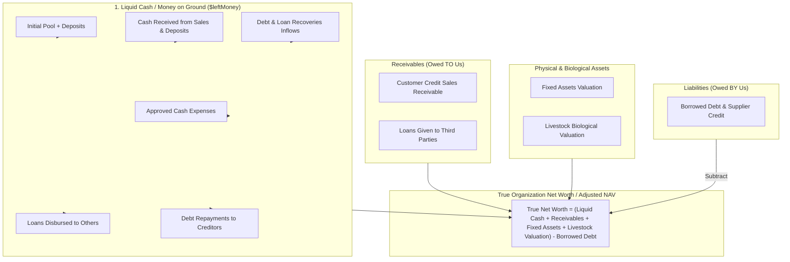
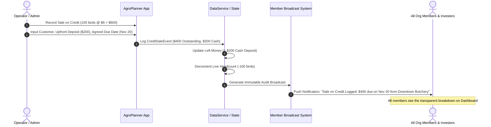

# Master Implementation Plan: Financial Integrity Engine, Credit Sales, Livestock Valuation & Mobile Banking Dashboard Redesign

**Document Version:** 1.0.0  
**Target Platform:** CapitaSeed / OmniVentures Enterprise Operations Platform  
**Target Release:** Production Phase 3 — Financial Transparency, Credit Operations & Banking Hub  
**Storage Location:** `plans/redesign plan/financial-and-dashboard-redesign-plan.md`  

---

## 1. Executive Summary & Root Cause Diagnosis

### 1.1 The Problem Reported
During live operations, the following critical accounting and workflow anomalies occurred:
1. **Unchecked Zero-Balance Purchases & Phantom Cash:**
   - A user added a batch of broilers with a purchase price (e.g. $250.00) while the organization had **$0.00** in liquid capital (`leftMoney`), and the operation succeeded without any warning.
   - Subsequently, when a member deposited **$250.00** into the capital pool, the balance displayed remained **$250.00** instead of balancing against the prior purchase or reflecting the true liabilities.
2. **Missing Concepts of External Borrowing & Lending:**
   - Real-world operations frequently acquire stock or inputs on credit (e.g. day-old chicks from Irvine's on 30-day payment terms, or feed from National Foods). The system lacked a mechanism to log **Borrowed Money / Liabilities (not paid yet)**.
   - Similarly, organizations advance credit or loans to outgrowers, partner farms, or members. The system lacked an option to log **Loans Given (not yet returned)**, causing cash to either vanish or go unrecorded.
3. **No Support for Sales on Credit & Member Broadcasts:**
   - Produce and broilers are frequently sold to butcheries, restaurants, or distributors on credit with agreed repayment dates and upfront deposits.
   - The platform had no way to log credit sales, agreed due dates, remaining receivables, or automatically dispatch broadcast notifications to all members regarding credit terms.
4. **Missing Expected Income & Configurable Unit Prices:**
   - Farmers cannot configure unit selling prices (per animal or per kg) to project expected income from available live animals (per individual animal and for the entire flock).
   - Farmers cannot record partial animal actions such as slaughtering/harvesting a specific number of animals or internal farm consumption.
5. **Cramped Navigation Bar vs. Modern Mobile Banking App Paradigm:**
   - The floating navigation bar currently holds 9 separate tabs (`HOME`, `LIVESTOCK`, `EXPENSES`, `POOL`, `ASSETS`, `BROADCASTS`, `AUDIT`, `USERS`, `SETTINGS`), making it cramped, hard to touch on mobile screens, and visually cluttered.
   - The user requested streamlining the bottom navigation bar down to **only three primary tabs** (`Overview`, `Livestock` / `Operations`, `Expenses`), and transforming the **Overview tab** into an **icon-title-preview grid hub** inspired by modern mobile banking applications (like Revolut, Monzo, and Kuda Bank).
   - This hub will host dedicated cards for the transferred tabs (`Settings`, `Ledger`, `Roles`, `Broadcast`, `Assets`, `Pool`) plus dedicated subpages for `Loans & Debts`, `Sales on Credit`, and `Livestock Valuation`.

---

## 2. Double-Entry Financial Architecture & Transparent Accounting

To ensure zero phantom money and 100% transparency, we establish the **9 Pillars of Organization Wealth**:



### 2.1 The 9 Pillars Breakdown

| # | Metric Title | Internal State / Formula | Real-World Meaning & Visibility |
|---|---|---|---|
| **1** | **True Money on the Ground** | `leftMoney` | Unencumbered liquid cash in bank accounts, EcoCash, InnBucks, cash safes. |
| **2** | **Total Capital Contributed** | `totalPool` | Gross equity invested by members minus contra-reversals. |
| **3** | **Cumulative Expenses** | `approvedExpenses` | Total money spent on feed, medication, salaries, utilities, transport. |
| **4** | **Borrowed (Not Paid Yet)** | `totalBorrowedDebtOutstanding` | Money borrowed from banks, lenders, or suppliers on credit (e.g., chicks taken on credit). |
| **5** | **Loans Given (Not Returned Yet)** | `totalLoansGivenOutstanding` | Money lent to third-party farmers, partners, or outgrowers. |
| **6** | **Sales on Credit (Receivables)** | `totalCreditSalesOutstanding` | Unpaid invoices owed by butcheries/customers with agreed due dates. |
| **7** | **Fixed Assets Valuation** | `totalFixedAssetsValue` | Depreciated verified value of solar, boreholes, vehicles, implements. |
| **8** | **Livestock Biological Valuation** | `estimatedActiveLivestockValue` | Projected value of living birds/goats based on configured selling prices. |
| **9** | **True Net Worth (Adjusted NAV)** | `netFinancialPosition` | Complete solvent net worth: Assets + Liquid Cash + Receivables minus Liabilities. |

### 2.2 Mathematical Consistency & Ledger Integrity Invariant
$$\text{True Cash on Ground} = \text{Pool Deposits} + \text{Cash Sales} + \text{Customer Deposits} + \text{Borrowings} + \text{Loan Recoveries} - \text{Cash Expenses} - \text{Debt Repayments} - \text{Loans Disbursed}$$

$$\text{True Net Worth} = (\text{True Cash on Ground} + \text{Credit Sales Receivables} + \text{Loans Given} + \text{Fixed Assets} + \text{Livestock Valuation}) - \text{Borrowed Debt}$$

Every single dollar is strictly accounted for. If cash is spent, it must either come from unspent liquid cash or be logged as an explicit liability.

---

## 3. Overdraft Prevention & Funding Source Verification

### 3.1 The Zero-Balance Purchase Dilemma & Resolution
When a farmer registers livestock (e.g. 500 broilers costing $500.00), purchases a fixed asset ($1,200 generator), or logs an operational expense:
1. **Pre-Flight Balance Check:**
   - The system inspects `financials.leftMoney`.
   - If `requestedCost > leftMoney` (or `leftMoney <= 0`), the transaction **CANNOT** proceed with a blind cash deduction.
2. **Intelligent Funding Source Selector:**
   Instead of silently corrupting balances or silently failing, the UI prompts the user:
   > ⚠️ **Insufficient Liquid Funds Alert**  
   > *Current Money on Ground is **$0.00**, but this operation requires **$250.00**.*  
   > *Where did this money come from?*
   
   The user selects from 3 sanctioned accounting paths:
   - **Path A: Acquired on Supplier Credit / Borrowed Debt**  
     - Example: "500 Day-old chicks taken from Irvine's Harare on 30-day payment term."
     - Automatically creates a `DebtLiabilityEvent` with principal $250.00, creditor "Irvine's Hatcheries", and due date.
     - Leaves `leftMoney` at $0.00 (no negative overdraft).
     - When the member later deposits $250.00, `leftMoney` becomes $250.00, and the $250.00 debt to Irvine's is prominently visible under **"Borrowed (Not Paid Yet)"**.
     - When paid, a single tap on "Repay Debt" disburses $250.00 from `leftMoney` to settle the creditor.
   - **Path B: Advanced by Member / Director Loan**  
     - A specific member paid out of pocket, creating a payable owed to that member.
   - **Path C: Deposit Capital First**  
     - Prompts the user to log a capital deposit into the Pool before completing the cash acquisition.
3. **Strict Validation Guard:**
   - Attempting to check "Deduct from Liquid Cash" when `requestedCost > leftMoney` immediately halts with a user-friendly error:  
     `"Insufficient liquid cash ($0.00 available). Please select 'Supplier Credit / Borrowed' or deposit funds first."`

---

## 4. Sales on Credit & Customer Receivables Engine

### 4.1 Real-World Farming Credit Cycle
In African and emerging market agribusiness, live broilers and livestock are frequently sold under deferred payment terms:
- A butchery takes 100 broilers at $6.00 ($600.00 total).
- The butchery pays **$200.00 cash upfront** (deposit).
- The remaining **$400.00 is due on an agreed date** (e.g., 14 days later).

### 4.2 Automated Operations Workflow


### 4.3 Credit Sale Lifecycle & Installment Settlement
- **Overdue Indicator:** Visual warning badges when current date passes the agreed settlement date (`OVERDUE_RECEIVABLE`).
- **Partial Repayments & Due Date Extension:** The treasurer or operator can record partial customer payments (e.g. $200 paid on Nov 15, $200 paid on Nov 20), each generating a receipt, crediting `leftMoney`, and reducing the credit balance.
- **Agreed Due Date Rescheduling / Extension:** Real-world farm situations often require extending payment terms (e.g., customer requests 10 more days due to delayed harvest or butchery sales). The system allows extending the agreed due date with mandatory explanation notes, maintaining an immutable history of date modifications and notifying members.
- **Broadcast on Settlement:** Upon full payment, a completion broadcast is dispatched to all members.

---

## 5. Configurable Livestock Pricing, Expected Income & Partial Operations

### 5.1 Dynamic Price Configuration
- Each livestock batch / category can have a **Configured Sale Price**:
  - `configuredSalePricePerUnit` (e.g., $6.50 per broiler bird, $120.00 per Boer goat).
  - `configuredSalePricePerKg` (e.g., $2.80 per kg live weight).
- Configurable during batch registration or updated at any time in batch details.

### 5.2 Real-Time Expected Income Projections
1. **Expected Revenue Per Animal:**
   $$R_{\text{animal}} = \text{Configured Price per Unit (or Target Weight} \times \text{Price/kg)}$$
2. **Total Expected Revenue from Available Herd:**
   $$R_{\text{total}} = \text{Current Live Headcount} \times R_{\text{animal}}$$
3. **Expected Net Profit & Margin:**
   $$\text{Expected Net Profit} = R_{\text{total}} - (\text{Initial Purchase Cost} + \text{Cumulative Feed \& Health Expenses})$$
   $$\text{Projected Margin \%} = \frac{\text{Expected Net Profit}}{R_{\text{total}}} \times 100$$

### 5.3 Partial Batch Operations ("Same / Slaughter / Cull a Certain Number of Animals")
- Supports logging partial batch stock movements:
  - **Slaughter / Dressed Harvest:** Slaughter $N$ birds for dressed carcass storage or direct cold-chain sale.
  - **Internal / Farm Consumption:** Record $N$ birds used for farm worker rations or member sustenance.
  - **Routine Mortality / Culling:** Record disease or natural loss with mandatory post-mortem audit notes.
  - **Commercial Sale:** Full or partial batch sale (Cash vs. Credit).

---

## 6. Mobile Banking App Style Dashboard & 3-Tab Floating Navbar

### 6.1 The 3-Tab Bottom Floating Navbar
Instead of squeezing 9 buttons into a cramped navigation bar, the bottom bar is streamlined to **3 primary operational tabs**:

```
+-------------------------------------------------------------+
|    [ 🏠 Overview ]      [ 🐔 Livestock ]     [ 🧾 Expenses ] |
+-------------------------------------------------------------+
```
*(If the organization is a non-agro venture, `Livestock` is dynamically replaced with `Fleet / Operations` or preserved as venture projects).*

### 6.2 Overview Tab (`HOME`) Architecture: The Banking Hub

The Overview Tab is redesigned from the ground up as a premier **Mobile Banking Dashboard** featuring modern, advanced, fintech-grade icons with ambient glow containers, subtle micro-badges, and high-contrast typography:

```
+-----------------------------------------------------------------+
|  🌿 Green Valley Agro-Ventures           [ Norton Site A v ] [🔔] |
+-----------------------------------------------------------------+
|  [ 1. LIQUID CAPITAL HERO CARD ]                                |
|  True Money on the Ground (Liquid Cash): $12,450.00 [👁️ Show]   |
|  Solora Power Health Gauge: 98% Viable | Unencumbered Reserve   |
|  [ + Quick Disburse ]   [ + Deposit Capital ]  [ + Record Sale ]|
+-----------------------------------------------------------------+
|  [ 2. TRANSPARENT 9-PILLAR FINANCIAL BREAKDOWN CARDS ]          |
|  +-------------------+  +-------------------+  +---------------+|
|  | True Cash: $12.4k |  | Net Worth: $48.2k |  | Pool: $20.0k  ||
|  +-------------------+  +-------------------+  +---------------+|
|  | Expenses: $8.5k   |  | Borrowed: $2.5k   |  | Loans: $1.2k  ||
|  +-------------------+  +-------------------+  +---------------+|
|  | Credit Sales: $800|  | Fixed Assets: $14k|  | Stock Val: $9k||
|  +-------------------+  +-------------------+  +---------------+|
+-----------------------------------------------------------------+
|  [ 3. MOBILE BANKING ICON-TITLE-PREVIEW ACTION HUB ]            |
|  [ 👥 Capital Pool ]        [ 🏗️ Fixed Assets ]                 |
|    $20,000 Contributed        12 Active Implements              |
|    7 Contributing Members     $14,200 Verified NAV              |
|                                                                 |
|  [ 🤝 Loans & Debts ]       [ 💳 Sales on Credit ]              |
|    $2,500 Borrowed (Owed)     $800 Due from Debtors             |
|    $1,200 Lent Out            3 Active Invoices (1 Due Soon)    |
|                                                                 |
|  [ 📈 Livestock Valuation ] [ 🛡️ Audit Ledger ]                 |
|    $9,450 Expected Revenue    100% SHA-256 Validated            |
|    $6.50 / Broiler            Append-Only Chain Active          |
|                                                                 |
|  [ 📢 Broadcast Center ]    [ 👤 Roles & Governance ]           |
|    2 Unread Alerts            4 Admins & Treasurers             |
|    1 Urgent Biosecurity       RBAC Strict Air-Gap               |
|                                                                 |
|  [ ⚙️ Settings & Security ]                                     |
|    Fingerprint / PIN Active                                     |
|    Invite Code: SEED-7821                                       |
+-----------------------------------------------------------------+
|  [ 4. ACTIVE LIVESTOCK STATUS & FEED BURN-RATE ]                |
+-----------------------------------------------------------------+
|  [ 5. RECENT HIGH-PRIORITY BROADCASTS & AUDIT ALERTS ]          |
+-----------------------------------------------------------------+
```

### 6.3 Seamless Deep-Linking & Modal Views
Clicking any icon tile in the Banking Hub opens the corresponding view:
- Tapping **Capital Pool** opens `PoolEquityTab` (or modal view).
- Tapping **Fixed Assets** opens `AssetsTab`.
- Tapping **Audit Ledger** opens `AuditAlertsTab`.
- Tapping **Roles & Governance** opens `UserManagementTab` (restricted to Admins).
- Tapping **Settings & Security** opens `UserSettingsTab`.
- Tapping **Broadcast Center** opens `BroadcastCenterTab`.
- Tapping **Loans & Debts** opens the dedicated `LoansDebtsModal` / subpage.
- Tapping **Sales on Credit** opens the dedicated `CreditSalesModal` / subpage.
- Tapping **Livestock Valuation** opens the dedicated `LivestockValuationModal` / subpage.

All existing components, forms, validation logic, and workflows remain 100% functional and accessible without breaking any code.

---

## 7. Inventory of Files to Create and Files to Modify

### 7.1 New Files to Create

| File Path | Purpose & Contents |
|---|---|
| `src/types/financials.ts` | Type definitions for `DebtLiabilityEvent`, `DebtRepaymentLog`, `LoanGivenEvent`, `LoanRecoveryLog`, `CreditSaleEvent`, `CreditSalePaymentLog`, and updated `FinancialSummary`. |
| `src/components/BankingHubGrid.tsx` | High-polish mobile banking style icon-title-preview grid component with live badges and navigation callbacks. |
| `src/components/FinancialBreakdownCards.tsx` | Multi-card financial health component presenting True Cash on Ground, Net Worth, Borrowed Debt, Loans Given, Credit Sales, Assets, and Livestock Expected Revenue. |
| `src/components/LoansDebtsModal.tsx` | Comprehensive modal & view for managing Borrowed Money (Liabilities) and Loans Given to third parties (with repayment actions). |
| `src/components/CreditSalesModal.tsx` | Dedicated view for recording sales on credit, customer payment logs, agreed due dates, overdue badges, and broadcast triggers. |
| `src/components/LivestockValuationModal.tsx` | View for configuring unit selling prices, calculating expected income per animal and total herd, and projecting profit margins. |
| `workflow-tests/08-financial-redesign-banking-hub.test.ts` | Comprehensive end-to-end workflow test suite verifying zero-balance guards, supplier credit, loan recovery, credit sales broadcasts, and banking hub navigation. |

### 7.2 Existing Files to Modify

| File Path | Required Changes | Backward Compatibility Safeguard |
|---|---|---|
| `src/types/agro.ts` | Export new types from `src/types/financials.ts`; extend `LivestockEventType` to include `'SLAUGHTER_HARVEST'` and `'FARM_CONSUMPTION'`; update `LivestockEntry` with `configuredSalePricePerUnit`. | Existing fields and types preserved; all new fields optional or with safe defaults. |
| `src/utils/calculations.ts` | Update `calculateFinancialSummary` to compute `totalBorrowedDebtOutstanding`, `totalLoansGivenOutstanding`, `totalCreditSalesOutstanding`, and true `netFinancialPosition`. | Preserves `leftMoney`, `totalPool`, `totalNav`, and all existing calculation tests. |
| `src/services/dataService.ts` | 1. Add state arrays: `debtLiabilities`, `loansGiven`, `creditSales`.<br>2. In `registerLivestock`: add zero-balance validation and support funding via `SUPPLIER_CREDIT`.<br>3. Add CRUD & repayment methods: `recordDebtLiability`, `repayDebtLiability`, `recordLoanGiven`, `recoverLoanGiven`, `recordCreditSale`, `recordCreditSalePayment`.<br>4. In `logLivestockLifecycleEvent`: support `SLAUGHTER_HARVEST`, `FARM_CONSUMPTION`, and credit sales dispatch. | Existing seed data and local storage schema gracefully initialized if empty. |
| `src/components/FloatingNavbar.tsx` | Simplify navbar items to 3 main tabs (`HOME`, `LIVESTOCK`, `EXPENSES`). | Props preserved; allows smooth navigation without layout breakages. |
| `src/components/HomeTab.tsx` | Integrate `FinancialBreakdownCards` and `BankingHubGrid` into the Overview dashboard. Add modals for `LoansDebtsModal`, `CreditSalesModal`, and `LivestockValuationModal`. | Existing hero card, Solora gauge, and activity feed preserved. |
| `src/components/LivestockTab.tsx` | 1. Add zero-balance guard banner and funding source selector in livestock registration modal.<br>2. Add configured selling price input and live expected income preview.<br>3. Add quick action for partial slaughter/harvest and consumption. | Existing recipe builder, move-in countdowns, and feeding logs intact. |
| `src/App.tsx` | Handle deep-linking between the Overview Banking Hub and transferred tabs/subpages (`POOL`, `ASSETS`, `AUDIT`, `USERS`, `SETTINGS`, `BROADCASTS`, etc.). | `ActiveTab` enum preserved; existing handlers remain functional. |
| `workflow-tests/run-all-workflow-tests.ts` | Register Suite 8 into the master automated test runner. | Ensures suites 1 to 7 plus suite 8 run in sequence and pass. |

---

## 8. Detailed Workflow Tests Plan (Suite 8)

A dedicated test suite `workflow-tests/08-financial-redesign-banking-hub.test.ts` will be created to verify every single requirement without regressing existing features:

```mermaid
flowchart LR
    T1["1. Zero-Balance Warning & Block"] --> T2["2. Supplier Credit Broiler Purchase"]
    T2 --> T3["3. Capital Deposit of $250 (Left Money = $250)"]
    T3 --> T4["4. Repay $200 Debt (Left Money = $50, Debt = $50)"]
    T4 --> T5["5. Disburse $30 Loan to Outgrower (Left Money = $20)"]
    T5 --> T6["6. Recover $30 Loan (Left Money = $50)"]
    T6 --> T7["7. Sale on Credit: $100 Cash + $200 Debt + Broadcast"]
    T7 --> T8["8. Expected Income Projections & Partial Slaughter"]
    T8 --> T9["9. 3-Tab Floating Navbar & Banking Hub Deep-Linking"]
    T9 --> T10["10. 100% Pass across All 8 Suites"]
```



### 8.1 Test Scenarios Specification

1. **Test Scenario 1: Zero-Balance Prevention & Overdraft Guard**
   - Setup: Organization account has $0.00 in Left Money.
   - Action: Attempt to register 500 broilers for $500.00 with "Deduct from Liquid Cash".
   - Expectation: Rejection with clear error message stating insufficient funds ($0.00 available) and advising supplier credit.
2. **Test Scenario 2: Broiler Purchase via Supplier Credit (Liabilities Logged)**
   - Action: Register 500 broilers for $500.00 with funding source `SUPPLIER_CREDIT` (Creditor: "Irvine's Hatcheries", due in 30 days).
   - Expectation:
     - Broiler batch successfully registered with 500 headcount.
     - `leftMoney` remains exactly $0.00 (not negative).
     - `totalBorrowedDebtOutstanding` is recorded as $500.00.
     - Audit log created.
3. **Test Scenario 3: Capital Deposit Math Verification ($250 Deposit Remains $250)**
   - Action: Member deposits $250.00 into the Capital Pool.
   - Expectation:
     - `totalPool` increases by $250.00.
     - `leftMoney` becomes exactly $250.00.
     - Debt to Irvine's remains $500.00 under "Borrowed (Not Paid Yet)".
     - System accurately explains why $250 is available cash while $500 is owed as a liability.
4. **Test Scenario 4: Partial Debt Repayment from Left Money**
   - Action: Disburse $200.00 from Left Money to repay Irvine's.
   - Expectation:
     - `leftMoney` reduces from $250.00 to $50.00.
     - Remaining debt balance reduces to $300.00.
     - Chained audit trail logs the repayment.
5. **Test Scenario 5: Loans Given to Third Parties (Receivables)**
   - Action: Advance a $30.00 short-term credit loan to Outgrower Farmer Chitepo.
   - Expectation:
     - `leftMoney` reduces from $50.00 to $20.00.
     - `totalLoansGivenOutstanding` becomes $30.00.
     - Loan status is `ACTIVE`.
6. **Test Scenario 6: Loan Recovery Back into Liquid Cash**
   - Action: Outgrower Chitepo returns the $30.00 loan.
   - Expectation:
     - `leftMoney` returns to $50.00.
     - `totalLoansGivenOutstanding` returns to $0.00.
     - Loan status is `RECOVERED`.
7. **Test Scenario 7: Sale on Credit with Agreed Due Date & Automated Broadcast**
   - Action: Sell 50 broilers to Downtown Butchery for $300.00 ($6.00/bird):
     - $100.00 upfront cash deposit paid.
     - $200.00 credit balance agreed due on Nov 25, 2026.
   - Expectation:
     - `leftMoney` increases by $100.00 (from $50.00 to $150.00).
     - `totalCreditSalesOutstanding` becomes $200.00.
     - Live broiler headcount decreases by 50.
     - An automated chained broadcast is posted to all members with the exact credit terms and due date.
8. **Test Scenario 8: Livestock Configured Selling Prices & Expected Income**
   - Action: Configure selling price of remaining 450 broilers at $6.50/bird.
   - Expectation:
     - Expected Revenue per animal: $6.50.
     - Total Expected Revenue: 450 × $6.50 = $2,925.00.
     - Partial action: Slaughter 20 birds for dressed freezer inventory; live headcount becomes 430; expected revenue updates to 430 × $6.50 = $2,795.00.
9. **Test Scenario 9: Mathematical Verification of True Net Worth / NAV**
   - Verify:
     $$\text{Net Worth} = (\$150 \text{ Cash} + \$200 \text{ Credit Sales} + \$0 \text{ Loans Given} + \text{Fixed Assets} + \$2,795 \text{ Livestock}) - \$300 \text{ Debt}$$
     Every term matches the verified balance sheet.
10. **Test Scenario 10: 3-Tab Floating Navbar & Banking Hub Navigation Integrity**
    - Verify navbar contains only 3 primary tabs.
    - Verify clicking tiles on the Overview Hub seamlessly opens the corresponding modals and subpages.

---

## 9. Phased Execution Roadmap

### Phase 1: Data Contracts, Ledger Models & Mathematical Engine
1. Create `src/types/financials.ts` with models for Liabilities, Loans Given, Credit Sales, and Extended Financial Summary.
2. Update `src/utils/calculations.ts` to implement the 9-pillar wealth equations and true net worth.
3. Update `src/services/dataService.ts` with state arrays, zero-balance validation guards, debt/loan methods, and credit sale workflows.

### Phase 2: Credit Sales, Liabilities & Livestock Valuation Modals
1. Create `src/components/CreditSalesModal.tsx` for deferred payment sales, customer records, and payment logs.
2. Create `src/components/LoansDebtsModal.tsx` for tracking borrowed money (creditors) and loans given (debtors) with repayment capabilities.
3. Create `src/components/LivestockValuationModal.tsx` for configuring selling prices, calculating expected income, and viewing margin projections.
4. Enhance `src/components/LivestockTab.tsx` with the zero-balance guard banner, funding source selector, configured price inputs, and partial slaughter/harvest actions.

### Phase 3: Mobile Banking Dashboard & 3-Tab Navbar Redesign
1. Create `src/components/FinancialBreakdownCards.tsx` displaying the transparent 9-pillar financial position.
2. Create `src/components/BankingHubGrid.tsx` with the 2/3-column icon-title-preview mobile banking grid.
3. Update `src/components/FloatingNavbar.tsx` to streamline the bottom navigation to 3 primary tabs (`HOME`, `LIVESTOCK`, `EXPENSES`).
4. Update `src/components/HomeTab.tsx` to integrate the banking cards, hub grid, and modal launchers.
5. Update `src/App.tsx` to support deep-linking from the hub tiles to transferred tabs and new modals.

### Phase 4: Workflow Test Suite & Verification
1. Create `workflow-tests/08-financial-redesign-banking-hub.test.ts`.
2. Register Suite 8 in `workflow-tests/run-all-workflow-tests.ts`.
3. Execute the full test runner: verify all 8 test suites pass cleanly.
4. Verify TypeScript compilation (`npm run lint`).

---

## 10. Conclusion & Acceptance Criteria
- **Zero Phantom Money:** No livestock, assets, or expenses can be purchased with zero funds without declaring an explicit liability or funding source.
- **Accurate Post-Deposit Balances:** Adding capital after acquiring items on credit correctly preserves liquid cash while tracking liabilities separately.
- **Transparent Credit Operations:** Sales on credit are logged with agreed dates, customer details, and automatic member broadcasts.
- **Accurate Livestock Valuation:** Selling prices are configurable, live herd expected revenues are projected dynamically, and partial slaughter/harvest operations are supported.
- **Streamlined 3-Tab Navbar & Banking Hub:** The cluttered 9-tab navbar is replaced with a 3-tab bar and a mobile banking app style icon-title-preview dashboard hub on the Overview page.
- **100% Test Compliancy:** All existing 7 test suites plus the new Suite 8 pass with zero regressions.

