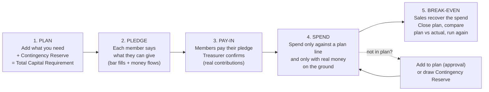

# Runway Capital Planning Module — Master Implementation Plan

**Module name (user-facing):** **Runway Plan** (full name: *Capital Runway Plan*)
**Platform:** CapitaSeed / OmniVentures — Agro-Farming **and** General Venture workspaces
**Status:** Design + implementation specification (planning phase — no code or tests have been run or changed)
**Storage location:** `plans/runway plan/runway-capital-planning-module-plan.md`
**Builds on:** `capital-seed-implementation-plan.md`, `plans/redesign plan/financial-and-dashboard-redesign-plan.md`, `plans/Frontend plan/frontend-implementation-plan.md`, `workflow-tests/test-implementation-plan.md`

---

## 0. The naming question (answered first)

> *"…plus their chosen Contingency Buffer or miscellaneous buffer — I am not sure what we call this in business"*

The standard business term is **Contingency Reserve** (also called *contingency buffer*, *contingency allowance* or, in project management, *management reserve*). It is a percentage or fixed amount added on top of the planned costs to absorb things nobody can predict: price rises, deaths of animals, repairs, delays.

| Term | Meaning in this module |
| :--- | :--- |
| **Budget line** | One thing the project must buy or pay for (qty × unit cost). |
| **Contingency Reserve** | Safety money added on top of the lines. Spent only with a reason. |
| **Total Capital Requirement** | Lines + Contingency Reserve = the number members must raise. |
| **Pledge** | A member's promise of how much they can provide. |
| **Pay-in** | Money actually paid and logged (becomes a real Capital Contribution). |
| **Money on the Ground** | The existing `leftMoney`: cash that is really in the account (contributed, borrowed, or from sales). |
| **Runway** | How long the money lasts, and how far it carries the project to **break-even**. |
| **Break-even** | The point where the project earns at least what it spends. |

Recommended defaults (shown as a tip, always editable): 5–10 % for an established operation, 10–15 % for a new business, 15–20 % for biological or high-uncertainty work (livestock).

---

## 1. Executive Summary

The module turns the idea into one guided, five-stage money journey that lives **on top of** the existing ledgers instead of beside them:



**Design principles**

1. **Optional but irresistible.** Off by default, introduced at the right moments (§6). An organization that never enables it sees **zero** behavior change.
2. **Derived, not duplicated.** Spent / paid / progress are *calculated from the existing immutable ledgers* (expenses, capital contributions). We only store user intent (plan, lines, pledges). The plan can never drift out of sync with the books.
3. **No money without money.** Spending is gated on real money on the ground, never on pledges (§7).
4. **Simple first, advanced on demand.** *Simple mode* = a shopping list + buffer + pledge. *Advanced mode* adds phases, expected income, break-even timeline, stress test and instalments. Same data model.
5. **Flexible, not hard-coded.** Templates are editable starting points (you already rejected hard-coded categories). Org-saved templates, free-text categories.
6. **Append-only & auditable.** Pledge changes, amendments and reserve draws are logged and hash-chained like every other event.
7. **Delight with restraint.** Money-flow and progress animations are the reward loop, but configurable (Full / Reduced / Off) and tuned for mid-range Android.

---

## 2. Code Audit — What Exists, What Is Missing, What Could Break

### 2.1 Reusable foundations (do not rebuild)

| Existing asset | Where | How the module reuses it |
| :--- | :--- | :--- |
| `leftMoney` = Money on the Ground | `computeFinancialSummary` (`src/utils/calculations.ts`) | Single source for "is there real money?". Already counts pool + reinvested sales + customer payments + `EXTERNAL_LOAN`/`DIRECTOR_MEMBER_ADVANCE` debts + loan recoveries, minus approved expenses, loans out, repayments. This matches your rule *"money actually paid and logged, from borrowed or contributed"*. |
| `getCurrentOrgLeftMoney(orgId)` | `dataService.ts` ~L2723 | The cash check inside the Spend Gate. |
| `CapitalContributionEvent` | `types/agro.ts` | Pay-in. Gains optional `runwayPlanId`, `pledgeId`. |
| `ExpenseLedgerEvent` | `types/agro.ts` | Spend. Gains optional `runwayPlanId`, `runwayLineId`, `runwayReserveDraw`. |
| `OrgMember.targetContributionUsd` / `contributionPace` | `types/agro.ts` | Default suggestion for a member's pledge amount and pace. |
| Multi-sig (> \$150 → `PENDING_MULTISIG`) | `logExpense`, `approveMultiSigExpense` | Reused; pending amounts are treated as *reserved*. |
| `DebtLiabilityEvent`, `LoanGivenEvent`, `CreditSaleEvent` | `types/financials.ts` | Planned financing, committed (supplier-credit) lines, break-even detection. |
| `createChainedAuditEvent`, `postGroundBroadcast` | `dataService.ts` | Immutable audit + member notifications/milestone broadcasts. |
| `customRecipes` + `FarmRecipeTemplate` pattern | Frontend plan | Pattern for org-saved Runway templates. |
| `BankingHubGrid` tiles, `ActiveTab` deep-links | Redesign plan | Entry tile; module page is a transferred tab like POOL/ASSETS. |
| `triggerHapticFeedback`, `index.css` keyframes (`shimmerSlide`, `fadeInScale`), `recharts`, `motion` (installed, currently unused) | `mobileHardware.ts`, `index.css`, `package.json` | Animations and timeline chart; no new dependency required. |

### 2.2 Gaps and defects found that **affect this module** (must be handled first)

| # | Finding | Evidence | Impact | Action |
| :-: | :--- | :--- | :--- | :--- |
| G1 | `sanitizeSnapshotOfLegacySeed` is a **whitelist** of snapshot keys | `dataService.ts` L206-232 | Any new array (e.g. `runwayPlans`) is **silently wiped on every `saveLocalState`**. | Add every new key to the whitelist (Phase 1) + regression test WF-RUN-24. |
| G2 | `logExpense` has **no cash check**; livestock, asset, loan and repayment paths do | `dataService.ts` L2592-2678 vs L2816, L3883, L3440, L3362 | A plain expense can drive Money on the Ground negative. The module's rule would be bypassable. | Spend Gate added to `logExpense` (only when a plan is ACTIVE). Global guard = Open Decision D1. |
| G3 | Pending multi-sig expenses are **excluded** from `leftMoney` until approved | `computeFinancialSummary` | Two pending \$200 expenses could both pass a naive cash check. | Gate uses `available = leftMoney − Σ pending multi-sig`. |
| G4 | `debt_liabilities`, `loans_given`, `credit_sales` have **no Firestore rules and are not in the cloud listener / sync / wipe lists**; the catch-all rule denies them | `firestore.rules` L183; `attachCloudListeners` L1931; `syncWithCloudServer` L2034; wipe list L1552 | Borrowed money and credit sales are not visible to other members. Runway funding by loans and break-even detection would be device-local. | **Phase 0**: add rules, listeners, sync and wipe entries (also fixes the redesign plan). |
| G5 | `logFixedAssetEvent`: guard runs when `deductFromLeftMoney !== false`, but the expense row is written only when it is truthy | `dataService.ts` L3881 vs L3911 | If the flag is `undefined`, the asset passes the cash check but **no money is deducted**. | **Phase 0** one-line fix + test. |
| G6 | Working tree is dirty (many modified files) | `git status` | Hard to isolate regressions. | Commit/tag a baseline and record the baseline run of all 8 suites + `npm test` + `npm run lint` before any module work. |
| G7 | `rulesEngineSimulator.ts` hand-mirrors `firestore.rules` | `workflow-tests/helpers/` | New collections must be added to **both**, or Suite 4 will not cover them. | Both updated in the same phase; new RULE tests. |
| G8 | Rules cannot enforce business invariants (multi-sig and overdraft guards are all client-side today) | `firestore.rules` | The Spend Gate is client-enforced like every other guard. | Mitigate with an **Off-Plan Spend compliance report** (§7.5) and a min-app-version bump via `ForceUpdateModal` after release. |

---

## 3. Product Design

### 3.1 Plan lifecycle

```mermaid
stateDiagram-v2
    [*] --> DRAFT: Admin/Treasurer builds the plan
    DRAFT --> PLEDGING: Admin "Open for pledges" (budget is LOCKED)
    PLEDGING --> PLEDGING: members pledge / pay in
    PLEDGING --> ACTIVE: Collected + opening cash >= activation threshold (admin confirms)
    ACTIVE --> ACTIVE: spend against lines / reserve / approved amendments
    ACTIVE --> COMPLETED: all lines done or closed, report generated
    DRAFT --> ARCHIVED: discard
    PLEDGING --> ARCHIVED: cancel (paid money stays in the pool; nothing deleted)
    COMPLETED --> [*]
```



* **Edit rules:** DRAFT = free editing. From PLEDGING onward the budget is locked; any change is an **Amendment** (§3.5), so members always pledge against a stable number.
* **One enforced plan per organization in v1** (max one `ACTIVE`). Any number of DRAFT / COMPLETED / ARCHIVED plans. Sequential runways ("Batch 5", then "Scale-up") are the common real-world pattern; ring-fenced parallel plans are a v2 item.
* Plans are never deleted (append-only spirit). Discarding sets `ARCHIVED`.

### 3.2 Screens (mobile-first, inside the existing Banking Hub design language)

**Entry points**
* Banking Hub tile **"Runway Plan"** — `Not started · Plan your capital` / `62 % funded · $1,600 to go` / `Day 18 · 4 of 9 steps done`.
* Overview hero card (when a plan exists in PLEDGING/ACTIVE) and invitation card (when not started; §6).

**Runway page (`RUNWAY` tab) — segmented control: `Plan · Pledges · Pay-in · Spend · Report`**

```
+-----------------------------------------------------------+
| Broiler Batch 5 · ACTIVE                       [ ⋯ ]      |
| TOTAL CAPITAL REQUIREMENT        $2,585.00                |
| [██████████████▓▓▓▓▓░░░░░░░░░░]  target marker ▲          |
|   ██ Spent $900   ▓▓ Collected $1,400   ░░ Pledged $2,585 |
|  Money on ground $500 · Reserve left $200 · 14 wks runway |
|  Coverage: Pledged 100% | Collected 54% | Executed 35%     |
+-----------------------------------------------------------+
| PLAN (steps)                 Phase 1 · Setup   $800  ✔    |
|  ✔ Day-old chicks   500 × $1.00        $500   PAID        |
|  ◐ Starter feed     20 × $28           $560   $280 spent  |
|  ○ Vaccines & meds                      $90   PLANNED     |
|  + Add step                                               |
| CONTINGENCY RESERVE  10%  $235  [used $35 · left $200]    |
+-----------------------------------------------------------+
```

* **Plan tab:** phases (Advanced) → lines → reserve card → sticky total that **counts up live as lines are added**.
* **Pledges tab:** "How much can you commit?" control + quick chips (**Fair share**, **My target**, **Custom**), pace (one-off / monthly / milestone), member rings (pledged ring + paid ring). Treasurer sees the *Collections* list ("who is behind", one-tap reminder broadcast).
* **Pay-in tab:** "I have paid" (amount, method, reference, optional photo) → **Payment Claim**; treasurer confirms → creates the real `CapitalContributionEvent` tagged to the pledge.
* **Spend tab:** "Spend on…" picker listing open plan lines (the user *chooses which event they are paying for*), reserve draw, add-to-plan; completed lines animate to Done.
* **Report tab:** plan vs actual per line, variance, reserve used, recovered %, break-even status, off-plan spend flags, share text / print.

### 3.3 Simple vs Advanced mode

| Capability | Simple (default) | Advanced (toggle, per plan) |
| :--- | :-: | :-: |
| Lines (qty × unit cost), reserve %, pledges, pay-in, spend gate | ✔ | ✔ |
| Phases / stages & optional "release next phase when previous done" | – | ✔ |
| Expected income lines + confidence %, **Break-even & Cash Timeline** | – | ✔ |
| Funding target basis: *Gross* vs *Peak need* | Gross | choose |
| Instalment schedules per pledge, due-date reminders | – | ✔ |
| Stress test (cost +x %, sales delayed y months) | – | ✔ |
| Planned external financing (loan) | – | ✔ |

### 3.4 Agro and General Venture fit

| | Agro workspace | General Venture workspace |
| :--- | :--- | :--- |
| Starter templates (all editable; costs blank or illustrative) | Broiler batch (42 d), Layers, Goat herd, Vegetable plot, Borehole / solar project, Blank | Retail / tuck shop, Transport / vehicle, Small manufacturing, Group property / stokvel investment, Event / project, Blank |
| Default reserve | 15 % (mortality, feed price) | 10 % |
| Smart links | Livestock purchase line → `registerLivestock` pre-filled; expected sale date from batch `targetSaleDate`; expected income = headcount × configured sale price; feed lines suggested from feed burn rate | Asset purchase line → `logFixedAssetEvent`; recurring rent/wages lines |
| Sites | Plan optionally scoped to a site (`locationId`) | Same (sites are optional venture locations) |
| **Smart cost suggestions** | Unit costs suggested from the org's own past expenses in the same category (median) — never hard-coded prices | Same |

### 3.5 Amendments (the "not in the plan" rule)

When someone needs to pay for something that is not in the plan (or exceeds a line):

| Choice | Effect | Approval | Needs ground cash? |
| :--- | :--- | :--- | :-: |
| **A. Add to plan** (new line, origin `AMENDMENT`) | Requirement grows by the amount; a **top-up pledge prompt** appears for members | Maker-checker: proposer ≠ approver (if the org has only one eligible approver, self-approval is allowed with an audit flag) | **Yes** (to actually pay) |
| **B. Use Contingency Reserve** (`runwayReserveDraw`) | Reserve left decreases; requirement unchanged | None beyond normal multi-sig (> \$150) | **Yes** |
| **C. Overrun of a line** | Same as B for the excess, or A to raise the line | as above | **Yes** |

Both A and B are **hard-blocked if money on the ground is insufficient** — your rule: *nothing can be added without sufficient money on the ground (actually paid and logged)*.

---

## 4. Capital Mathematics (all pure functions in `src/utils/runway.ts`)

Rounding: every monetary result is `Number(x.toFixed(2))` (matches the codebase).

**Lines.** `Cost_i = qty_i × unitCost_i × occurrences_i` (`occurrences = 1` for one-off; recurring lines expand into dated occurrences). `S = Σ Cost_i` over COST lines that are not `SKIPPED` and are `APPROVED`.

**Contingency Reserve.**
`C = round2(p × Σ Cost_i over lines not flagged excludeFromContingency)` (percent mode) **or** `C = fixedAmount` (fixed mode).

**Total Capital Requirement (gross).** `R = S + C`.

**Cash timeline (Advanced).** Collect every dated cash event (outflows from COST lines; inflows from INCOME lines × confidence × optional haircut). Sort by date; on the same date **outflows are applied before inflows**. Running balance `B_k`.
* **Peak need** `P = max(0, −min_k B_k)`
* **Operating break-even month** = first month ≥ 1 where recurring inflow ≥ recurring outflow.
* **Payback date** = first date after the trough where `B_k ≥ 0`; if none inside the horizon, report the remaining shortfall.

**Funding target.** `T = R` (basis *GROSS*) or `T = P + C` (basis *PEAK_NEED*).
`MemberTarget M = max(0, T − O − F)` where `O` = opening cash adopted from the existing pool at lock time, `F` = planned external financing.

**Funding layers (the multi-layer progress bar).**

| Layer | Formula | Source |
| :--- | :--- | :--- |
| Pledged | `Σ active pledge amounts` | `runwayPledges` |
| Collected | `Σ contributions with runwayPlanId` (+ `O` + received plan loans) | `capitalContributions`, `debtLiabilities` |
| Executed (spent) | `Σ approved expenses with runwayPlanId` (net of contra) | `expenses` |
| Gap | `max(0, M − Pledged)` | derived |

`pledgedPct = min(100, Pledged / M)`, `collectedPct = min(100, Collected / M)`, `executedPct = Executed / R`. Over-payment is kept as *extra* (shown, not hidden).

**Line status (derived).** `spent_i` = approved tagged expenses (minus the reserve-draw portion); `pending_i` = pending multi-sig tagged amounts; `remaining_i = Cost_i − spent_i − pending_i`.
`PLANNED` (spent = 0) → `PARTIAL` (0 < spent < Cost) → `PAID` (spent ≥ Cost) · `COMMITTED` (paid by supplier credit, debt open; becomes `PAID` when the linked debt is settled) · `SKIPPED` (explicit, with note).

**Reserve.** `reserveUsed = Σ runwayReserveDraw`, `reserveLeft = C − reserveUsed` (never below 0 — enforced).

**Spend Gate availability.** `availableCash = leftMoney − Σ(pending multi-sig expenses of the org)`; a spend of `a` is allowed only if `a ≤ availableCash`.

**Break-even recovery (actual).** `recoveredPct = (cash sales + customer deposits/instalments received) / Executed`. `≥ 100 %` → *Break-even reached* celebration (once).

**Runway months (live KPI).** `availableCash / avgMonthlyOutflow(last 60 days)`; alerts at < 4 weeks and < 2 weeks.

**Pledge fair-share calculator.** `equal = M / n`, `byTarget = M × target_i / Σ target`, `byEquity = M × netContribution_i / Σ netContribution` (uses existing `computeMemberEquities`). Always editable; shown as chips. Rounding remainder cents are assigned so the split sums exactly to `M`.

---

## 5. Animation & Feedback Design ("satisfying money flow")

| Moment | Animation | Haptic (respects existing vibration setting) |
| :--- | :--- | :--- |
| Line added in builder | Row slides in; total **counts up** (odometer, 400 ms); reserve recalculates with a soft pulse | none |
| **Pledge confirmed** | Up to 14 coins arc from the member's avatar chip to the bar's fill head (staggered 40 ms, bezier, 700 ms); bar fills with liquid shimmer (`shimmerSlide`); counters count up; ring around member avatar grows | short tick |
| **Payment confirmed** | Coins fly from the *Pledged* layer into the *Collected* layer (the bar visibly "solidifies": striped → solid) | double tick |
| Another member pays (live cloud update) | Same bar animation triggered by **value diff** (`useRunwayProgress` compares previous vs next totals) so everyone sees it happen | none |
| Milestone 25/50/75/100 % | Tick pops on the bar, toast, audit + **broadcast to all members** (once per plan, de-duplicated via `plan.milestonesReached`) | pattern |
| **Fully funded** | 1.2 s coin shower + "Fully funded — ready to launch" card; shown once per device (`localStorage` key `runway_celebrated_{planId}_{milestone}`) | success pattern |
| Line paid (Spend) | Check mark draws (stroke-dashoffset), ring pulse, row moves to Done; plan progress ring ticks | single tick |
| Break-even reached | Gold bar sweep + coin shower | success pattern |

**Performance & accessibility rules (non-negotiable)**
* Animate only `transform` / `opacity`; ≤ 14 particles; `will-change` only during playback; measure rects once.
* Honour `prefers-reduced-motion` → instant fill + one soft ring pulse. Settings → **Celebrations: Full / Reduced / Off** (default Full; auto-Reduced on low-end hint `navigator.hardwareConcurrency <= 4`). Haptics follow the existing vibration toggle (you flagged vibration as annoying, so it stays user-controlled).
* Animations are **purely presentational** and driven by state diffs, never by business logic (so tests ignore them).
* Never use motion as the only signal: every state also has text/icon; the bar uses `role="progressbar"` with `aria-valuenow`.

Implementation: `motion/react` (already in `package.json`) for coin paths and spring bars; CSS keyframes in `index.css` for shimmer/pulse; `CountUp` via `requestAnimationFrame`.

---

## 6. Optional, but introduced to every new user

The module must be **discovered**, never forced.

| # | Touchpoint | Who sees it | Behavior |
| :-: | :--- | :--- | :--- |
| 1 | **Org creation (last step of `OrgOnboardingModal`)** | New org admin | "Plan your capital runway? Know what you need, let members pledge, spend with confidence." → **[Start guided plan]** / **[Maybe later]**. Skipping sets `runwayPromoSnoozedUntil`. |
| 2 | **Overview invitation card** | Admin/Treasurer, module not enabled | Dismissible; snoozes 7 days, max 3 appearances, then only the hub tile remains. |
| 3 | **Banking Hub tile** | Admin: "Not started"; members: visible only once enabled | Always-available passive discovery. |
| 4 | **Member invite moment** | Members | When a plan enters PLEDGING: broadcast + hero card "Your organization needs \$2,585 — add your pledge". |
| 5 | **Contextual nudges** | Admin/Treasurer | One-time, dismissible: after creating supplier-credit debt, or after the first overdraft refusal ("Planning your costs first avoids surprises"). |
| 6 | **Settings → Organization & Team** | Admin | Toggle **Enable Runway Planning**; **Celebrations** + haptics options for everyone. |

**Opt-out / safety:** disabling is allowed only when there is no PLEDGING/ACTIVE plan; data is retained. While disabled nothing in the app changes.

---

## 7. Enforcement — The Spend Gate

### 7.1 When it applies

Gate is active ⇔ the org has a plan with `status === 'ACTIVE'` **and** `plan.enforcement === 'STRICT'` (default chosen at lock; admin may choose `ADVISORY`, which warns but never blocks). **If no such plan exists the gate returns immediately and all current behavior is untouched.**

### 7.2 Which outflows are gated (single helper `assertRunwayCompliance`)

| Outflow | Function | Gated | Notes |
| :--- | :--- | :-: | :--- |
| Expense | `logExpense` | ✔ | contra-reversals exempt; they **inherit the tags** of the referenced expense so the line's spent decreases |
| Livestock purchase (cash) | `registerLivestock` (CASH_POOL + auto-deduct) | ✔ | supplier credit → line becomes `COMMITTED`, no cash check |
| Fixed-asset purchase | `logFixedAssetEvent` (deduct) | ✔ | |
| Loan given to third party | `recordLoanGiven` | ✔ | needs a plan line (e.g. "Outgrower advance") |
| Debt repayment | `repayDebtLiability` | ✔ | debt linked to a `COMMITTED` line settles that line; otherwise needs allocation |
| Feed stock-in / consumption | `logFeedEvent` | – | does not move cash (the purchase itself is an expense) |
| Customer payments, sales, contributions | – | – | inflows |

### 7.3 Decision table (`evaluateSpend` in `runway.ts`)

Inputs: `plan, lines, expenses, allocation, amount, availableCash`. `allocation` = `{ mode: 'LINE', lineId } | { mode: 'NEW_LINE', title, category, qty?, unitCost? } | { mode: 'CONTINGENCY', reason }` (optional `reserveDrawAmount` for a partial overrun).

| # | Condition | Result | Error code |
| :-: | :--- | :--- | :--- |
| 1 | Gate not active | allow, no tagging | — |
| 2 | Allocation missing | **block**, UI opens Spend Gate dialog | `RUNWAY_ALLOCATION_REQUIRED` |
| 3 | Line not found / not in this plan / SKIPPED | block | `RUNWAY_LINE_INVALID` |
| 4 | Line belongs to a locked-but-unreleased phase | block | `RUNWAY_PHASE_NOT_RELEASED` |
| 5 | `amount > availableCash` | **block** (even if the line has budget and pledges are complete) | `RUNWAY_INSUFFICIENT_GROUND_CASH` |
| 6 | LINE and `amount ≤ remaining_i` | allow; tag `runwayPlanId`, `runwayLineId` | — |
| 7 | LINE and `amount > remaining_i` and no `reserveDrawAmount` | block, offer "reserve for the extra" or "raise the line" | `RUNWAY_LINE_OVERRUN` |
| 8 | CONTINGENCY / overrun portion `> reserveLeft` | block | `RUNWAY_RESERVE_EXHAUSTED` |
| 9 | NEW_LINE | creates `PROPOSED` amendment line; spend allowed **only after approval** (or immediate if the actor is an eligible approver and the proposer ≠ approver rule is satisfied) | `RUNWAY_AMENDMENT_PENDING` |
| 10 | CONTINGENCY without reason (< 4 chars) | block | `RUNWAY_REASON_REQUIRED` |

Errors are thrown as `RunwayError extends Error { code, details }` so the UI can open the correct dialog and **retry** the original action with the chosen allocation. Messages follow the existing guard wording, e.g. *"Insufficient money on the ground ($120.00 available, $200.00 needed). Money counts only after it is paid in and logged."*

### 7.4 Pledged ≠ spendable

Pledges never create cash. The Spend tab always shows three numbers side by side: **Budget left on this step**, **Reserve left**, **Money on the ground**; the Spend button is disabled with a clear reason when any gate fails.

### 7.5 Compliance report (honest about client-side limits)

Any approved expense while a plan is ACTIVE/STRICT with no `runwayPlanId` (e.g. from an old app version or an offline queue) is listed as **OFF-PLAN** in the Report tab and raises a broadcast to admin/treasurer. Combined with a minimum-app-version bump (`ForceUpdateModal`) after release.

---

## 8. Roles & Permissions

New entries in `PERMISSIONS` (`src/utils/permissions.ts`), covered by new cases in `permissions.test.ts`:

| Permission | ORG_ADMIN | TREASURER | MEMBER (+legacy REMOTE_INVESTOR) | GROUND_OPERATOR |
| :--- | :-: | :-: | :-: | :-: |
| `canEnableRunwayModule` | ✔ | – | – | – |
| `canCreateRunwayPlan` / `canLockRunwayPlan` / `canActivateRunwayPlan` / `canClosePlan` | ✔ | – | – | – |
| `canEditRunwayDraft` (lines, reserve, phases) | ✔ | ✔ | – | – |
| `canProposeAmendment` | ✔ | ✔ | – | ✔ |
| `canApproveAmendment` | ✔ | ✔ | – | – |
| `canPledge` (own pledge) | ✔ | ✔ | ✔ | – |
| `canConfirmPaymentClaim` (creates contribution) | ✔ | ✔ | – | – |
| `canSpendAgainstPlan` | ✔ | ✔ | – | ✔ (> \$150 still multi-sig) |
| `canViewRunwayPlan` | ✔ | ✔ | ✔ | ✔ (progress only, no pledge amounts) |
| `canViewAllPledges` (named amounts of others) | ✔ | ✔ | per-plan flag `showMemberPledges` | – |

Pledge privacy follows the existing `canViewAllInvestorStakes` model: regular members see **their own pledge + totals + "n members pledged"**; admins/treasurers see everyone. (UI-level, exactly like existing capital contribution reads — Firestore rules cannot hide fields.) No ranking or leaderboard — rings and totals only, to avoid shaming.

Multi-tenant: every record carries `orgId`; every service method calls an org-boundary check (`actor.orgId === plan.orgId`); the founder/superadmin has **no** cross-org access (Suite 6 philosophy preserved).

---

## 9. Data Model

### 9.1 New file `src/types/runway.ts`

```typescript
export type RunwayPlanStatus = 'DRAFT' | 'PLEDGING' | 'ACTIVE' | 'COMPLETED' | 'ARCHIVED';
export type RunwayEnforcement = 'STRICT' | 'ADVISORY';
export type RunwayMode = 'SIMPLE' | 'ADVANCED';
export type RunwayTargetBasis = 'GROSS' | 'PEAK_NEED';
export type ContingencyMode = 'PERCENT' | 'FIXED';
export type RunwayLinePriority = 'ESSENTIAL' | 'IMPORTANT' | 'NICE_TO_HAVE';
export type RunwayLineKind = 'COST' | 'INCOME';               // INCOME = expected sales (Advanced)
export type RunwayLineOrigin = 'PLAN' | 'AMENDMENT';
export type RunwayApproval = 'APPROVED' | 'PROPOSED' | 'REJECTED';
export type RunwayLineStatus = 'PLANNED' | 'PARTIAL' | 'PAID' | 'COMMITTED' | 'SKIPPED'; // derived (SKIPPED stored)

export interface RunwayPhase { id: string; name: string; order: number; releaseAfterPhaseId?: string; }

export interface RunwayPlan {
  id: string;                    // RWY-XXXX
  orgId: string;
  name: string;
  orgType: 'AGRO_FARMING' | 'GENERAL_VENTURE';
  mode: RunwayMode;
  status: RunwayPlanStatus;
  enforcement: RunwayEnforcement;           // chosen at lock, default STRICT
  locationId?: string;                      // optional site scope
  linkedLivestockId?: string;               // optional agro link
  templateId?: string;
  startDate: string;                        // ISO
  fundingDeadline?: string;
  breakEvenTargetDate?: string;
  contingencyMode: ContingencyMode;
  contingencyPercent?: number;              // e.g. 10
  contingencyFixedAmount?: number;
  targetBasis: RunwayTargetBasis;
  activationThresholdPct: number;           // default 100
  openingCashAdopted: number;               // O, frozen at lock
  plannedFinancing: { id: string; lenderName: string; amount: number; expectedDate?: string }[]; // F
  phases: RunwayPhase[];
  showMemberPledges: boolean;
  collectionMode: 'ANYTIME' | 'BY_DEADLINE' | 'INSTALMENTS';
  stress?: { costIncreasePct: number; incomeDelayMonths: number; incomeHaircutPct: number };
  milestonesReached: Partial<Record<'PLEDGED_25'|'PLEDGED_50'|'PLEDGED_75'|'PLEDGED_100'|'COLLECTED_25'|'COLLECTED_50'|'COLLECTED_75'|'COLLECTED_100'|'BREAK_EVEN', string>>;
  version: number;                          // increments on amendment approval
  lockedAt?: string; activatedAt?: string; completedAt?: string;
  createdByMemberId: string; createdByName: string; createdAt: string; updatedAt: string;
  auditHash: string;
}

export interface RunwayLine {
  id: string;                    // RWL-XXXX
  planId: string; orgId: string;
  phaseId?: string;
  kind: RunwayLineKind;
  title: string;                 // free text (never a hard-coded list)
  category: string;              // maps to ExpenseCategory or custom text
  qty: number; unitCost: number; unitLabel?: string;
  recurrence?: { everyDays: number; occurrences: number };
  plannedDate?: string;
  priority: RunwayLinePriority;
  excludeFromContingency?: boolean;
  confidencePct?: number;        // INCOME lines
  origin: RunwayLineOrigin;
  approval: RunwayApproval;      // PROPOSED for amendments until approved
  proposedByMemberId?: string; approvedByMemberId?: string; amendmentNote?: string;
  skipped?: boolean; skippedNote?: string;
  linkedDebtId?: string;         // supplier-credit commitment
  sortOrder: number;
  createdAt: string; updatedAt: string; auditHash: string;
}

export interface RunwayPledgeEvent {            // append-only history inside the pledge doc
  id: string; type: 'INITIAL' | 'INCREASE' | 'DECREASE' | 'WITHDRAW';
  previousAmount: number; newAmount: number; note: string; byMemberId: string; at: string; auditHash: string;
}

export interface RunwayPledge {
  id: string;                    // PLG-XXXX (one active pledge per member per plan)
  planId: string; orgId: string;
  memberId: string; memberName: string;
  amount: number;                // current pledged amount
  pace: 'ONE_OFF' | 'MONTHLY' | 'MILESTONE' | 'FLEXIBLE';
  instalments?: { dueDate: string; amount: number }[];
  history: RunwayPledgeEvent[];
  createdAt: string; updatedAt: string;
}

export interface RunwayPaymentClaim {            // member says "I paid"
  id: string; planId: string; orgId: string; pledgeId: string;
  memberId: string; memberName: string;
  amount: number; method: string; reference?: string; proofPhotoDataUrl?: string;
  status: 'PENDING' | 'CONFIRMED' | 'REJECTED';
  resolvedByMemberId?: string; resolutionNote?: string; contributionId?: string;
  createdAt: string; resolvedAt?: string; auditHash: string;
}

export interface RunwayTemplate {                // org-saved; built-ins live in code
  id: string; orgId?: string; name: string; orgType: 'AGRO_FARMING' | 'GENERAL_VENTURE' | 'ANY';
  contingencyPercent: number; phases: Omit<RunwayPhase,'id'>[];
  lines: Omit<RunwayLine,'id'|'planId'|'orgId'|'createdAt'|'updatedAt'|'auditHash'|'approval'|'origin'>[];
  isBuiltIn: boolean; createdAt: string;
}

export type RunwayAllocation =
  | { mode: 'LINE'; lineId: string; reserveDrawAmount?: number; reserveReason?: string }
  | { mode: 'NEW_LINE'; title: string; category: string; qty?: number; unitCost?: number; note: string }
  | { mode: 'CONTINGENCY'; reason: string };

export type RunwayErrorCode =
  | 'RUNWAY_ALLOCATION_REQUIRED' | 'RUNWAY_LINE_INVALID' | 'RUNWAY_PHASE_NOT_RELEASED'
  | 'RUNWAY_INSUFFICIENT_GROUND_CASH' | 'RUNWAY_LINE_OVERRUN' | 'RUNWAY_RESERVE_EXHAUSTED'
  | 'RUNWAY_AMENDMENT_PENDING' | 'RUNWAY_REASON_REQUIRED' | 'RUNWAY_PLAN_LOCKED'
  | 'RUNWAY_THRESHOLD_NOT_MET' | 'RUNWAY_PLEDGE_BELOW_PAID' | 'RUNWAY_NOT_ENABLED' | 'RUNWAY_ACTIVE_PLAN_EXISTS';

export class RunwayError extends Error {
  constructor(public code: RunwayErrorCode, message: string, public details?: Record<string, unknown>) { super(message); }
}
```

### 9.2 Additive optional fields on existing types (all optional → zero migration)

| Type (`types/agro.ts` / `organization.ts`) | New optional fields |
| :--- | :--- |
| `ExpenseLedgerEvent` | `runwayPlanId?`, `runwayLineId?`, `runwayReserveDraw?: number`, `runwayAllocationNote?` |
| `CapitalContributionEvent` | `runwayPlanId?`, `pledgeId?`, `claimId?` |
| `DebtLiabilityEvent` | `runwayPlanId?` (plan financing / committed line) |
| `AgroStateSnapshot` | `runwayPlans?`, `runwayLines?`, `runwayPledges?`, `runwayClaims?`, `runwayTemplates?` |
| `OrganizationFeatures` | `runwayModule?: boolean` (undefined/false = off) |
| `Organization` | `runwayPromoSnoozedUntil?`, `runwayPromoShownCount?`, `runwayDefaults?: { mode, contingencyPercent }` |
| `AuditEventType` | `RUNWAY_PLAN_CREATED`, `RUNWAY_PLAN_LOCKED`, `RUNWAY_PLAN_ACTIVATED`, `RUNWAY_PLEDGE`, `RUNWAY_PAYMENT`, `RUNWAY_AMENDMENT`, `RUNWAY_RESERVE_DRAW`, `RUNWAY_MILESTONE`, `RUNWAY_PLAN_CLOSED` |
| `ActiveTab` (`App.tsx`) | `'RUNWAY'` |

### 9.3 Firestore collections (5 new)

`runway_plans` (phases + financing embedded), `runway_lines` (per-line docs to avoid concurrent-edit conflicts), `runway_pledges` (history embedded, one doc per member per plan), `runway_claims`, `runway_templates`.

Every one must be added to **all** of: `firestore.rules`, `rulesEngineSimulator.ts`, the `attachCloudListeners` map, the `syncWithCloudServer` list, the wipe list, `sanitizeSnapshotOfLegacySeed` (G1), `createEmptyProductionSnapshot`, and `AgroStateSnapshot`.

**Rule sketch (`firestore.rules`)**

```
match /runway_plans/{id} {
  allow read:   if isApprovedMemberOfOrg(resource.data.orgId);
  allow create: if isOrgAdmin(request.resource.data.orgId) && isValidId(id);
  allow update: if isTreasurerOfOrg(resource.data.orgId)
                && request.resource.data.orgId == resource.data.orgId;   // admin-only transitions enforced in service
  allow delete: if false;                                                // plans are archived, never deleted
}
match /runway_lines/{id} {
  allow read:   if isApprovedMemberOfOrg(resource.data.orgId);
  allow create: if isTreasurerOfOrg(request.resource.data.orgId) && isValidId(id)
                && request.resource.data.unitCost >= 0 && request.resource.data.qty >= 0;
  allow update: if isTreasurerOfOrg(resource.data.orgId) && request.resource.data.orgId == resource.data.orgId;
  allow delete: if isOrgAdmin(resource.data.orgId);                      // DRAFT clean-up only (service checks status)
}
match /runway_pledges/{id} {
  allow read:   if isApprovedMemberOfOrg(resource.data.orgId) && getMemberData().role != 'GROUND_OPERATOR';
  allow create, update: if isApprovedMemberOfOrg(request.resource.data.orgId)
                && (request.resource.data.memberId == request.auth.uid || isTreasurerOfOrg(request.resource.data.orgId));
  allow delete: if false;
}
match /runway_claims/{id} {
  allow read:   if isApprovedMemberOfOrg(resource.data.orgId);
  allow create: if isApprovedMemberOfOrg(request.resource.data.orgId) && request.resource.data.status == 'PENDING';
  allow update: if isTreasurerOfOrg(resource.data.orgId)
                && request.resource.data.diff(resource.data).affectedKeys().hasOnly(['status','resolvedByMemberId','resolutionNote','contributionId','resolvedAt']);
  allow delete: if false;
}
match /runway_templates/{id} {
  allow read:   if isApprovedMemberOfOrg(resource.data.orgId);
  allow create, update: if isTreasurerOfOrg(request.resource.data.orgId);
  allow delete: if isOrgAdmin(resource.data.orgId);
}
```

> [!WARNING]
> Confirm the `members/{uid}` ↔ `OrgMember.id` mapping for admin-added members (`addMember`) before relying on `request.resource.data.memberId == request.auth.uid` (Open Decision D5). Fallback: treasurer records the pledge on behalf of the member.

Rules handle **tenant isolation, role gating and immutability**; business invariants (Spend Gate, activation threshold) live in the service layer, consistent with how multi-sig works today.

---

## 10. Service Layer (thin methods in `dataService.ts`, logic in `runway.ts`)

All methods: validate actor/org/permission → call pure function → `createChainedAuditEvent` → `saveLocalState` → `persistDocumentToCloudIfActive`. Same shape as `recordDebtLiability`.

| Method | Purpose |
| :--- | :--- |
| `setRunwayModuleEnabled({orgId, enabled, actor})` | Toggle `features.runwayModule`; refuses to disable with a PLEDGING/ACTIVE plan |
| `snoozeRunwayPromo({orgId, days, actor})` | Intro-card throttle |
| `createRunwayPlan({name, templateId?, mode, …, actor})` | Creates DRAFT (+ lines from template) |
| `upsertRunwayLine` / `removeRunwayLine` / `reorderRunwayLines` | DRAFT-only (after lock: use amendments) |
| `updateRunwayReserve({planId, mode, percent?, fixed?, actor})` | DRAFT-only |
| `lockRunwayPlan({planId, enforcement, activationThresholdPct, adoptOpeningCash, actor})` | DRAFT → PLEDGING; freezes `O`; audit + broadcast "Pledges open" |
| `pledgeToRunwayPlan({planId, memberId, amount, pace, instalments?, note?, actor})` | Create/increase/decrease; decrease cannot go below paid; after ACTIVE, decreases need admin |
| `submitRunwayPaymentClaim` / `resolveRunwayPaymentClaim({claimId, decision, note, actor})` | Confirm → calls `logCapitalContribution` with `runwayPlanId`, `pledgeId`, `claimId` (single code path for all money-in) |
| `activateRunwayPlan({planId, actor})` | PLEDGING → ACTIVE if threshold met (`RUNWAY_THRESHOLD_NOT_MET` otherwise); only one ACTIVE per org |
| `proposeRunwayAmendment` / `resolveRunwayAmendment` | Maker-checker; approval bumps `version`, requirement grows, top-up prompt |
| `spendAgainstRunwayPlan({planId, allocation, amount, category, locationId, note, …})` | Convenience wrapper → `logExpense` with allocation (the Spend tab uses this) |
| `assertRunwayCompliance(params)` *(private)* | Spend Gate used by `logExpense`, `registerLivestock`, `logFixedAssetEvent`, `recordLoanGiven`, `repayDebtLiability` |
| `closeRunwayPlan({planId, note, actor})` | COMPLETED + report snapshot + audit |
| `saveRunwayTemplate({…, actor})` | Org-saved template |
| `checkRunwayReminders()` | On app open/resume: due instalments, low runway, low reserve → in-app + system notification (no server needed) |

Existing public signatures only gain **optional** params (`runwayAllocation?`) — existing callers/tests compile and behave identically.

---

## 11. Files to Create / Modify

### 11.1 Create

| File | Purpose |
| :--- | :--- |
| `src/types/runway.ts` | Types + `RunwayError` (§9.1) |
| `src/utils/runway.ts` | Pure engine: `computePlanTotals`, `buildCashTimeline`, `computeFundingLayers`, `deriveLineStatuses`, `evaluateSpend`, `suggestPledgeSplit`, `detectMilestones`, `computeRecovery`, `computeRunwayMonths`, `buildVarianceReport`, `findOffPlanSpend`, `fundingGapCoach`, `runStressTest`, `suggestUnitCosts` |
| `src/utils/runway.test.ts` | Unit tests for the engine (§12.1) |
| `src/utils/runwayTemplates.ts` | Built-in editable templates (agro + general) |
| `src/components/runway/RunwayTab.tsx` | Module page + segmented sub-views |
| `src/components/runway/RunwayHeroCard.tsx` | Overview hero (PLEDGING/ACTIVE) |
| `src/components/runway/RunwayPromoCard.tsx` | Dismissible intro/invitation card (§6) |
| `src/components/runway/RunwayWizard.tsx` | 5-step guided creation |
| `src/components/runway/RunwayBudgetBuilder.tsx` | Lines/phases/reserve editor with live total |
| `src/components/runway/RunwayLineSheet.tsx` | Add/edit line bottom sheet (with cost suggestions) |
| `src/components/runway/RunwayFundingBar.tsx` | Multi-layer animated bar with milestone ticks |
| `src/components/runway/MoneyFlowLayer.tsx` | Coin-flow particle overlay |
| `src/components/runway/CountUp.tsx` | Odometer number |
| `src/components/runway/PledgePanel.tsx` | Pledge UI + member rings + collections list |
| `src/components/runway/PayInPanel.tsx` | Payment claims + treasurer confirmation |
| `src/components/runway/SpendPanel.tsx` | "Spend on…" picker, reserve, add-to-plan |
| `src/components/runway/SpendGateDialog.tsx` | Reusable allocation dialog (opened on `RUNWAY_ALLOCATION_REQUIRED`) |
| `src/components/runway/AmendmentSheet.tsx` | Propose/approve amendments |
| `src/components/runway/TimelineChart.tsx` | Cash timeline (recharts) + stress sliders |
| `src/components/runway/RunwayReport.tsx` | Plan vs actual, off-plan flags, share/print, "Run it again" |
| `src/hooks/useRunway.ts` | Memoised selectors over state; `useRunwayProgress` (diff → animation triggers) |
| `src/utils/celebrations.ts` | Animation level resolver (Full/Reduced/Off), once-per-device milestone store |
| `workflow-tests/09-runway-capital-planning.test.ts` | Suite 9 (§12.2) |

### 11.2 Modify (every change additive)

| File | Change | Safeguard |
| :--- | :--- | :--- |
| `src/types/agro.ts` | Snapshot arrays, optional tags on expense/contribution/debt, new `AuditEventType`s, re-export `runway.ts` | Optional fields only |
| `src/types/organization.ts` | `features.runwayModule?`, promo fields, defaults | Optional |
| `src/data/seedData.ts` | Add empty runway arrays to `createEmptyProductionSnapshot` | — |
| `src/services/dataService.ts` | **(1)** whitelist keys in `sanitizeSnapshotOfLegacySeed`; **(2)** listeners / sync / wipe entries for 5 new + 3 existing (G4) collections; **(3)** Spend Gate in the 5 outflow methods; **(4)** `logCapitalContribution` accepts optional tags; contra inherits tags; **(5)** new methods §10; **(6)** fix G5 | Gate returns immediately without an ACTIVE plan |
| `src/utils/permissions.ts` + `permissions.test.ts` | New permissions §8 | Existing entries untouched |
| `src/utils/calculations.ts` | No change (engine consumes `computeFinancialSummary` as-is) | Existing tests untouched |
| `src/App.tsx` | `ActiveTab` + `'RUNWAY'`; add to `accessibleTabs` **only when enabled**; render `RunwayTab`; global `SpendGateDialog` host; call `checkRunwayReminders` on resume | Tab absent when module off |
| `src/components/BankingHubGrid.tsx` | New tile (props optional) | Existing tiles/props unchanged |
| `src/components/HomeTab.tsx` | Render `RunwayHeroCard` / `RunwayPromoCard` conditionally | Hidden when module off and promo snoozed |
| `src/components/OrgOnboardingModal.tsx` | Optional final opt-in step (admin only) | "Maybe later" = existing flow |
| `src/components/UserSettingsTab.tsx` | Enable toggle (admin), Celebrations level, haptics link | Inside existing Org & Team / Notifications categories |
| `src/components/ExpensesFeedTab.tsx` | Allocation picker shown only when gate active; catch `RunwayError` → `SpendGateDialog` → retry | No UI change when inactive |
| `src/components/LivestockTab.tsx`, `AssetsTab.tsx`, `LoansDebtsModal.tsx` | Optional `runwayAllocation` pass-through + same dialog handling | Same |
| `src/components/PoolEquityTab.tsx` | "Count toward Runway pledge" selector when logging a contribution (default on if the member has an open pledge); pledge chip on member cards | Hidden without plan |
| `src/components/AuditAlertsTab.tsx` | Labels/icons for new event types (check for any exhaustive `Record<AuditEventType, …>`) | — |
| `src/index.css` | Keyframes: `coinArc`, `ringPulse`, `liquidShift`, `tickPop` (+ reduced-motion media query) | Additive |
| `firestore.rules` | 5 new collections (§9.3) **+ the 3 missing financial collections** (G4) | Catch-all remains last |
| `workflow-tests/helpers/rulesEngineSimulator.ts` | Mirror every new rule | Must change together with `firestore.rules` |
| `workflow-tests/helpers/testContext.ts`, `accounts.md` | 2 extra accounts: `agroMemberB`, `ventureMember2` (partial-pledge scenarios) | Additive |
| `workflow-tests/run-all-workflow-tests.ts` | Register Suite 9 **at the end** (the rules-compliance line reads `results[3]`/`results[5]`, so order must not shift) | Append only |
| `workflow-tests/test-implementation-plan.md` | Add Suite 9 section | Docs |
| `package.json` | `test` script appends `&& tsx src/utils/runway.test.ts` | — |
| `README.md` / `FUTURE_RELEASE_GUIDE.md` | Module notes, min-version bump step | Docs |

---

## 12. Testing Strategy

> Conventions follow the existing suites: `node:test` + `assert/strict`, real accounts from `helpers/testContext.ts`, singleton `dataService`, one process per suite (`npx tsx <file>`), so Suite 9 starts from clean in-memory state. Nothing has been run yet; the first implementation step is recording the baseline (G6).

### 12.1 Unit tests — `src/utils/runway.test.ts`

| ID | Verifies |
| :-: | :--- |
| U-01 | Line cost math (qty × unit, recurrence expansion, rounding to cents) |
| U-02 | Reserve percent vs fixed; `excludeFromContingency`; zero-line plan = 0 |
| U-03 | **Broiler example:** lines 500 + 560 + 750 + 90 + 150 + 200 + 60 + 40 = **\$2,350**, reserve 10 % = **\$235**, requirement **\$2,585** |
| U-04 | Timeline: same-date outflow-before-inflow; **Shop example** (§12.3): peak need **\$4,100**, operating break-even month **2**, no payback inside the 5-month horizon, remaining shortfall **\$800** |
| U-05 | Target basis `GROSS` (\$7,700) vs `PEAK_NEED` (\$4,100 + \$700 = **\$4,800**) |
| U-06 | `MemberTarget = T − O − F`, floors at 0 |
| U-07 | Funding layers & percentages; over-payment kept as *extra* |
| U-08 | Derived line status (PLANNED/PARTIAL/PAID/COMMITTED); contra restores |
| U-09 | `evaluateSpend` — every row of the §7.3 decision table |
| U-10 | `availableCash` subtracts pending multi-sig |
| U-11 | Pledge split: equal / by target / by equity; sums exactly to `M` (cent distribution) |
| U-12 | Milestone detection fires once per threshold, never twice |
| U-13 | Recovery % and break-even trigger |
| U-14 | Variance report & off-plan detection |
| U-15 | Stress test raises peak need predictably |
| U-16 | Funding Gap Coach ordering (raise pledges / trim NICE_TO_HAVE / phase / loan) |

### 12.2 Workflow Suite 9 — `workflow-tests/09-runway-capital-planning.test.ts`

Accounts: Agro — `agroAdmin`, `agroTreasurer`, `agroMember`, `agroMemberB` (new), `agroOperator`; Venture — `ventureAdmin`, `ventureTreasurer`, `ventureMember`, `ventureMember2` (new); isolation — `intruder`, `founder`.

| ID | Workflow | Key assertions |
| :-: | :--- | :--- |
| WF-RUN-01 | **Opt-in & no-regression** | Module off by default; non-admin cannot enable; with module off, `logExpense` / `registerLivestock` / asset / loan behave exactly as before (same errors, same balances) |
| WF-RUN-02 | Build plan from Broiler template (Agro) | Totals = \$2,350 / \$235 / **\$2,585**; free-text category accepted; template lines editable |
| WF-RUN-03 | Break-even & timeline (General shop) | Peak \$4,100, op. break-even month 2, shortfall \$800; stress (+20 % cost, 2-month delay) raises peak |
| WF-RUN-04 | Permissions on draft & lock | Treasurer edits DRAFT; member/operator cannot; only admin locks; **after lock** `upsertRunwayLine` → `RUNWAY_PLAN_LOCKED` (must use an amendment) |
| WF-RUN-05 | Pledging | Cannot pledge in DRAFT; operator cannot pledge; admin \$1,200, treasurer \$800, memberB \$300 → pledged 89 % / gap \$285; increase allowed; decrease below paid → `RUNWAY_PLEDGE_BELOW_PAID`; history append-only |
| WF-RUN-06 | Milestones & broadcasts | 25/50/75/100 % produce exactly one audit + broadcast each (recalculating creates no duplicates); all members have the broadcast unread |
| WF-RUN-07 | Pay-in | Treasurer logs contribution tagged to pledge; member claim → confirm creates exactly one contribution (`claimId`); reject creates none; over-pay shown as *extra*; contra-reversal reduces *Collected* |
| WF-RUN-08 | Activation threshold & opening cash | Below threshold → `RUNWAY_THRESHOLD_NOT_MET`; adopting existing pool cash counts; second ACTIVE plan → `RUNWAY_ACTIVE_PLAN_EXISTS` |
| WF-RUN-09 | **Spend on a line** | Chicks \$500: line PLANNED → PAID; expense tagged; Money on the Ground and *Executed* update; plan progress recalculated |
| WF-RUN-10 | **No allocation = blocked** | Plain `logExpense` while STRICT/ACTIVE → `RUNWAY_ALLOCATION_REQUIRED`; ADVISORY plan allows but flags |
| WF-RUN-11 | **Pledged but not paid ≠ spendable** | Line has budget and pledges are 100 %, but only \$100 is paid in → \$200 spend → `RUNWAY_INSUFFICIENT_GROUND_CASH`; pay in more → succeeds |
| WF-RUN-12 | **Unplanned spend → Add to plan** | Operator proposes NEW_LINE; spend blocked until approved; proposer cannot self-approve when another approver exists; approved → requirement grows, `version` + 1, spend succeeds; still needs cash |
| WF-RUN-13 | **Unplanned spend → Contingency** | Reason required; reserve decreases; exceeding reserve → `RUNWAY_RESERVE_EXHAUSTED`; line overrun requires reserve split or raise (`RUNWAY_LINE_OVERRUN`) |
| WF-RUN-14 | Multi-sig interplay | \$200 expense → PENDING: line shows *pending*, available cash reduced so a second spend that would overdraw is refused; approval turns it into spent |
| WF-RUN-15 | Borrowed money counts | External loan logged → ground cash up → spend allowed; supplier-credit livestock line → `COMMITTED`, no cash check; debt repayment → line `PAID` |
| WF-RUN-16 | Integration paths | `registerLivestock` and `logFixedAssetEvent` with allocation tag their expense rows and mark lines; without allocation under the gate they are blocked; asset-flag fix (G5) verified |
| WF-RUN-17 | Contra restores line | Contra-reversal inherits tags; line spent decreases; reserve draw returns |
| WF-RUN-18 | Break-even from real sales | Livestock sale + credit-sale payments push recovery ≥ 100 % → BREAK_EVEN milestone fires once |
| WF-RUN-19 | Close & report | Close → COMPLETED; variance per line; leftover stays in the pool; "Run it again" clones with actuals; ADVISORY off-plan list correct |
| WF-RUN-20 | **Multi-tenant isolation** | Other org (`intruder`) and `founder` cannot read, pledge, spend, or modify this org's plan/lines/claims; cash check uses only own org |
| WF-RUN-21 | Disable guard | Cannot disable module with PLEDGING/ACTIVE plan; allowed after COMPLETED |
| WF-RUN-22 | **General Venture variant** | Retail template, no livestock UI; same pledge → pay-in → spend → close flow with venture accounts |
| WF-RUN-23 | Audit integrity | After the full run the SHA-256 audit chain is continuous and valid; every runway action is audited |
| WF-RUN-24 | **Persistence regression (G1)** | After mutations, `getState()` still contains all runway arrays (fails if the whitelist is missed) |

### 12.3 Reference datasets used in tests

**Shop (General):** setup \$3,000 at day 0; then monthly (30 d) outflow \$800 and inflows \$500, \$900, \$1,300, \$1,600, \$1,900 (months 1–5). Sorted running balances (outflow first on equal dates): −3000, −3800, −3300, −4100, −3200, −4000, −2700, −3500, −1900, −2700, −800 → **peak 4,100; payback not reached; shortfall 800; operating break-even month 2**. Costs total 7,000 → reserve 10 % = 700 → gross requirement 7,700.

**Broiler (Agro):** pledges 1,200 + 800 + 585 = 2,585 (fully funded) for the happy path; 1,200 + 800 + 300 = 2,300 (gap 285, 89 %) for the gap path.

### 12.4 Security-rules tests (extend Suite 4 style)

New RULE cases against the updated simulator: plan read/create/update/delete by role and org; lines create/update isolation; pledges own-write vs other member; claims `status` update restricted to treasurer and only listed keys; templates; **catch-all still denies unknown collections**; and the three previously missing financial collections (G4).

### 12.5 Regression & release gate

Run in this order and require green at each step:

1. Baseline (before any change): `npm run lint`, `npm test`, `npm run test:workflows` (Suites 1-8) — record the results.
2. After **each phase** below: the same three commands.
3. Final: add Suite 9 and `runway.test.ts` → all 9 suites + unit tests + `npm run lint` + `npm run build`.
4. Manual device matrix (Android 360 × 800 and a low-end device): enable/disable module, wizard in < 2 min, pledge animation at 60 fps (Full), Reduced/Off modes, TalkBack labels on the bar, two devices live-sync (progress animates on the other device), offline spend then reconnect, dark/light theme contrast.

---

## 13. Step-by-Step Implementation (each step independently shippable and revertible)

| Phase | Work | Safeguard | Done when |
| :-: | :--- | :--- | :--- |
| **0. Prerequisites** | Baseline commit/tag + record test baseline (G6). Fix G5. Add rules + listeners + sync + wipe for `debt_liabilities`, `loans_given`, `credit_sales` (G4) with simulator + RULE tests. | No feature code yet | Suites 1-8 green; new RULE tests green |
| **1. Contracts & engine** | `types/runway.ts`; additive optional fields; whitelist + empty snapshot (G1); `utils/runway.ts` + `runway.test.ts`; `permissions` additions | Pure functions; no UI, no behavior change | U-01…U-16 green; Suites 1-8 green |
| **2. Headless backend** | Service methods §10 (without gate wiring); rules + simulator for 5 collections; Suite 9 tests WF-RUN-01…08, 20, 21, 24 | Module disabled by default | Those tests green |
| **3. Spend Gate** | `assertRunwayCompliance` + wiring into the 5 outflow methods; contra tag inheritance; WF-RUN-09…19, 22, 23 | Gate is a no-op without an ACTIVE plan; verified by WF-RUN-01 | All Suite 9 green; **all existing suites unchanged and green** |
| **4. Planning UI** | `RunwayTab` shell, wizard, budget builder, line sheet, templates, reserve card, live count-up total; hub tile (disabled state) | Tab hidden unless enabled | Manual: plan built in < 2 min on a phone |
| **5. Pledge & pay-in UI + animations** | `RunwayFundingBar`, `MoneyFlowLayer`, `CountUp`, `PledgePanel`, `PayInPanel`, `useRunwayProgress`, celebrations setting, milestones | Reduced/Off modes first, Full second | Animations verified on device; a11y checked |
| **6. Spend UI & integration** | `SpendPanel`, `SpendGateDialog`, `AmendmentSheet`; integrate Expenses/Livestock/Assets/Loans/Pool screens | Dialog opens only on `RunwayError` | End-to-end spend flows manually verified |
| **7. Discovery & onboarding** | `RunwayPromoCard`, onboarding opt-in step, nudges, Settings toggle, member invite broadcast | Snooze/throttle logic tested | A new org sees the offer exactly once and can skip |
| **8. Advanced** | Phases + release rule, timeline chart, stress test, gap coach, instalments + reminders, saved templates, cost suggestions, Report tab (variance, off-plan, share/print), "Run it again" | Behind Advanced toggle | WF-RUN-03, 18, 19 green on the UI path |
| **9. Hardening & release** | Full regression (§12.5), rules deploy, bump `version.json` / min required version, docs, `test-implementation-plan.md` update | Staged rollout: enable for one pilot org first | All gates green; pilot sign-off |

**Rollback story:** the feature flag (`features.runwayModule`) plus the no-active-plan early return mean the module can be disabled instantly without data migration; all new data lives in separate arrays/collections that the old app ignores.

---

## 14. Edge Cases & Risks

| Risk / edge case | Handling |
| :--- | :--- |
| Two admins edit lines at once | Per-line docs (no whole-plan overwrite); budget locks at PLEDGING; version counter on amendments |
| Member pays without logging | Payment Claim flow; treasurer confirms; only confirmed money counts |
| Member over-pays | Shown as *extra*, increases ground cash, never lost |
| Member leaves or is suspended | Pledge stays; the unpaid part is flagged for an admin decision (reassign / write-off with note); paid money untouched |
| Offline operator spends | Local gate uses local state; conflicts surface in the off-plan/compliance report after sync |
| Pledge decrease after activation | Needs admin approval and cannot go below paid; funding % recalculated; broadcast |
| Expense reversed after plan closed | Contra still allowed (immutable ledger rule); report marked "adjusted after close" |
| Currency/units | Uses `organization.currencySymbol`; amounts stored as plain numbers like the rest of the app |
| Loan interest | Out of scope v1 (principal only, same as `DebtLiabilityEvent` today) |
| Plan with zero lines / zero requirement | Cannot lock; clear message |
| Very large plans (200+ lines) | Memoised selectors; virtualised list in builder; per-line docs |
| A modified client bypasses client-side enforcement | Documented (G8); compliance report + min-version gate; rules still enforce tenancy/roles |
| Animation jank on low-end Android | ≤ 14 particles, transform/opacity only, auto-Reduced hint, user setting |

---

## 15. Open Decisions (please confirm; the default shown is what will be built)

| # | Question | Default |
| :-: | :--- | :--- |
| D1 | Also block **plain expenses with no plan** when Money on the Ground is insufficient (existing hole G2)? Consistent with your "no purchase with zero money" rule, but existing test fixtures may need seeded capital first. | **Not in v1 of the module**: soft warning for everyone, hard-block only under a plan. Can follow as a separate small change after Phase 3. |
| D2 | One enforced plan per org (sequential runways) vs parallel ring-fenced plans? | One enforced plan; parallel is v2 |
| D3 | Pledge visibility to regular members | Own pledge + totals only; admin can switch on a "pledge wall" per plan |
| D4 | Enforcement default at lock | `STRICT` (your rule); admin may choose `ADVISORY` |
| D5 | `members/{uid}` vs `OrgMember.id` for admin-added members (affects the pledge rule) | Verify in Phase 2; fallback = treasurer records the pledge on behalf |
| D6 | In-kind pledges (land, equipment, labor valued in money) | Out of v1; designed to fit later as an INITIAL asset event + contribution |

---

## 16. Acceptance Criteria

1. An organization that never enables the module sees **no UI or behavior difference**; Suites 1-8 and `npm test` stay green throughout.
2. A new admin is offered the module at org creation, on the Overview and in the Hub, and can decline without friction.
3. A user can build a plan (template or blank), see **Total Capital Requirement = lines + Contingency Reserve** update live, and open it for pledges in under two minutes on a phone.
4. Members pledge; the multi-layer bar and counters animate with money flowing; live updates animate on other members' devices; milestones broadcast once.
5. Money counts as *collected* only after it is paid in and confirmed/logged.
6. While a plan is ACTIVE/STRICT, **no outflow can be recorded without choosing a plan step, a Contingency draw, or an approved amendment — and never without real money on the ground.**
7. Completed steps are marked done and overall plan progress updates; the plan-vs-actual report is accurate; break-even is detected from real sales.
8. Org A can never see or affect Org B's plan, even for the founder account.
9. All Suite 9 tests (WF-RUN-01…24), `runway.test.ts` (U-01…U-16), updated Firestore-rules tests, `npm run lint` and `npm run build` pass; animations meet the performance and accessibility rules in §5.

