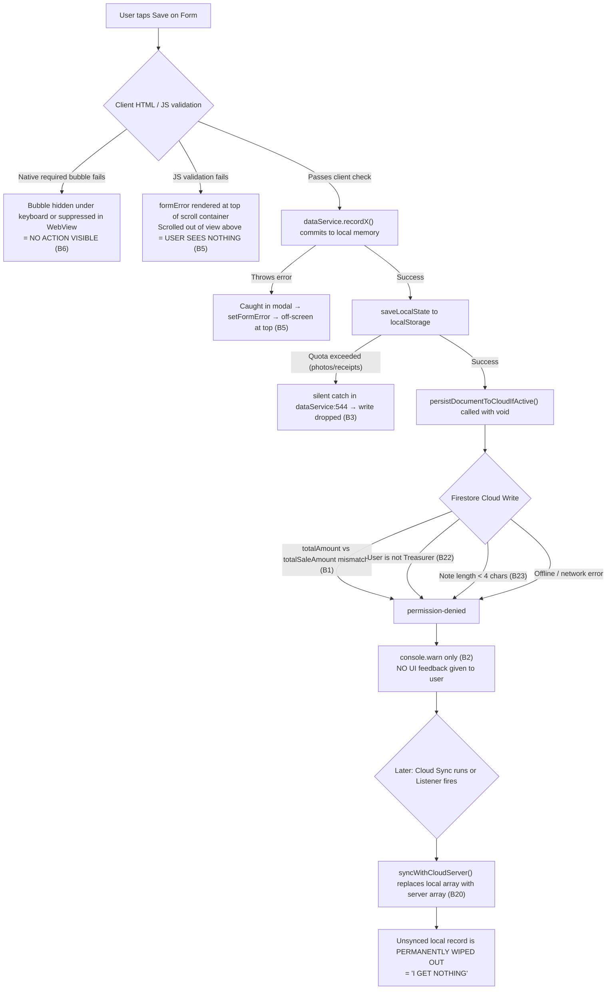

# 01 — Audit: Gaps, Bugs and Missing Features

Severity: **P0** = data loss or broken core flow, **P1** = clearly broken UX / silent submission failure, **P2** = polish or missing capability.
"Verified" means verified by inspecting the actual source code and rules.

## A. Exhaustive Code & Architecture Bug Audit

| ID | Sev | Where | Finding | Fix (doc) |
|----|-----|-------|---------|-----------|
| **B1** | P0 | `firestore.rules:197-202`, `dataService.ts:3837-3871`, `workflow-tests/helpers/rulesEngineSimulator.ts:478-486` | Rule requires `totalAmount > 0`. The credit-sale doc writes `totalSaleAmount` and `totalSaleAmountUsd`, never `totalAmount`. **Every cloud create of a credit sale is permission-denied.** The simulator copies the same wrong field, giving false test confidence. | 06 §1 |
| **B2** | P0 | `dataService.ts:2272-2274` | `persistDocumentToCloudIfActive` catches every error and only executes `console.warn`. The caller executes `void persist...`. The user sees a local update, but cloud persistence failed; other members see nothing, and cloud sync deletes the record. | 06 §2 |
| **B3** | P0 | `dataService.ts:531-545` | `saveLocalState` catches `QuotaExceededError` on `localStorage.setItem` and only calls `console.warn`. Base64 receipts and gallery images exceed the ~5 MB limit, causing **silent data loss on local saves**. | 06 §4, 05 |
| **B4** | P0 | `dataService.ts:3820-3835` | `recordCreditSale` calls `logLivestockLifecycleEvent` (reducing headcount) **before** creating the credit sale. Any subsequent throw leaves the herd permanently reduced with no credit sale recorded. No atomic transaction or rollback exists. | 06 §3 |
| **B5** | P1 | `CreditSalesModal.tsx:289-294`, `LoansDebtsModal.tsx:440`, `ExpensesFeedTab.tsx:1005`, `LivestockTab.tsx:181,198,331` | `formError` / `expError` / `regError` is rendered at the **top** of the scroll container while the submit button is at the bottom. On mobile phones, when the user taps Save, the error is off-screen. To the user, **tapping Save produces zero response ("nothing happens")**. | 03 §6, 06 §5 |
| **B6** | P1 | 99 `required` HTML attributes across `src/components/*.tsx` | Native HTML5 validation popups are either suppressed, hidden behind the virtual keyboard, or ignored in Android WebViews. Forms fail to submit with zero visual feedback. | 06 §5 |
| **B7** | P1 | `App.tsx:182-198` | The global `focusin → scrollIntoView({block:'center'})` fights modal and bottom sheet scroll containers and the keyboard resize, causing form inputs to violently jump or hide. | 03 §5 |
| **B8** | P1 | `index.css:168-170` | `.text-white { color:#0F172A !important }` plus `.bg-slate-950`, `.bg-slate-900` global overrides. White-on-dark text becomes dark-on-dark unless whitelisted. This is the root cause of recurring contrast bugs (Frontend plan Issue 7) and unpredictable component styling. | 03 §1 |
| **B9** | P1 | `index.css` (missing animation keyframes) | Classes `animate-fade-in`, `animate-in`, `fade-in`, `slide-in-from-bottom` are referenced across 20+ components but never defined in CSS or Tailwind v4 `@theme`. **No sheet or modal animations run.** | 03 §4 |
| **B10** | P1 | `App.tsx:463-526` | Touch swipe listener cycles through `accessibleTabs`, which contains 10 tabs (`HOME`, `LIVESTOCK`, `EXPENSES`, `POOL`, `ASSETS`, `BROADCASTS`, `AUDIT`, `USERS`, `RUNWAY`, `SETTINGS`). The navbar only shows 3 tabs. **Accidental horizontal swipes fling the user into unknown, unrequested pages.** | 02 §5 |
| **B11** | P1 | `App.tsx:964-1231` | Conditional tab rendering (`activeTab === 'X' && <XTab/>`) unmounts components on every switch. In-progress form inputs, draft notes, filters, expanded views, and scroll positions are destroyed. | 02 §3 |
| **B12** | P1 | `App.tsx:365-461` | Back handling uses `document.querySelector('[role="dialog"]')` and clicks close buttons. Modals without `role="dialog"` (e.g. `CreditSalesModal`, `LoansDebtsModal`, sub-views) ignore the back gesture and exit the app. No `history.pushState` integration. | 02 §4 |
| **B13** | P1 | `FloatingNavbar.tsx:38-45`, `App.tsx:351-353` | General Venture workspaces display an "Operations" nav tab that immediately bounces back to Overview (`HOME`). It is a dead button with no screen implementation. | 04 §6 |
| **B14** | P1 | `HomeTab.tsx:503`, `:444` | Hard-coded fake mock data: "15:00 Live" ruler marker, "+100% Equity Pool", and static "On Track" operator badge presented as live real metrics. | 04 §1 |
| **B15** | P1 | `App.tsx:970-985` | Inconsistent "Back to Overview Hub" top banner on Pool and Assets, but missing on Livestock and Expenses, wasting vertical space and confusing navigation hierarchy. | 02 §2 |
| **B16** | P2 | `AssetsTab.tsx:241`, `ExpensesFeedTab.tsx:165,264`, `LivestockTab.tsx:301,309,344,612`, `LoansDebtsModal.tsx:304`, `SiteManagerModal.tsx:132`, `RunwayTab.tsx:117,131,137,144` | `alert()` and `window.confirm()` used in 13 places. They freeze the UI thread, look like unstyled browser popups, and violate mobile app design standards. | 03 §7 |
| **B17** | P2 | `LoansDebtsModal.tsx:49` | `payload: any` in the pending-disbursement state bypasses TypeScript checks and hides payload mismatches when routing through the Runway Spend Gate. | 06 §3 |
| **B18** | P2 | `index.html` viewport `user-scalable=no`, `body{min-height:100vh}`, `min-h-screen` in 8 places | `100vh` ignores mobile browser address bars and Android on-screen keyboards. Causes severe clipping. `user-scalable=no` violates accessibility standards. | 03 §5 |
| **B19** | P2 | `capacitor.config.json` `Keyboard`/`SplashScreen` blocks | Config references `@capacitor/keyboard` and `@capacitor/splash-screen`, but neither plugin is installed in `package.json`. Configuration is completely inert. | 05 |
| **B20** | P0 | `dataService.ts:2171-2220` (`syncWithCloudServer`), `dataService.ts:2097-2101` (`attachCloudListeners`) | **Cloud Sync Drops Unsynced Local Records**: When sync runs or listeners fire, local state arrays (`this.state.creditSales = docs as CreditSaleEvent[]`, etc.) are completely replaced with cloud arrays. If a local write failed cloud persistence (due to B1, B2, B3, B23, B24 or offline status), **cloud sync permanently wipes the local record**. This directly explains: *"forms are not actually sending data and I get nothing"*. | 06 §2 |
| **B21** | P1 | `CreditSalesModal.tsx:218-220`, `LoansDebtsModal.tsx:429` | **Ugly "0 Active" Badge on Small Screens**: The active count badge (`{activeSalesCount} Active`) is hard-coded directly inside the modal's `<h2>` title with bright amber styling (`bg-amber-100 text-amber-800`). On phones < 360dp width, it forces ugly line wraps and highlights "0 Active" as an alarming badge even when zero debt/credit is a positive state. Similarly, `LoansDebtsModal` renders `Borrowed Liabilities (0)` and `Loans Given (0)` inside cramped subtab buttons. | 04 §2, §3 |
| **B22** | P1 | `firestore.rules:185,192,114`, `LoansDebtsModal.tsx`, `PoolEquityTab.tsx` | **Role-Permission Mismatch in UI**: Firestore rules enforce `isTreasurerOfOrg` for creating debts, issuing loans, and logging capital contributions. The frontend UI displays these forms to general members without pre-checking role permissions. When a non-treasurer submits, Firestore returns `permission-denied`, B2 swallows the error, and B20 wipes the local record on sync. | 06 §6 |
| **B23** | P1 | `firestore.rules:40-41` (`hasMandatoryAuditFields`) | Rule requires `note.size() >= 4 && note.size() <= 500`. UI forms that allow notes shorter than 4 characters (or omit notes) fail cloud write silently. | 06 §1, §5 |
| **B24** | P1 | `CreditSalesModal.tsx`, `LoansDebtsModal.tsx` form height & layout | Full-page modals with stacked 3-card summary banners consume >40% of screen height before form fields begin. In addition, nested views (`LIST` ⇄ `NEW` ⇄ `REPAY` ⇄ `EXTEND`) prevent URL/stack navigation. | 03 §2, 04 §2 |

---

## B. Why "Forms Don't Send Data and I Get Nothing" — Complete Failure Chain

### The Three Deadly Loops:
1. **The Off-Screen Error Trap**: The form actually *did not submit* because of a validation issue, but the error message appeared at the top of the scrolled body. The user tapped Save and saw no reaction.
2. **The Silent Cloud Denial Trap**: The form submitted locally, but the cloud write was rejected by Firestore rules (`totalAmount`, `isTreasurerOfOrg`, or `note >= 4`). The error was swallowed into `console.warn`.
3. **The Sync Wipeout Trap**: The local record existed temporarily, but because it never reached the server, the subsequent cloud snapshot overwrote the local array with the server's empty array, erasing the record completely.

---

## C. Exhaustive Missing Features & Screens Inventory

### 1. Both Workspaces (`AGRO_FARMING` and `GENERAL_VENTURE`)
- **Global Toast/Snackbar System with Undo**: Ephemeral feedback on bottom-center (above navigation bar), supporting `success`, `error`, and `info` with action callbacks.
- **Outbox & Sync Status Pipeline**:
  - Visual status pill in AppBar (`Synced ✓`, `Syncing ⟳`, `Offline (N queued)`, `Error ⚠`).
  - `SyncStatusScreen`: Inspect pending outbox items, force sync, retry failed mutations with error explanations.
  - Snapshot protection: Local pending outbox items are merged, never wiped by cloud listeners.
- **Keyboard-Aware Bottom Sheet Modal Architecture**:
  - Max height: `min(88dvh, visualViewportHeight - safeTop - 12px)`.
  - Upward sliding animation with spring deceleration.
  - Footer action bar pinned directly above soft keyboard.
  - Focus auto-scroll to active input.
- **Multi-Level Navigation Back-Stack & Recents**:
  - Independent navigation stack per bottom tab.
  - Persistent Recent Pages list (last 8 opened screens) with deep restoration.
  - Hardware back button and Android 14+ predictive back gesture integration.
- **Customers & Debtors Directory**: Derived customer list with contact information, total credit history, and 1-tap call/WhatsApp intents.
- **Document & Statement Sharing**: Native Android Share Sheet integration for PDF/Image receipts, loan agreements, and credit balance statements.
- **Scheduled Local Due Date Reminders**: Android `AlarmManager` reminders at T-2 days and due date morning for credit sales, loan repayments, debt settlements, and livestock checkpoints.
- **Biometric App Lock on Resume**: Biometric challenge when returning to the app after 5 minutes of backgrounding.
- **Currency & Regional Number Formatting**: Configurable organization currency (default `$ USD`, supports `ZAR`, `EUR`, `GBP`, `KES`, `UGX`, etc.) replacing 100+ hard-coded `$` instances.
- **Storage & Backup Manager Screen**: Visual breakdown of storage consumption (IndexedDB, image cache), cache clearing, and 1-click JSON backup export.

### 2. Agro-Farming Workspace Specific
- **Dedicated Batch Detail Screen (`BatchDetailScreen`)**:
  - Replaces the 134 KB `LivestockTab.tsx` monolith.
  - Sticky Segmented Navigation: `Overview` · `Checkpoints` · `Feed Ledger` · `Weight Curves` · `Gallery` · `Sales`.
- **Batch Card Quick-Log Strip**:
  - 1-tap quick actions directly on each batch card: `[Log Feed]` · `[Log Mortality]` · `[Weigh-in]` · `[Sell/Harvest]`.
- **Feed Inventory & Consumption Screen (`FeedInventoryScreen`)**:
  - Total feed stock on hand (kg/bags), consumption rate, projected run-out date.
- **Site Comparison Analytics Screen (`SiteCompareScreen`)**:
  - Side-by-side performance comparison across farm locations (FCR, mortality %, avg daily gain).
- **Vaccination & Checkpoint Agenda Calendar (`CheckpointAgendaScreen`)**:
  - Unified multi-batch timeline of upcoming health and operational milestones.

### 3. General Venture Workspace Specific
- **Operations Hub Screen (`OperationsHubScreen`)**:
  - Replaces dead "Operations" button in `FloatingNavbar`.
  - Operational KPIs: Total Stock Value, Monthly Sales Turnover, Low-Stock Warnings, Active Receivables.
  - Quick action grid: `[Record Cash/Credit Sale]` · `[Receive Stock / Stock In]` · `[Log Stock Usage / Stock Out]` · `[Manage Warehouses]`.
  - Current Inventory Ledger: Searchable inventory items with quantity on hand, unit cost, selling price, and reorder alerts.
- **General Venture Overview Customization**:
  - Hides all poultry/livestock KPIs.
  - Elevates Cash on Ground, Inventory Valuation, Net Receivables, and Capital Pool.
- **Stock Movement Ledger**:
  - Full audit trail of goods received, goods sold, internal transfers, and shrinkage adjustments.

---

## D. Workflow Test Alignment & Gaps (`workflow-tests/`)

- Current suites 01–09 run strictly in Node.js headless environment against `dataService` and `rulesEngineSimulator`.
- **No UI component or DOM rendering tests exist.** Critical bugs B5, B6, B7, B8, B9, B10, B11, B12, B13, B15, B21, B24 are completely invisible to current tests.
- Suite 08 verifies credit sale accounting math, but does not assert the payload matches `firestore.rules` field naming (`totalAmount` vs `totalSaleAmount`).
- The rules engine simulator is a separate TypeScript implementation that can drift from `firestore.rules`.
- Roadmap additions:
  - **Suite 10**: Cloud Rules ↔ Mutation Payload Contract Test (guaranteeing 100% of mutations pass real rules).
  - **Suite 11**: Atomic Writes & Outbox Snapshot Reconciler Test (proving cloud sync never wipes pending local writes).
  - **Suite 12**: UI Bottom Sheets, Keyboard Insets & Sticky Error Test.
  - **Suite 13**: Navigation Back-Stack, Recents & Mobile Viewport Matrix Test (320px, 360px, 412px).
