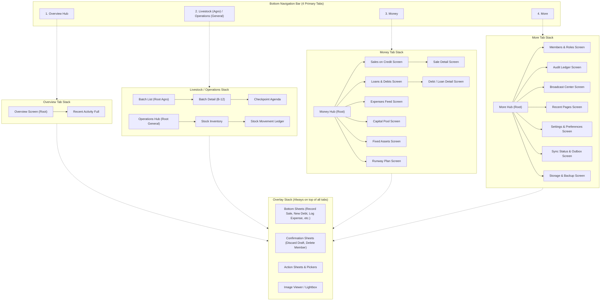

# 02 — Navigation Architecture

Replaces:
- Single `activeTab` / `tabHistory` state in `App.tsx:85-105`
- Brittle DOM-querying back handler in `App.tsx:365-430`
- Global horizontal swipe handler in `App.tsx:463-526` (which caused unrequested pages to appear)
- Floating pill navbar `FloatingNavbar.tsx`

---

## 1. Core Model: Multi-Stack Navigation with Overlay Layer

Modern mobile operating systems (Android Jetpack Navigation / iOS UIKit) use **multiple independent back-stacks**: one stack per bottom navigation tab, topped by an overlay stack for modal dialogs and bottom sheets.



---

## 2. Navigation Rules & Stack Preservation

1. **Tab Memory & State Preservation (Fixes B11)**:
   - Tabs remain mounted in the DOM (`display: none` when inactive) after their first visit.
   - User inputs, filter states, scroll offsets, and active tabs inside sub-views are never lost when switching tabs.
2. **Tab Re-Tap Behavior**:
   - Tapping an inactive tab switches to that tab and restores its current stack.
   - Re-tapping the *already active* tab pops its stack back to the root screen.
   - Tapping the root screen again smoothly scrolls to the top (`window.scrollTo({ top: 0, behavior: 'smooth' })`).
3. **Cross-Tab Deep Links**:
   - Tapping an Overview Hub row (e.g. *Sales on Credit*) switches to the **Money** tab and pushes `CreditSalesScreen` onto the Money stack.
   - Pressing the hardware back button pops `CreditSalesScreen` and returns to the Money root; pressing Back again switches back to the previous tab (Overview).

---

## 3. Persistent Recents System ("Stores the Opened Pages")

The user requested a navigation system that **stores opened pages** so operators can retrace their steps or jump back to recently viewed batches, sales, debts, or settings.

### 3.1 Recents Data Structure
```ts
export interface RecentPage {
  id: string;                      // Unique ID (e.g. 'saleDetail:CS-8812' or 'batch:B-12')
  routeId: RouteId;
  title: string;                   // Human readable: "Batch B-12 (Cobb 500 Broilers)"
  subtitle: string;                // Context: "Due in 3 days • $450.00 balance"
  icon: string;                    // Lucide icon identifier
  params: Record<string, string>;  // Route parameters for restoration
  timestamp: number;               // Epoch ms of last visit
  workspaceMode: 'AGRO_FARMING' | 'GENERAL_VENTURE' | 'BOTH';
  requiredPermission?: keyof typeof PERMISSIONS;
}
```

### 3.2 Storage & Recording Lifecycle
- Every time a pushed screen mounts (`useNavigationEffect`), `recentsManager.recordPage(...)` is called.
- Persisted to `@capacitor/preferences` (with `localStorage` fallback) under key `capita_recents_v1`.
- Capped at **8 recent unique pages**, LRU (Least Recently Used) eviction.
- Gating on load: Filtered against active workspace mode (`isAgroEnabled`) and user role permissions. If a referenced entity was deleted, it is automatically purged on next access.

### 3.3 UI Presentation
1. **Overview Quick Strip (`RecentChips.tsx`)**:
   - Rendered directly on the Overview screen below quick actions as a horizontal scrolling pill carousel:
   - `[🕒 Sale: John Doe ($250)] [🕒 Batch: Cobb Broilers] [🕒 Debt: National Foods] [See all ›]`
2. **More Tab Dedicated Screen (`RecentScreen.tsx`)**:
   - Full list with clear action `[Clear Recents]`. Each row shows timestamp ("10m ago", "Yesterday"), entity badge, and 1-tap navigation back to the screen.

---

## 4. Hardware Back Button, Gestures & Predictive Back (Fixes B10, B12)

### 4.1 Global Back Priority Stack
Back handling is governed by a single prioritized registry (`BackHandlerProvider`). Handlers register with a priority rank; the highest priority active handler executes:

| Priority | Event Condition | Action |
|---|---|---|
| **P1** | Virtual Keyboard is open (`--kb > 0`) | Dismiss keyboard only; keep sheet open. |
| **P2** | Image Lightbox / Picker open | Close overlay. |
| **P3** | Topmost Bottom Sheet open | If form is dirty, show Discard Confirmation Sheet; otherwise slide down sheet. |
| **P4** | Drawer open (Notification inbox) | Slide closed drawer. |
| **P5** | Current tab stack depth > 1 | Pop top screen with reverse slide transition. |
| **P6** | Current tab != Overview (`HOME`) | Switch to Overview tab; keep previous tab's stack. |
| **P7** | Root of Overview tab | Show toast: *"Press back again to exit"*. If pressed within 2.0s, call `CapacitorApp.exitApp()`. |

### 4.2 Browser & PWA `popstate` Alignment
- Every screen push and bottom sheet open executes `history.pushState({ stackId, depth }, '')`.
- Browser back button and Android gesture navigation seamlessly trigger the exact same back stack without DOM hacking (`querySelector('[role="dialog"]')` is completely removed).

### 4.3 Gesture Navigation Rules (Fixes B10)
- **Global Horizontal Swipe Across All Tabs**: **REMOVED ENTIRELY**. Accidental swipes were cycling through hidden/unrelated tabs (`POOL`, `AUDIT`, `USERS`, `SETTINGS`).
- **Edge Swipe (Left 24dp)**: Triggers Stack Pop with a smooth rightward slide animation (Android 14+ `OnBackInvokedCallback` predictive back support).
- **Segmented Control Swiping**: Swipe between `[Borrowed]` and `[Lent]` or `[Outstanding]` and `[Settled]` is preserved because the active indicator and tabs are clearly visible on screen.
- **Bottom Sheet Dismiss Swipe**: Dragging the sheet grab handle downwards past 25% height or velocity > 0.6 px/ms smoothly dismisses the sheet.

---

## 5. Tab Destinations & Workspace Mode Matrix

| Bottom Tab | Agro-Farming Mode (`isAgroEnabled: true`) | General Venture Mode (`isAgroEnabled: false`) |
|---|---|---|
| **1. Overview** | Balance card, quick action circles, biological livestock valuation row, hub rows, recents carousel. | Balance card, quick action circles, inventory valuation row, hub rows, recents carousel. (Livestock KPIs hidden). |
| **2. Operations** | **Livestock Hub**: Batch cards stream, quick-log buttons, batch detail sub-tabs (feed, weight, checkpoints, gallery, sales). | **Operations Hub (`OperationsHubScreen`)**: Cash & credit sales invoices, stock inventory in/out, supplier receiving, warehouse locations. |
| **3. Money** | Unified financial hub: Credit Sales, Loans & Debts, Expenses, Capital Pool, Fixed Assets, Runway Plan. | Same unified financial hub (Livestock feed expenses adapted to operational product expenses). |
| **4. More** | Members & roles, Audit trail, Broadcasts, Recents, Settings, Sync status, Storage & Backup. | Same. |

---

## 6. Typed Route Table & Screen Definitions

```ts
export type RouteId =
  // Tab Roots
  | 'overview'
  | 'livestock'
  | 'operations'
  | 'money'
  | 'more'
  // Agro Screens
  | 'batchDetail'
  | 'checkpointAgenda'
  | 'feedInventory'
  | 'siteCompare'
  // General Screens
  | 'stockInventory'
  | 'stockLedger'
  | 'generalSales'
  // Money Screens
  | 'creditSales'
  | 'saleDetail'
  | 'loansDebts'
  | 'loanDetail'
  | 'debtDetail'
  | 'expenses'
  | 'expenseDetail'
  | 'capitalPool'
  | 'fixedAssets'
  | 'runwayPlan'
  | 'financialBreakdown'
  // More Screens
  | 'members'
  | 'auditLedger'
  | 'broadcastCenter'
  | 'recentPages'
  | 'settings'
  | 'syncStatus'
  | 'storageManager'
  | 'helpOnboarding';

export interface RouteState {
  key: string;                       // Unique instance key
  routeId: RouteId;
  params: Record<string, string>;
  title: string;
  scrollTop?: number;
}
```

---

## 7. Migration & Files

- **New Files**:
  - `src/navigation/NavigationProvider.tsx`: Context holding tab stacks and overlay state.
  - `src/navigation/useNavigation.ts`: Typed hook (`navigate`, `pop`, `switchTab`, `openSheet`, `closeSheet`).
  - `src/navigation/useBackHandler.ts`: Clean stack-based back registration hook.
  - `src/navigation/recents.ts`: Recents manager with persistence and role gating.
  - `src/navigation/BottomNav.tsx`: 4-tab mobile navigation bar with active indicators and badging.
  - `src/navigation/ScreenHost.tsx`: Animated screen container with slide transitions.
  - `src/navigation/AppBar.tsx`: Standardized top app bar with site switcher, sync dot, and title.
- **Deletions**:
  - `src/components/FloatingNavbar.tsx` (superseded by `BottomNav.tsx`).
