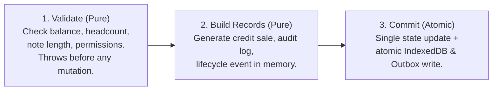

# 06 — Forms & Data Reliability ("Forms Send Nothing" Resolution)

Goal: When an operator taps "Save" on any form in CapitaSeed, they **always** receive one of three unambiguous, visible outcomes:
1. **Immediate Success Feedback**: Visual checkmark micro-interaction, haptic confirmation, bottom toast, and sheet slide-down dismissal.
2. **Immediate Inline Validation Feedback**: Auto-scroll to invalid input with red error border, explanatory error message, and sticky alert banner.
3. **Transparent Offline / Queued Feedback**: Sheet dismisses with a toast stating: *"Saved locally on device — queued to sync when connection restores"*, with the AppBar `SyncChip` displaying the pending count.
**Under no circumstance does the app fail silently or wipe user data.**

---

## 1. Cloud Rules ↔ Payload Contract Fixes (Fixes B1, B22, B23)

### 1.1 Correcting the `credit_sales` Rule
In `firestore.rules:197-202`, the rule requires `totalAmount > 0`, but the application writes `totalSaleAmount` and `totalSaleAmountUsd`. Because `totalAmount` is undefined, Firestore rejects every credit sale create with `permission-denied`.

**Rule Fix in `firestore.rules`**:
Accept both fields during migration to prevent breaking existing data:
```javascript
match /credit_sales/{id} {
  allow read: if isApprovedMemberOfOrg(resource.data.orgId);
  allow create: if isApprovedMemberOfOrg(request.resource.data.orgId)
                && isValidId(id)
                && (request.resource.data.get('totalSaleAmount', request.resource.data.get('totalAmount', 0)) > 0);
  allow update: if isApprovedMemberOfOrg(resource.data.orgId)
                && request.resource.data.orgId == resource.data.orgId;
  allow delete: if isOrgAdmin(resource.data.orgId);
}
```
Mirror this exact logic in `workflow-tests/helpers/rulesEngineSimulator.ts:478-486`.

### 1.2 Full Audit of Rules vs Code Payload Fields

| Collection | Rule Requirements | Code Writer Payload | Status | Action Required |
|---|---|---|---|---|
| `credit_sales` | `totalAmount > 0` | `totalSaleAmount`, `totalSaleAmountUsd` | ❌ **Mismatch** | Update rule to check `totalSaleAmount` (Fix B1). |
| `debt_liabilities` | `isTreasurerOfOrg` && `principalAmount > 0` | `principalAmount` (`dataService:3505`) | ⚠️ **Role Risk** | Enforce Treasurer role check in UI before opening form (Fix B22). |
| `loans_given` | `isTreasurerOfOrg` && `principalAmount > 0` | `principalAmount` (`dataService:3425`) | ⚠️ **Role Risk** | Enforce Treasurer role check in UI before opening form (Fix B22). |
| `capital_contributions` | `isTreasurerOfOrg` && `hasMandatoryAuditFields()` | `amount`, `note`, `auditHash` | ⚠️ **Role Risk** | Enforce Treasurer role check in UI; enforce `note.length >= 4` (Fix B23). |
| `expense_ledger` | `hasMandatoryAuditFields()` | `amount`, `note`, `auditHash` | ✅ Match | Enforce `note.length >= 4` client-side. |
| `fixed_assets_ledger` | `hasMandatoryAuditFields()` | `initialCost`, `note`, `auditHash` | ✅ Match | Enforce `note.length >= 4` client-side. |
| `livestock_lifecycle_events` | `hasMandatoryAuditFields()` | `headcountDelta`, `note`, `auditHash` | ✅ Match | Enforce `note.length >= 4` client-side. |
| `feed_ledger` | `hasMandatoryAuditFields()` | `quantityKg`, `note`, `auditHash` | ✅ Match | Enforce `note.length >= 4` client-side. |
| `audit_notifications` | `previousHash`, `currentHash`, `timestamp`, `message` | `createChainedAuditEvent` | ✅ Match | Audited and verified. |

### 1.3 Mandatory Contract Test (Suite 10)
A new automated contract test (`workflow-tests/10-rules-payload-contract.test.ts`) intercepts every payload produced by `dataService` methods and asserts that `rulesEngineSimulator.verifyCreate(collection, payload, role)` returns `ALLOWED = true`. If any payload fails, the build breaks immediately.

---

## 2. Preventing Cloud Sync Wipeouts: The Outbox Reconciler (Fixes B2, B20)

### 2.1 The Root Cause of Disappearing Data (B20)
In `dataService.ts:2171-2220` (`syncWithCloudServer`) and `dataService.ts:2097-2101` (`attachCloudListeners`):
```ts
// Existing broken code in syncWithCloudServer:
if (colPath === 'credit_sales') {
  this.state.creditSales = docs as CreditSaleEvent[]; // WIPES LOCAL ARRAY!
}
```
When an offline or permission-denied local write occurred, it existed in local memory. When cloud sync ran, Firestore returned the server's list of docs (which did not contain the pending local item). The code executed an unconditioned assignment, permanently erasing the user's local item. To the user, the record vanished into thin air.

### 2.2 The Outbox Pattern (`src/services/outbox.ts`)
Instead of fire-and-forget `void persistDocumentToCloudIfActive(...)`, all cloud writes route through an atomic local outbox stored in IndexedDB:

```ts
export interface OutboxItem {
  id: string;                      // Unique mutation ID (UUID v4)
  collectionPath: string;          // e.g. 'credit_sales'
  docId: string;                   // Document ID (e.g. 'CS-8812')
  data: Record<string, any>;       // Exact document payload
  status: 'PENDING' | 'SYNCING' | 'FAILED' | 'COMMITTED';
  attempts: number;
  lastError?: string;
  errorCode?: string;              // 'permission-denied' | 'unavailable' | 'unknown'
  createdAt: string;
  nextRetryAt: number;
}
```

### 2.3 Snapshot Reconciliation Algorithm
When `syncWithCloudServer` or `attachCloudListeners` receives a snapshot from Firestore, it reconciles with the local outbox:

```ts
// Reconciliation Invariant: Never overwrite pending local writes with cloud snapshots!
export function reconcileCloudSnapshot<T extends { id: string }>(
  cloudDocs: T[],
  localCollection: T[],
  pendingOutboxItems: OutboxItem[],
  collectionName: string
): T[] {
  const pendingDocIds = new Set(
    pendingOutboxItems
      .filter((item) => item.collectionPath === collectionName && item.status !== 'COMMITTED')
      .map((item) => item.docId)
  );

  // Preserve local items that are currently pending sync in the outbox
  const protectedLocalItems = localCollection.filter((item) => pendingDocIds.has(item.id));

  // Merge: Start with cloud docs, update or append pending local items
  const mergedMap = new Map<string, T>();
  for (const doc of cloudDocs) {
    mergedMap.set(doc.id, doc);
  }
  for (const localItem of protectedLocalItems) {
    mergedMap.set(localItem.id, localItem); // Pending local edits take precedence
  }

  return Array.from(mergedMap.values());
}
```

### 2.4 Error Classification & Retry Policy
- **Network Flaky / Offline (`unavailable`)**: Backoff retry: 2s → 5s → 15s → 60s → 5min. Automatically triggers on `networkStatus.online === true`.
- **Permission Denied (`permission-denied`)**: Marked as `FAILED`. **Never retried silently in a loop.** Surfaced immediately in the AppBar `SyncChip` as a warning badge (`⚠ 1 Sync Issue`). Tapping opens `SyncStatusScreen`, which explains the exact error (e.g. *"Only Treasurers can create Debt Liabilities"*) with options to copy error log or discard.

---

## 3. Atomic Multi-Step Transactions (Fixes B4, B17)

### 3.1 Headcount & Credit Sale Race Condition (B4)
In `dataService.ts:3820-3835`:
```ts
// Existing broken sequence:
this.logLivestockLifecycleEvent(...); // Reduces headcount immediately!
// If subsequent code throws (e.g. invalid date or storage quota):
this.state.creditSales.push(newSale); // NEVER REACHED!
```
Result: The herd headcount was reduced, but no credit sale or revenue was recorded.

### 3.2 Pure `Validate → Build → Commit` Architecture
Every multi-record operation is refactored into three strictly isolated phases:



1. **Step 1: Pure Validation**:
   - Verify active member role has permission.
   - Verify batch headcount ≥ quantity sold.
   - Verify deposit ≤ total sale amount.
   - Verify note length ≥ 4.
   - If any check fails, throw a typed error. Zero state is modified.
2. **Step 2: In-Memory Construction**:
   - Construct `CreditSaleEvent`.
   - Construct `LivestockLifecycleEvent` with link `creditSaleId`.
   - Construct `AuditNotification` with chained hash.
3. **Step 3: Atomic State Commit**:
   - Update in-memory state arrays together.
   - Persist to IndexedDB in a single transaction.
   - Enqueue all 3 records into the outbox together.

---

## 4. Storage Engine: Migrating from LocalStorage to IndexedDB (Fixes B3)

### 4.1 Why LocalStorage Fails
- `localStorage` has a rigid ~5 MB synchronous quota per origin.
- Storing base64 receipts and camera photos quickly exceeds this limit, triggering `QuotaExceededError`.
- In `dataService.ts:544`, this error was swallowed with `console.warn`, resulting in **silent data loss**.

### 4.2 IndexedDB Storage Pipeline (`src/services/storage.ts`)
- Implemented via a lightweight promise wrapper over native IndexedDB (or `idb-keyval`).
- Supports hundreds of megabytes of structured data asynchronously without blocking the UI main thread.
- **Loud Failure**: If IndexedDB fails to write, an error toast is displayed immediately and an error banner appears on screen; it is never silently swallowed.
- **Automatic Migration**:
  - On app launch, checks if legacy `localStorage.getItem(STORAGE_KEY)` exists.
  - If found, migrates records into IndexedDB, verifies the write succeeded, and cleans up legacy storage.
- Storage Screen (`StorageManagerScreen.tsx`): Displays exact disk space used by database and photos with an "Export Backup JSON" share option.

---

## 5. Unified Form Engine: `useForm` & `<FormSheet>` (Fixes B5, B6, B23)

### 5.1 Architecture of `useForm` Hook (`src/hooks/useForm.ts`)
```ts
export function useForm<T extends Record<string, any>>(options: {
  initial: T;
  draftKey?: string;                     // Persists in sessionStorage for 15 min
  validate: (values: T) => Partial<Record<keyof T, string>>;
  crossValidate?: (values: T) => Partial<Record<keyof T, string>>;
  onSubmit: (values: T) => Promise<void>;
  successMessage?: string;
}) {
  // Returns: { values, errors, isSubmitting, isDirty, stickyError, handleChange, handleSubmit, reset }
}
```

### 5.2 Key Features
1. **Sticky Error Banner**:
   - Pinned at `top: 0` inside the scroll container.
   - Displays clear summary message when submission is blocked.
2. **Auto-Scroll to Error**:
   - Automatically scrolls the body container to the first field containing an error and focuses the `<input>` element.
3. **Double-Submit Prevention**:
   - Client-generated UUID idempotency key generated when the form opens.
   - Submit button is disabled and displays an inline spinner while `isSubmitting` is true.
4. **Draft Recovery**:
   - In-progress inputs are automatically cached in `sessionStorage` under `draftKey`.
   - If an operator accidentally swipes or receives a phone call, reopening the sheet restores their form draft.
   - On successful submit, draft is purged.
5. **Mandatory Note Length Enforcement**:
   - Universal validation helper `minAuditNote(4)` guarantees all audit notes meet Firestore rule requirements (`note.length >= 4`) before submission.

---

## 6. Pre-Submission Role Gating in UI (Fixes B22)

To prevent users from seeing permission-denied errors after taking the time to fill out forms:
- Action buttons and Floating Action Buttons (FABs) check permissions before rendering:
  ```tsx
  // Example: In LoansDebtsScreen
  const canCreate = PERMISSIONS.canRecordDebt(activeMember.role);

  return (
    <div>
      {canCreate ? (
        <Fab icon={Plus} label="New Debt" onClick={() => openSheet('newDebt')} />
      ) : (
        <RoleInfoBanner message="Only organization Treasurers and Admins can record external debt liabilities." />
      )}
    </div>
  );
  ```
- Any unauthorized direct deep link automatically redirects with an explanatory toast: *"Access restricted: Treasurer role required."*
