# 07 — Files, Roadmap, Test Suites & Acceptance Criteria

This document provides the exhaustive blueprint of all files to create, modify, and delete, the phased delivery roadmap, automated test specifications, and acceptance sign-off criteria.

---

## 1. Exhaustive Inventory of Files to CREATE

```
src/
├── design/
│   ├── tokens.css                       # Semantic CSS custom properties (colors, radii, spacing, touch targets)
│   └── animations.css                   # Keyframe animations (slide-in-from-bottom, enter/exit curves, shake)
│
├── native/
│   ├── haptics.ts                       # Hardware tactile feedback (tick, click, success, error) with user toggle
│   ├── keyboard.ts                      # IME virtual keyboard listener & inset injector
│   ├── statusBar.ts                     # Edge-to-edge transparent system bars & light/dark icon styling
│   ├── share.ts                         # System Share Sheet for PDF/Image receipts and credit statements
│   ├── clipboard.ts                     # Native clipboard copy with toast feedback
│   ├── camera.ts                        # Camera hardware intent & gallery picker with compression
│   ├── files.ts                         # App-private binary storage for photos (replaces localStorage base64)
│   ├── network.ts                       # Connectivity status listener driving SyncChip
│   ├── reminders.ts                     # AlarmManager scheduled notifications (due dates, checkpoints)
│   ├── appLauncher.ts                   # Phone dialer & WhatsApp direct launch intents
│   └── biometrics.ts                    # BiometricPrompt & auto-lock challenge engine
│
├── navigation/
│   ├── NavigationProvider.tsx           # Context managing independent tab stacks and overlay stack
│   ├── routes.ts                        # Typed route registry and screen metadata
│   ├── useNavigation.ts                 # Navigation hook (navigate, pop, switchTab, openSheet, closeSheet)
│   ├── useBackHandler.ts                # Prioritized back stack registration hook
│   ├── recents.ts                       # Recents manager (persisting opened pages with LRU eviction)
│   ├── ScreenHost.tsx                   # Animated screen transition host with slide transitions
│   ├── TabHost.tsx                      # Bottom tab container maintaining state memory (Fix B11)
│   ├── AppBar.tsx                       # Standardized mobile app bar with site chip, sync pill, and icons
│   └── BottomNav.tsx                    # 4-tab mobile banking navigation bar (replaces FloatingNavbar)
│
├── hooks/
│   ├── useKeyboardInset.ts              # Injects --kb variable from native keyboard and visualViewport
│   ├── useForm.ts                       # Universal form engine (validation, sticky error, saving state, idempotency)
│   ├── useFormDraft.ts                  # In-progress form draft persistence in sessionStorage
│   ├── useSyncStatus.ts                 # Reactive hook tracking outbox state (synced, pending, failed)
│   └── usePullToRefresh.ts              # Touch gesture pull-down hook triggering cloud synchronization
│
├── services/
│   ├── outbox.ts                        # Local mutation queue with backoff retry and snapshot reconciliation
│   └── storage.ts                       # IndexedDB persistence layer replacing localStorage
│
├── utils/
│   ├── validation.ts                    # Pure TypeScript validation schemas (minAuditNote, currency, positiveInt)
│   ├── errors.ts                        # Human-friendly error translation engine
│   └── currency.ts                      # Configurable organization currency formatter
│
├── components/ui/
│   ├── BottomSheet.tsx                  # Base bottom sheet shell (grab handle, max 88dvh, backdrop scrim)
│   ├── FormSheet.tsx                    # Specialized form wrapper with sticky error banner & actions footer
│   ├── ConfirmSheet.tsx                 # Destructive & confirmation sheet (replaces window.confirm)
│   ├── PickerSheet.tsx                  # Searchable selection sheet (sites, batches, customers, SKUs)
│   ├── DatePickerSheet.tsx              # Quick chips (+7d, +14d, +30d, End of Month) + calendar picker
│   ├── ActionSheet.tsx                  # Row action menu (Call, WhatsApp, Share, Record Payment)
│   ├── ImageViewerSheet.tsx             # Fullscreen pinch-to-zoom photo viewer
│   ├── Toast.tsx                        # Toast component and ToastProvider for bottom snackbars
│   ├── ListRow.tsx                      # Banking-style row: Leading Icon + Title/Subtitle + Preview + Chevron
│   ├── BalanceCard.tsx                  # Top overview card with adjusted NAV, metrics strip, and CountUp
│   ├── QuickActions.tsx                 # Circular quick action buttons strip (56dp)
│   ├── SegmentedControl.tsx             # Swipeable segment tab bar with sliding indicator
│   ├── Chip.tsx                         # Filter chip component with neutral muted zero-state styling
│   ├── Fab.tsx                          # Floating Action Button pinned bottom-right
│   ├── Skeleton.tsx                     # Shimmer skeleton loader for list snapshots
│   ├── EmptyState.tsx                   # Illustrated empty state container with primary CTA
│   ├── Field.tsx                        # Form input wrapper with label, error text, and accessibility aria tags
│   ├── MoneyInput.tsx                   # Currency-formatted input with decimal keypad support
│   ├── SyncChip.tsx                     # Real-time sync and connectivity status pill for AppBar
│   └── PermissionSheet.tsx              # Educational rationale sheet before native permission prompts
│
├── screens/
│   ├── overview/
│   │   ├── OverviewScreen.tsx           # Mobile banking layout (Balance card, Quick actions, Hub rows)
│   │   ├── RecentActivity.tsx           # Recent transactions and event feed
│   │   ├── RecentChips.tsx              # Horizontal carousel of recently opened pages
│   │   └── HubList.tsx                  # Sectioned rows with icon · title · preview columns
│   │
│   ├── credit/
│   │   ├── CreditSalesScreen.tsx        # Pushed credit sales list with compact summary and filter chips
│   │   ├── SaleDetailScreen.tsx         # Customer details, payment timeline, extension history, share CTA
│   │   └── SaleCard.tsx                 # Compact credit sale card with progress bar and relative due date
│   │
│   ├── loans/
│   │   ├── LoansDebtsScreen.tsx         # Pushed loans & debts screen with Borrowed ⇄ Lent segment
│   │   ├── DebtDetailScreen.tsx         # Creditor details, repayment ledger, Spend Gate integration
│   │   └── LoanDetailScreen.tsx         # Borrower details, recovery timeline, collateral info
│   │
│   ├── livestock/                       # Agro-Farming Mode Screens
│   │   ├── BatchListScreen.tsx          # Compact batch cards stream with quick-log action rows
│   │   ├── BatchDetailScreen.tsx        # Multi-tab batch detail (Overview, Checkpoints, Feed, Weights, Sales)
│   │   ├── CheckpointAgendaScreen.tsx   # Cross-batch timeline of upcoming health milestones
│   │   ├── FeedInventoryScreen.tsx      # Feed inventory on hand, burn rate, stock-out projection
│   │   └── SiteCompareScreen.tsx        # Side-by-side performance analytics across locations
│   │
│   ├── operations/                      # General Venture Mode Screens
│   │   ├── OperationsHubScreen.tsx      # General Venture Operations Hub (Sales, Stock, Warehouses)
│   │   ├── StockInventoryScreen.tsx     # Current inventory items, SKU catalog, reorder levels
│   │   └── StockMovementLedger.tsx      # Stock in/out movement history and shrinkage audit trail
│   │
│   ├── money/
│   │   ├── MoneyScreen.tsx              # Consolidated financial navigation root
│   │   └── FinancialSummaryScreen.tsx   # 9 Pillars of Organization Wealth breakdown
│   │
│   ├── more/
│   │   ├── MoreScreen.tsx               # System menu and management hub
│   │   ├── RecentScreen.tsx             # Full list of opened pages with deep navigation links
│   │   ├── MembersScreen.tsx            # Team directory, roles, and invitation code
│   │   ├── AuditLedgerScreen.tsx        # Cryptographic hash-chained audit log
│   │   └── BroadcastsScreen.tsx         # Operational announcements and notifications
│   │
│   └── system/
│       ├── SyncStatusScreen.tsx         # Outbox inspect, force sync, retry failed mutations
│       ├── StorageManagerScreen.tsx     # Storage usage breakdown and JSON backup export
│       ├── NotificationPrefsScreen.tsx  # Reminder alerts preferences per category
│       └── CurrencyLocaleScreen.tsx     # Organization currency symbol and formatting
│
└── sheets/                              # Bottom Sheets for All User Forms
    ├── credit/
    │   ├── RecordCreditSaleSheet.tsx    # 2-step sale form with live computation strip
    │   ├── RecordPaymentSheet.tsx       # Customer installment payment with "Pay in Full" chip
    │   └── ExtendDueDateSheet.tsx       # Settlement date extension with reason note
    │
    ├── loans/
    │   ├── NewDebtSheet.tsx             # Borrowed liability creation (Treasurer gated)
    │   ├── RepayDebtSheet.tsx           # Debt repayment through Runway Spend Gate
    │   ├── NewLoanSheet.tsx             # Loan advance to third party with cash guard
    │   ├── RecoverLoanSheet.tsx         # Inward loan recovery payment
    │   └── SpendGateSheet.tsx           # Budget line allocation or contingency reserve draw
    │
    ├── expenses/
    │   ├── LogExpenseSheet.tsx          # Expense logging with photo, GPS, and runway allocation
    │   └── ContraExpenseSheet.tsx       # Ledger reversal with mandatory explanation note
    │
    ├── assets/
    │   ├── AssetSheet.tsx               # Fixed asset purchase with mandatory pool deduction check
    │   ├── AdjustAssetSheet.tsx         # Asset revaluation or impairment adjustment
    │   └── TransferAssetSheet.tsx       # Location transfer between farm sites
    │
    ├── pool/
    │   ├── AddMemberSheet.tsx           # New member onboarding
    │   ├── ContributionSheet.tsx        # Capital contribution logging
    │   └── TargetFundraisingSheet.tsx   # Capital target and deadline configuration
    │
    ├── livestock/
    │   ├── RegisterBatchSheet.tsx       # Freely editable species, target duration, initial cost
    │   ├── FeedEventSheet.tsx           # Quick feed logging (kg, ration, photo)
    │   ├── LogLivestockActionSheet.tsx  # Mortality, weigh-in, harvest, health actions
    │   ├── CheckpointSheet.tsx          # Milestone checkpoint with auto-date calculation
    │   ├── HeadcountContraSheet.tsx     # Headcount adjustment with high-contrast warning
    │   └── LivestockValuationSheet.tsx  # Configurable selling price per kg/head
    │
    ├── general/
    │   ├── RecordGeneralSaleSheet.tsx   # Cash or credit sale of general products
    │   ├── StockInSheet.tsx             # Receiving inventory shipments from suppliers
    │   └── StockOutSheet.tsx            # Inventory usage, internal consumption, or shrinkage
    │
    └── common/
        ├── BroadcastSheet.tsx           # Message composer with priority tag and photo
        ├── SiteSheet.tsx                # Farm/site creation and GPS coordinates
        ├── MemberRoleSheet.tsx          # Role change dialog (Admin, Treasurer, etc.)
        └── InviteCodeSheet.tsx          # 1-click copy and WhatsApp share for organization code
```

---

## 2. Inventory of Files to MODIFY

| File | Exact Modifications Required |
|---|---|
| `src/App.tsx` | Strip out legacy `activeTab`, `tabHistory`, global swipe listener, DOM `querySelector` back hack, and global `focusin` scroll. Wrap app root with `NavigationProvider`, `ToastProvider`, and `KeyboardInsetHost`. Render `TabHost` and `BottomNav`. |
| `src/index.css` | Delete `.text-white { color: #0F172A !important }` and slate overrides (Fix B8). Import `tokens.css` and `animations.css`. Replace `100vh` and `min-h-screen` with `100dvh`. |
| `index.html` | Remove `interactive-widget=resizes-content` from viewport meta. Set `theme-color` to `#FAF8F5`. Configure viewport: `width=device-width, initial-scale=1.0, maximum-scale=5.0, viewport-fit=cover`. |
| `capacitor.config.json` | Set `Keyboard.resize = "none"`, configure `StatusBar.style = "LIGHT"`, configure `SplashScreen` launch show/hide duration. |
| `android/app/src/main/AndroidManifest.xml` | Set `android:enableOnBackInvokedCallback="true"`. Add `<queries>` for WhatsApp (`com.whatsapp`) and dialer (`android.intent.action.DIAL`). Configure app shortcuts metadata. |
| `package.json` | Install missing Capacitor plugins (`@capacitor/keyboard`, `@capacitor/status-bar`, `@capacitor/haptics`, `@capacitor/splash-screen`, `@capacitor/share`, `@capacitor/clipboard`, `@capacitor/camera`, `@capacitor/filesystem`, `@capacitor/preferences`, `@capacitor/network`, `@capacitor/geolocation`, `@capacitor/app-launcher`, `@capacitor/browser`, `@capacitor/screen-orientation`). |
| `firestore.rules` | Update `credit_sales` create rule to accept `totalSaleAmount` and legacy `totalAmount` (Fix B1). Audit note length and treasurer restrictions. |
| `workflow-tests/helpers/rulesEngineSimulator.ts` | Mirror the `credit_sales` field fix (Fix B1). Ensure 100% parity with `firestore.rules`. |
| `workflow-tests/run-all-workflow-tests.ts` | Register new automated test suites 10, 11, 12, 13. |
| `src/services/dataService.ts` | Integrate `Outbox` for all cloud persistence; implement `reconcileCloudSnapshot` to prevent sync wipeouts (Fix B20); refactor `recordCreditSale`, `repayDebtLiability`, and `recordLoanGiven` into pure `Validate → Build → Commit` atomic transactions (Fix B4); migrate storage from `localStorage` to IndexedDB (Fix B3). |
| `src/utils/permissions.ts` | Add UI-level mirror methods for Firestore rules (`canRecordDebt`, `canIssueLoan`, `canLogContribution`). |
| `src/utils/mobileHardware.ts` | Delegate haptics and notifications to `native/haptics.ts` and `native/reminders.ts`. |
| `src/components/HomeTab.tsx` | Refactor into `OverviewScreen` composition; remove hard-coded "15:00 Live", "+100% Equity Pool", and static "On Track" labels (Fix B14). |
| `src/components/BankingHubGrid.tsx` | Rename and re-skin into `HubList.tsx` using `ListRow` components. |
| `src/components/Header.tsx` | Upgrade to `AppBar.tsx` with real-time `SyncChip`, site switcher, privacy toggle, and notifications bell. |
| `src/components/LivestockTab.tsx` | Split 134 KB monolith into `BatchListScreen`, `BatchDetailScreen`, and modular livestock sheets. |
| `ExpensesFeedTab.tsx`, `AssetsTab.tsx`, `PoolEquityTab.tsx`, `UserManagementTab.tsx`, `UserSettingsTab.tsx`, `SiteManagerModal.tsx`, `RecipeBuilderModal.tsx` | Migrate internal modals to corresponding `<BottomSheet>` components; eliminate all `alert()` and `confirm()` calls (Fix B16). |
| `src/components/runway/*` | Re-skin `SpendGateDialog`, `AmendmentSheet`, `PayInPanel`, `PledgePanel` onto `BottomSheet`; update `useRunway.ts` to replace `payload: any` with typed union (Fix B17). |

---

## 3. Files to DELETE (After Parity & Verification)

- `src/components/FloatingNavbar.tsx` (superseded by `BottomNav.tsx`)
- `src/components/CreditSalesModal.tsx` (superseded by `CreditSalesScreen.tsx` and credit sheets)
- `src/components/LoansDebtsModal.tsx` (superseded by `LoansDebtsScreen.tsx` and loan sheets)
- Legacy modal CSS utility classes in `index.css` (`modal-overlay-responsive`, `modal-dialog-responsive`)

---

## 4. Phased Implementation Roadmap

```mermaid
gantt
    title CapitaSeed UI/UX & Android Native Roadmap
    dateFormat  X
    axisFormat  Day %d
    section Phase 0: Emergency Fixes
    Rules fix (B1) & Outbox Reconciler (B20) :active, p0, 0, 1
    Animation keyframes (B9) & Disable global swipe (B10) :p0b, 0, 1
    Install Capacitor plugins :p0c, 0, 1
    section Phase 1: Design System & Core
    Tokens, BottomSheet, FormSheet, useForm :p1, 1, 3
    Keyboard engine & Inset hook :p1b, 2, 4
    Native wrappers (haptics, files, storage) :p1c, 2, 4
    section Phase 2: Navigation Engine
    NavigationProvider, Stacks, Recents, BottomNav :p2, 4, 7
    Shrink App.tsx & Hardware Back registry :p2b, 5, 8
    section Phase 3: Money Hub & Overview
    Overview mobile banking redesign (HubList) :p3, 8, 11
    Credit Sales Screen & Sheets (No "0 Active") :p3b, 8, 12
    Loans & Debts Screen & Sheets (Spend Gate) :p3c, 9, 13
    section Phase 4: Remaining Form Migration
    Expenses, Assets, Pool, Team, Sites to Sheets :p4, 13, 17
    Eliminate all alert() & confirm() :p4b, 15, 18
    section Phase 5: Agro & General Depth
    Livestock monolith split to BatchDetailScreen :p5, 18, 22
    General OperationsHubScreen & Stock Ledger :p5b, 19, 23
    section Phase 6: Native Depth
    Scheduled due date reminders (AlarmManager) :p6, 23, 26
    Camera pipeline, Share sheet, App lock :p6b, 24, 27
    section Phase 7: Polish & QA Matrix
    Accessibility 48dp, Font scale 1.3x, Viewports :p7, 27, 30
    Test Suites 10-13 Sign-off :p7b, 28, 30
```



---

## 5. Automated Test Suites Specification (`workflow-tests/`)

### Suite 10 — Cloud Rules ↔ Payload Contract Test (`10-rules-payload-contract.test.ts`)
- Intercepts all mutation payloads produced by `dataService`:
  - `recordCreditSale`, `recordCreditSalePayment`, `extendCreditSaleDueDate`
  - `recordDebtLiability`, `repayDebtLiability`
  - `recordLoanGiven`, `recoverLoanGiven`
  - `logExpense`, `logFixedAssetEvent`, `logFeedConsumption`, `addCapitalContribution`
  - `registerLivestock`, `logLivestockLifecycleEvent`
- Evaluates each payload against `rulesEngineSimulator.verifyCreate(collection, payload, role)` across all 6 roles (`ORG_ADMIN`, `TREASURER`, `ACCOUNTANT`, `AUDITOR`, `MEMBER`, `GROUND_OPERATOR`).
- **Assertion**: Asserts allowed roles succeed and unauthorized roles are denied. Proves B1 and B22 are permanently eliminated.

### Suite 11 — Atomic Multi-Step Writes & Outbox Reconciler Test (`11-atomic-writes-and-outbox.test.ts`)
- **Rollback Test**: Forces a mid-transaction throw during `recordCreditSale`. Asserts livestock headcount, credit sales array, and audit log remain 100% unaltered.
- **Snapshot Wipeout Prevention Test**: Populates the local outbox with a pending credit sale (`status: 'PENDING'`). Simulates `syncWithCloudServer` receiving a cloud snapshot that omits the document. Asserts that `reconcileCloudSnapshot` preserves the local item and does not drop it (Proves B20 is eliminated).
- **Storage Quota Resilience**: Mocks storage quota limits; asserts that failure triggers a visible error state without swallowing data.

### Suite 12 — UI Bottom Sheets, Keyboard & Inline Error Test (`12-ui-forms-and-sheets.test.tsx`)
- Headless React Testing Library tests for each sheet:
  - Opens sheet; asserts initial focus and ARIA attributes (`role="dialog"`, `aria-modal="true"`).
  - Simulates submit with empty required fields; asserts **sticky error banner is in the document** and the first invalid field receives focus.
  - Simulates keyboard opening (`--kb: 284px`); asserts sheet container updates bottom offset and action buttons remain visible.
  - Submits valid form; asserts `dataService` method is called with expected parameters, sheet dismisses, and toast renders.
  - Asserts pressing Back while form is dirty opens `ConfirmSheet` (*"Discard in-progress changes?"*).

### Suite 13 — Navigation Back-Stack, Recents & Viewport Matrix Test (`13-navigation-and-viewport.test.tsx`)
- **Tab Memory**: Navigates from Overview → Livestock (types draft in form) → switches to Money → switches back to Livestock. Asserts form draft and scroll position are intact.
- **Recents Recording**: Visits `CreditSalesScreen`, `BatchDetailScreen`, `DebtDetailScreen`. Asserts `recentsManager.getRecents()` contains all 3 entries with correct metadata.
- **Back Hierarchy**: Asserts back order: Keyboard → Overlay Sheet → Pushed Screen → Switch to Overview → Double-back to exit.
- **Swipe Guard**: Asserts horizontal touch swipes do NOT navigate to unexpected tabs.
- **Viewport Matrix (320×568, 360×640, 412×915)**:
  - Asserts no horizontal window scrolling (`scrollWidth <= clientWidth`).
  - Asserts sheet max height ≤ 88dvh.
  - Asserts touch targets are ≥ 48×48px.
  - Asserts "0 Active" renders cleanly with no text truncation or title wrapping.

---

## 6. Exhaustive Acceptance Criteria

Every requirement from the user's prompt is guaranteed by the following verifiable criteria:

1. **Sales on Credit Page ("0 Active" & Form Sizing)**:
   - On a 320px-wide screen, the credit sales header displays clean title text with no nested count badge.
   - Filter chips display `Outstanding (0)` in neutral muted gray with zero awkward wrapping.
   - The *Record Credit Sale* form opens as a bottom sheet with a 280ms bottom-up slide animation.
   - The sheet height never exceeds 88% of viewport height (leaves status bar visible).
   - The form is fully responsive to the Android soft keyboard: action buttons stay pinned above the keyboard keys, and numeric keypad pops on price and deposit inputs.
2. **Loans, Debts & Liabilities Hub**:
   - The same bottom sheet architecture, bottom-up animation, keyboard responsiveness, and compact neutral badges apply to all loan and debt forms (`NewDebtSheet`, `RepayDebtSheet`, `NewLoanSheet`, `RecoverLoanSheet`).
   - Spend Gate allocation routes seamlessly through `SpendGateSheet`.
3. **Routing & Opened Pages Navigation System**:
   - Navigation uses independent back stacks per tab. Tabs never lose state or scroll on switch.
   - The system records recently opened pages (`RecentPage`), accessible via a horizontal strip on the Overview screen and a dedicated list in More.
   - Accidental horizontal swiping right and left across the screen is completely disabled from switching unrelated tabs.
   - Hardware back button and Android 14+ predictive back pop sheets and screens in strict priority order.
4. **All Forms as Bottom Sheets**:
   - Every single modal and in-page form across the entire application (inventory of 28+ sheets in doc 04 §4) operates as a bottom sheet with bottom-up animation.
   - Zero full-page modals, zero `alert()` or `confirm()` dialogs remain.
5. **Mobile Banking Overview Redesign**:
   - Overview screen features a Consolidated Balance Card with Adjusted Net Worth, CountUp animations, and privacy number masking (`••••••`).
   - 4 circular quick action buttons (56dp) for primary operations.
   - Content organized in clean section rows using the `ListRow` component (Leading Icon Tile + Title/Subtitle + Trailing Preview Amount + Chevron).
   - Zero fake mock labels ("15:00 Live", static "+100%", static "On Track" are eliminated).
6. **Forms Reliability ("Forms Send Nothing" Elimination)**:
   - `firestore.rules` accepts `totalSaleAmount`, eliminating the cloud permission-denied bug.
   - The Outbox Reconciler guarantees cloud synchronization never wipes out pending local records.
   - Form validation errors are pinned sticky at the top of the body and inline beneath fields, eliminating off-screen invisible errors.
   - Every form submission provides immediate visible feedback (toast, haptic, and spinner).
7. **Android Native Capabilities**:
   - `@capacitor/keyboard`, `@capacitor/status-bar`, `@capacitor/haptics`, `@capacitor/splash-screen`, `@capacitor/share`, `@capacitor/clipboard`, `@capacitor/camera`, `@capacitor/filesystem`, `@capacitor/preferences`, `@capacitor/network`, `@capacitor/local-notifications` are fully installed, configured, and accessible via typed wrappers in `src/native/`.
   - Scheduled local reminders fire for upcoming credit due dates and livestock checkpoints.
8. **Agro and General Workspace Equality**:
   - Agro workspaces have dedicated `BatchDetailScreen` and quick-log rows.
   - General Venture workspaces have a dedicated, fully implemented `OperationsHubScreen` (Sales, Stock In/Out, Inventory Ledger, Warehouses). No dead tabs exist.
9. **Automated Test Coverage**:
   - All existing suites 01–09 pass without modification.
   - New suites 10, 11, 12, 13 pass with zero regressions.
