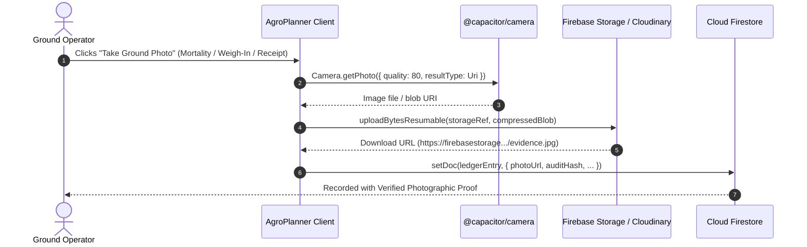

# AgroPlanner Enterprise: Complete Feature, Operations, Security & Image Upload Audit

This document provides an exhaustive technical and operational evaluation of **AgroPlanner**, covering all primary application pages: **Overview**, **Livestock**, **Expenses**, **Pool**, **Assets**, **Ledger**, **Roles**, and **Settings**.

It details the step-by-step procedure for every user operation, evaluates whether each security access level has the necessary permissions in **Cloud Firestore**, and provides a definitive audit of **image upload capabilities** across all field stages.

---

## 1. System Architecture & Access Level Matrix

AgroPlanner implements an append-only accounting and livestock telemetry model governed by cryptographic SHA-256 hash chains. The application defines four core operational roles plus a primary founder clearance:

| Role Name | Identifier | Primary Responsibilities | Data Privacy Boundary |
| :--- | :--- | :--- | :--- |
| **Primary Founder Admin** | `baseramarlvin@gmail.com` | Full master authority; member CRUD, data wipe, production ledger reset. | Unrestricted; unmasked PII. |
| **Syndicate Admin** | `SYNDICATE_ADMIN` | General system administration, member oversight, farm site creation, branding. | Full ledger access; unmasked PII. |
| **Syndicate Treasurer** | `TREASURER` | Dual-authorization multi-sig expense sign-off (> \$150), capital deposits, contra-reversals. | Full financial ledger access; masked PII. |
| **Remote Investor** | `REMOTE_INVESTOR` | Capital contributor; read-only real-time portfolio, dividend calculations, livestock telemetry. | Read-only; cannot see other investors' PII. |
| **Ground Operator** | `GROUND_OPERATOR` | Field station operator; daily feeding, weigh-ins, site receipts, and dispatches. | **Restricted from Capital Pool tab**; no financial NAV access. |

```mermaid
flowchart TD
    subgraph Users ["Syndicate Members & Roles"]
        FA["Primary Founder Admin\n(baseramarlvin@gmail.com)"]
        SA["Syndicate Admin\n(SYNDICATE_ADMIN)"]
        TR["Syndicate Treasurer\n(TREASURER)"]
        RI["Remote Investor\n(REMOTE_INVESTOR)"]
        GO["Ground Operator\n(GROUND_OPERATOR)"]
    end

    subgraph AppPages ["Application Modules / Tabs"]
        HOME["Overview (HomeTab)"]
        LIVE["Livestock (LivestockTab)"]
        EXP["Expenses (ExpensesFeedTab)"]
        POOL["Pool & Equity (PoolEquityTab)"]
        ASSET["Assets (AssetsTab)"]
        AUDIT["Ledger & Audit (AuditAlertsTab)"]
        ROLES["Roles & Users (UserManagementTab)"]
        SETT["Settings (UserSettingsTab)"]
    end

    FA --> ROLES
    FA --> POOL
    FA --> EXP
    FA --> LIVE
    FA --> ASSET
    FA --> AUDIT
    FA --> SETT
    FA --> HOME

    SA --> ROLES
    SA --> POOL
    SA --> EXP
    SA --> LIVE
    SA --> ASSET
    SA --> AUDIT
    SA --> SETT
    SA --> HOME

    TR --> POOL
    TR --> EXP
    TR --> LIVE
    TR --> ASSET
    TR --> AUDIT
    TR --> SETT
    TR --> HOME

    RI --> POOL
    RI --> EXP
    RI --> LIVE
    RI --> ASSET
    RI --> AUDIT
    RI --> SETT
    RI --> HOME

    GO --> LIVE
    GO --> EXP
    GO --> ASSET
    GO --> AUDIT
    GO --> SETT
    GO --> HOME
    GO -.->|BLOCKED / RESTRICTED| POOL
    GO -.->|BLOCKED / RESTRICTED| ROLES
```



---

## 2. Exhaustive Page-by-Page Feature & Step-by-Step Operations Guide

### Page 1: Overview (`HomeTab.tsx`)

#### Features & Indicators
* **Role-Tailored Hero Card**:
  * *Ground Operator*: Displays **Live Farm Inventory Headcount**, flock survival rate radial arc gauge, cumulative feed logged (kg), and assigned field station name.
  * *Executive/Investor*: Displays **"Left Money"** (Liquid Working Capital available in USD), capital reserve percentage arc gauge, and total fixed assets valuation.
* **Solora Dual KPI Strip**:
  * *Ground Operator*: Monitored active livestock batches count and cumulative feed consumed (kg).
  * *Investor/Executive*: Total syndicate capital pool contributed ($) and approved expenses deployed ($ and %).
* **Operations Frequency Scrubber**: Interactive timeline bar with time filters (`1H`, `6H`, `1D`, `1W`, `1M`, `ALL`) and a center indicator needle.
* **Active Livestock Sale Countdowns**: Dynamic countdown cards for each monitored batch/animal displaying age progress bars, days remaining, live headcounts, and urgency badges (`NORMAL`, `PREPARE_MARKET`, `READY_FOR_SALE`).
* **Multi-Location Syndicate Comparison**: Cross-site comparative breakdown showing active headcount, site expenses, fixed assets, and mortality percentage per farm plot.
* **Ground Broadcast Alerts**: Displays the latest field observation broadcast from ground operators.

#### Step-by-Step Operations
1. **Quick Module Navigation**:
   * *Step 1*: Click `+ Log Farm Expense` to jump directly into the expense ledger.
   * *Step 2*: Click `Weigh-In / Health` (or `Livestock Batches`) to navigate to livestock tracking.
   * *Step 3*: Click `Pool & Equity` (available to Admin, Treasurer, and Investor) to open capital accounting.
2. **Post Ground Broadcast Update**:
   * *Step 1*: Click `Post Ground Update` or `+ Ground Broadcast` to open the composer modal.
   * *Step 2*: Select **Location Scope** (`ALL` for syndicate-wide or a specific farm site).
   * *Step 3*: Select **Urgency Severity** (`Routine Status Update`, `Weigh-in / Growth Advisory`, `Urgent Ground Notice`, or `Critical Vet Alert`).
   * *Step 4*: Enter a descriptive **Title** (e.g., *"Weigh-in Day 41: Average weight 2.28kg"*).
   * *Step 5*: Enter the **Broadcast Message** (minimum 4 characters) documenting ground observations, temperature, or buyer arrival.
   * *Step 6*: Click `Broadcast to Syndicate`. This writes an immutable notification event into Cloud Firestore and appends an audit block.
3. **Filter Global View by Farm Site**:
   * *Step 1*: Scroll to the *Multi-Location Syndicate Comparison* section.
   * *Step 2*: Click `Filter View to This Site` on the target location card. The entire application session adjusts its scope to that site.
4. **Scrub Operations Frequency**:
   * *Step 1*: Click any frequency pill (`1H`, `6H`, `1D`, `1W`, `1M`, `ALL`) to toggle the operational window.
5. **Direct Livestock Event Launch**:
   * *Step 1*: On any active sale countdown card, click `Log Event`. This navigates to the Livestock module with the selected batch expanded.

---

### Page 2: Livestock (`LivestockTab.tsx` & `LivestockGrowthCharts.tsx`)

#### Features & Indicators
* **Herd & Flock Inventory Management**: Tracks poultry, cattle, goats, pigs, and sheep under either `BATCH` mode (broilers, layers) or `INDIVIDUAL_TAG` mode (ear-tagged breeder stock).
* **Automated Growth Computations**: Real-time calculation of current total age (days/weeks/months), target market readiness date, and progress percentage.
* **Recharts Growth Telemetry & Projections**: Expandable interactive SVG line charts comparing empirical flock weight curves against target breed standards.
* **Standard Operating Protocol (SOP) Milestones**: Interactive checklist for scheduled vaccinations, feed transitions, and biosecurity protocols.
* **Cryptographic Event History**: Expandable audit log per animal group detailing every lifecycle event with its sequence ID and SHA-256 seal.

#### Step-by-Step Operations
1. **Register New Animal / Livestock Batch**:
   * *Step 1*: Click `+ Register Batch / Animal` at the top of the Livestock tab.
   * *Step 2*: Select the **Farm Location** where the animals will be housed.
   * *Step 3*: Choose **Species** (presets: *Broilers*, *Boer Goats*, *Indigenous Goats*, *Cattle*, *Layers*, *Pigs*, or enter a *Custom Species*). Selecting a preset automatically autofills standard headcounts, durations, and weights.
   * *Step 4*: Enter **Batch Name / Ear-Tag** (e.g., *"Broiler Batch #05"* or *"Buck #ZW-44"*).
   * *Step 5*: Select **Tracking Mode** (`BATCH` or `INDIVIDUAL_TAG`).
   * *Step 6*: Enter **Initial Headcount** (e.g., `100`).
   * *Step 7*: Specify **Initial Age** and unit (`DAYS`, `WEEKS`, `MONTHS`, `YEARS`).
   * *Step 8*: Specify **Target Duration to Market** and unit (e.g., `42 DAYS`). The system dynamically calculates the `targetSaleDate`.
   * *Step 9*: Enter **Total Purchase Cost ($)** and **Target Sale Weight (kg)**.
   * *Step 10*: Toggle `Auto-deduct purchase from Left Money cash`. If enabled, an automated expense deduction entry is generated in the cash ledger.
   * *Step 11*: Enter mandatory notes and click `Register & Seal in Ledger`.
2. **Filter by Species**:
   * *Step 1*: Click any dynamic species pill (*All*, *Broilers*, *Boer Goats*, etc.) to filter the active flock list.
3. **Log Mortality / Loss Event**:
   * *Step 1*: Locate the livestock card and click `Log Mortality`.
   * *Step 2*: Input the number of dead animals (`headcountDelta` is recorded as a negative number).
   * *Step 3*: Enter a mandatory explanatory note (e.g., heat stress, post-mortem findings).
   * *Step 4*: Click `Commit Event`. Headcount is reduced, mortality percentage is recalculated, and an audit hash is appended.
4. **Log Birth / Offspring Event**:
   * *Step 1*: Click `Log Birth` on a breeding herd card.
   * *Step 2*: Input the number of offspring born (`headcountDelta` recorded as positive).
   * *Step 3*: Enter the birth note and commit.
5. **Log Vaccination & Medication Event**:
   * *Step 1*: Click `Vaccinate / Medicate`.
   * *Step 2*: Input medicine details (e.g., Gumboro / Newcastle booster, dose, batch number).
   * *Step 3*: Click `Commit Event` (headcount delta remains 0; recorded as health audit).
6. **Log Regular Weigh-In**:
   * *Step 1*: Click `Weigh-in`.
   * *Step 2*: Enter the sample average weight in kg (e.g., `1.85`).
   * *Step 3*: Enter scale notes and commit. The growth curve updates immediately.
7. **Log Sale & Harvest Dispatch (with Multi-Investor Dividend Split)**:
   * *Step 1*: Click `Sale / Dispatch`.
   * *Step 2*: Input the number of animals sold/dispatched.
   * *Step 3*: Input the **Total Sale Cash Revenue ($)** realized.
   * *Step 4*: Adjust the **Profit Reinvestment Split Slider** (e.g., 60% reinvested into Left Money working capital vs. 40% released as investor dividends).
   * *Step 5*: Enter buyer details and invoice reference.
   * *Step 6*: Click `Commit Sale`. The system deposits the reinvested funds into Left Money, updates the sale revenue ledger, and generates dividend allocation records.
8. **Log Headcount Contra-Adjustment (Admin & Treasurer Only)**:
   * *Step 1*: Click `Contra Adjustment`.
   * *Step 2*: Choose adjustment direction (`ADD` or `SUBTRACT` headcount).
   * *Step 3*: Reference the prior transaction ID and enter the mandatory explanation for the correction.
9. **Manage SOP Protocol Checklist**:
   * *Step 1*: Click `SOP Protocols & Care Milestones` on any batch card to expand the checklist.
   * *Step 2*: Check off completed items (vaccines, feed transitions, weigh-ins).
10. **Toggle Growth Telemetry Charts**:
    * *Step 1*: Click `Hide Growth Telemetry` / `Show Growth Telemetry` to toggle the Recharts graphical curves.

---

### Page 3: Expenses (`ExpensesFeedTab.tsx`)

#### Features & Indicators
* **Three Functional Sub-Tabs**:
  1. `LEDGER`: Real-time feed of all operational expenses with categories, GPS coordinates, and receipt status.
  2. `MULTISIG`: Maker-checker authorization queue for disbursements greater than \$150.
  3. `FEED`: Dedicated livestock feed stock-in, daily consumption, and inventory burn-rate tracker.
* **Liquid Capital (Left Money) Monitor**: Real-time display of unspent cash reserves available across syndicate mobile wallets and bank accounts.
* **Contra-Entry Ledger Corrections**: Strict append-only financial model where mistakes cannot be edited or deleted—only adjusted via linked contra-entries.

#### Step-by-Step Operations
1. **Log Operational Farm Expense**:
   * *Step 1*: In the `LEDGER` sub-tab, click `+ Log Farm Expense`.
   * *Step 2*: Select the **Farm Location** (system automatically attaches the site's GPS stamp).
   * *Step 3*: Select the **Expense Category** (*FEED*, *VACCINES_MEDICATION*, *LIVESTOCK_PURCHASE*, *FIXED_ASSET_PURCHASE*, *LABOR_WAGES*, *TRANSPORT_LOGISTICS*, *UTILITIES_SECURITY*, *MAINTENANCE*, *OTHER*).
   * *Step 4*: Enter the dollar amount ($).
     > [!NOTE]
     > If the amount is **greater than \$150**, the expense is automatically marked as `PENDING_MULTISIG` and will not deduct cash from Left Money until approved by a second signer.
   * *Step 5*: (Optional) Link expense to a specific livestock batch.
   * *Step 6*: Enter the mandatory detailed description (minimum 4 characters) of the purchase.
   * *Step 7*: Click `Attach Receipt Photo` (see Image Upload section for details on this mock toggle).
   * *Step 8*: Click `Commit Expense to Ledger`.
2. **Authorize Multi-Sig Expense (Dual-Authorization Maker-Checker)**:
   * *Step 1*: An Admin or Treasurer navigates to the `MULTISIG` sub-tab.
   * *Step 2*: Inspect the pending expense (amount, note, GPS coordinates, submitting operator).
     > [!IMPORTANT]
     > The person who submitted the expense **cannot approve their own submission** (maker cannot be checker).
   * *Step 3*: The second authorized officer clicks `Dual-Authorize & Release Funds`.
   * *Step 4*: The expense status switches to `APPROVED`, funds are deducted from Left Money, and an audit notification is broadcast.
3. **Post Expense Contra-Entry Reversal / Adjustment (Admin & Treasurer Only)**:
   * *Step 1*: On any posted expense card, click `Reverse / Adjust`.
   * *Step 2*: Select mode:
     * `REDUCE_EXPENSE`: Reverses an overstated expense, returning funds to Left Money.
     * `INCREASE_EXPENSE`: Increases the recorded expense, deducting additional funds.
   * *Step 3*: Enter the positive adjustment dollar amount.
   * *Step 4*: Enter the mandatory audit explanation referencing the original transaction.
   * *Step 5*: Click `Commit Contra-Entry`. An immutable linked adjustment record is appended.
4. **Stock-In Feed Bags (`STOCK_IN`)**:
   * *Step 1*: Switch to the `FEED` sub-tab and click `+ Stock-In Feed`.
   * *Step 2*: Select location and enter feed type (e.g., *"Broiler Starter Crumbles"*).
   * *Step 3*: Enter the number of bags stocked in and weight per bag (default: `50kg`).
   * *Step 4*: Enter purchase notes and commit. Feed stock levels and burn-rate runway increase.
5. **Log Daily Feed Consumption (`DAILY_CONSUMPTION`)**:
   * *Step 1*: In the `FEED` sub-tab, click `Log Daily Consumption`.
   * *Step 2*: Select the flock batch being fed.
   * *Step 3*: Input the number of bags consumed (e.g., `1.5` bags).
   * *Step 4*: Enter feeding notes and commit. Inventory is deducted and cumulative feed consumption is linked to the flock.
6. **Feed Contra Reversal**:
   * *Step 1*: Click `Contra Reversal` on any feed inventory card to correct over/under-logged bags with a linked reference transaction.

---

### Page 4: Pool & Equity (`PoolEquityTab.tsx`)

#### Features & Indicators
* **Strict Role Guard**: Ground Operators are completely blocked from viewing this tab; attempting to access it renders an "Access Restricted" security screen.
* **Master Capital Pool Metrics**: Displays Total Syndicate Pool contributed ($), Left Money cash reserves, and approved operational expenditures.
* **Investor Equity Ledger Table**: Tabular breakdown for every member showing Gross Contributed ($), Contra Adjustments ($), Net Contributed ($), Profit Share Percentage (%), and Implied NAV Stake ($).
* **Privacy Data Masking**: Phone numbers and email addresses are masked (`jo***@***.com`, `+263 77 *** **90`) for all roles except the Syndicate Admin.
* **Interactive Dividend Simulator**: Real-time slider and input tool calculating the exact pro-rata dividend payout for each investor under any projected net profit scenario.

#### Step-by-Step Operations
1. **Pre-Authorize / Add Syndicate Member**:
   * *Step 1*: Click `+ Add Syndicate Member` (accessible to Admin).
   * *Step 2*: Enter the member's **Full Name** and **Phone / Email**.
   * *Step 3*: Select their **Role** (*Remote Investor*, *Ground Operator*, *Treasurer*, *Syndicate Admin*).
   * *Step 4*: (Optional) Assign a primary farm location.
   * *Step 5*: (Optional) Enter an initial capital deposit amount ($) and contribution note.
   * *Step 6*: Click `Add Member to Syndicate`.
2. **Log Direct Capital Contribution / Deposit**:
   * *Step 1*: Click `Log Deposit` on an investor's row or in the section header.
   * *Step 2*: Select the contributing member.
   * *Step 3*: Enter the deposit amount ($).
   * *Step 4*: Enter a mandatory audit note (bank wire reference, payment slip info).
   * *Step 5*: Click `Commit Contribution`. Pool total and Left Money increment immediately; all investor equity percentages recalculate.
3. **Post Capital Contra-Reversal (Admin & Treasurer Only)**:
   * *Step 1*: Click `Contra / Reverse` on a member's equity row.
   * *Step 2*: Select adjustment direction (`DEDUCT` to reverse an overstated deposit, or `ADD`).
   * *Step 3*: Reference the original transaction ID and provide a detailed explanation.
   * *Step 4*: Commit the contra-entry. The member's net stake and pool totals update with audit hash tracking.
4. **Simulate Harvest Profit Distributions**:
   * *Step 1*: In the *Interactive Dividend & Profit-Share Simulator*, change the simulated harvest profit figure (e.g., enter `$5,000`).
   * *Step 2*: The simulator instantly updates the pro-rata payout schedule for each member based on their net equity percentage.

---

### Page 5: Assets (`AssetsTab.tsx`)

#### Features & Indicators
* **Fixed Asset Portfolio Valuation**: Total book valuation ($) across all equipment, infrastructure, and tools.
* **Categorized Asset Groups**: Grouping by *Housing Infrastructure*, *Water & Solar*, *Feeders & Drinkers*, *Fencing & Kraal Security*, and *Tools & Machinery*.
* **Asset Condition Telemetry**: Active condition tracking (`EXCELLENT`, `GOOD`, `FAIR`, `DAMAGED`).
* **Multi-Site Movement History**: Full chronological chain of all transfers, depreciation adjustments, and additions.

#### Step-by-Step Operations
1. **Register New Fixed Asset**:
   * *Step 1*: Click `+ Register Fixed Asset`.
   * *Step 2*: Enter the **Asset Name** (e.g., *"Solar Borehole Pump 2.5HP"*).
   * *Step 3*: Select the **Asset Category**.
   * *Step 4*: Select the **Farm Location** where the asset is deployed.
   * *Step 5*: Enter **Quantity** and **Total Valuation ($)**.
   * *Step 6*: Select **Condition** (*EXCELLENT*, *GOOD*, *FAIR*, *DAMAGED*).
   * *Step 7*: Toggle `Deduct purchase price from Left Money cash` if paid from working capital.
   * *Step 8*: Enter mandatory audit notes and click `Commit Asset to Ledger`.
2. **Adjust Valuation or Quantity (Depreciation / Damage Contra-Entry)**:
   * *Step 1*: Click `Adjust Valuation / Quantity` on the asset group card.
   * *Step 2*: Enter **Quantity Delta** (e.g., `-2` for broken feeders) and/or **Value Delta** (e.g., `-$150` for depreciation).
   * *Step 3*: Update the condition status if appropriate.
   * *Step 4*: Enter the mandatory explanation for the adjustment.
   * *Step 5*: Commit. The book value is adjusted without deleting the original asset entry.
3. **Inter-Site Asset Transfer**:
   * *Step 1*: Click `Transfer Location` on the target asset card.
   * *Step 2*: Select the destination farm site.
   * *Step 3*: Specify the quantity and valuation to transfer.
   * *Step 4*: Enter the transfer reason and logistics details.
   * *Step 5*: Click `Execute Inter-Site Transfer`. The system atomically logs a `TRANSFER_OUT` record at the origin site and a `TRANSFER_IN` record at the destination site.
4. **Expand Asset Event History**:
   * *Step 1*: Click the chevron on any asset group to view all past purchases, transfers, and valuation changes.

---

### Page 6: Ledger & Audit (`AuditAlertsTab.tsx`)

#### Features & Indicators
* **Dual Sub-Tabs**:
  1. `STREAM`: Real-time notification and ground broadcast feed.
  2. `AUDIT_TRAIL`: Cryptographic SHA-256 block ledger with mathematical chain verification.
* **Stream Category Filters**: Filter by *All Events*, *Ground Messages Only*, *Contra-Reversals*, *Financials*, and *Livestock Alerts*.
* **Automated Chain Verifier**: Validates continuous SHA-256 linkage from the Genesis block to the current block.

#### Step-by-Step Operations
1. **Post Direct Field Broadcast**:
   * *Step 1*: In the `STREAM` sub-tab, locate the broadcast composer.
   * *Step 2*: Select the destination location scope and urgency severity.
   * *Step 3*: Enter the headline and detailed message.
   * *Step 4*: Click `Post`. The notification appears across all connected devices and updates the mobile notification drawer.
2. **Filter Broadcast Stream**:
   * *Step 1*: Click any filter pill (*All Events*, *Ground Messages*, *Contra-Reversals*, *Financials*, *Livestock Alerts*) to inspect targeted activity.
3. **Run Cryptographic Ledger Verification**:
   * *Step 1*: Click the `Audit Trail` sub-tab (accessible to Admin, Treasurer, and Investor).
   * *Step 2*: Click `Verify Ledger Integrity`.
   * *Step 3*: The cryptographic engine recomputes the SHA-256 hash of every single event in memory and verifies that each record's `previousHash` matches the prior block's `currentHash`.
   * *Step 4*: A verification banner confirms either:
     * `100% Tamper-Proof Verified — All Records Authentic` (along with total block count), or
     * `Integrity Alert — Verification Mismatch Detected` if any record has been modified.
4. **Inspect Raw Ledger Blocks**:
   * *Step 1*: Scroll through the chronological chain list to review block sequence numbers, timestamps, actor IDs, and cryptographic signatures.

---

### Page 7: Roles & Governance (`UserManagementTab.tsx`)

#### Features & Indicators
* **Role Guard**: Completely restricted to `SYNDICATE_ADMIN`.
* **Zero-Trust Founder Shield**: Member CRUD operations (add, approve, edit, suspend, delete) are strictly restricted to the primary founder account (`baseramarlvin@gmail.com`).
* **Governance KPI Cards**: Displays counts for *Pending Approvals*, *Active Ground Operators*, and *Privileged Signers* (Admins + Treasurers).
* **Pending Registrations Lobby**: Dedicated queue for reviewing, assigning roles to, and approving new user sign-ups.

#### Step-by-Step Operations
1. **Pre-Authorize Member / Invite**:
   * *Step 1*: Click `+ Pre-Authorize Member`.
   * *Step 2*: Enter the member's full name, email or phone, assigned role, and site assignment.
   * *Step 3*: (Optional) Enter an initial capital deposit.
   * *Step 4*: Click `Pre-Authorize Member`. When the user signs in with that email/phone, their account is immediately active without waiting in the approval lobby.
2. **Approve & Activate New Sign-Up**:
   * *Step 1*: In the *Pending Registrations Lobby*, review incoming user accounts.
   * *Step 2*: Select the user's role (*Remote Investor*, *Ground Operator*, *Treasurer*, *Syndicate Admin*).
   * *Step 3*: Select their assigned farm location.
   * *Step 4*: Click `Approve & Activate`. Cloud Firestore is updated and the user is granted access to the application.
3. **Modify Member Role, Site Assignment, or Status**:
   * *Step 1*: Find the user in the member table using search or role filters.
   * *Step 2*: Change their role dropdown or farm location assignment.
   * *Step 3*: Toggle their status between `APPROVED`, `SUSPENDED`, and `PENDING_APPROVAL`. Changes sync directly to Cloud Firestore.
4. **Permanently Delete Member (Founder Only)**:
   * *Step 1*: Click the trash icon next to the member.
   * *Step 2*: Enter a mandatory deletion justification reason.
   * *Step 3*: Click `Confirm Permanent Deletion`. The user document is removed from Firestore and local cache.
5. **Wipe Demo Data / Full Ledger Reset (Founder Only)**:
   * *Step 1*: Click `Wipe Demo / Reset Ledger`.
   * *Step 2*: Choose reset mode:
     * `DEMO_ONLY`: Removes only legacy seed records, retaining all live entries.
     * `FULL_RESET`: Wipes all ledger collections and restarts clean production at Sequence #1.
   * *Step 3*: Confirm the action.

---

### Page 8: Settings (`UserSettingsTab.tsx`)

#### Features & Indicators
* **Profile Management**: Full name, contact phone, and biographical notes.
* **Security & Credentials**: Linked authentication providers (Google, Email/Password), password set/update, and WebAuthn biometric fingerprint enrollment.
* **Appearance & Theme Studio**: Typography font switcher (`Modern Geometric`, `Clean Sans`, `Editorial Serif`, `Precision Mono`) and farm terrain background intensity (`subtle`, `standard`, `expressive`).
* **Privacy Quick-Unlock Preference**: Configure whether unmasking financial numbers uses Biometric Fingerprint or Account Password.
* **System & Hardware Push Notifications**: Permission requester, preference toggles, and hardware dispatch test button.
* **Cloud Force-Sync Utility**: Forces a direct server-side snapshot refresh from Cloud Firestore.
* **Zero-Trust Access Matrix**: Visual audit breakdown showing the active role's exact system capabilities.

#### Step-by-Step Operations
1. **Update Profile Details**:
   * *Step 1*: Modify Full Name, Phone number, or Bio.
   * *Step 2*: Click `Save Profile Changes`.
2. **Link / Update Password**:
   * *Step 1*: In the *Password & Security Credentials* section, enter a new password (min. 6 characters) and confirmation.
   * *Step 2*: Click `Link / Update Password`. The credential is registered with Firebase Auth and the local verifier hash is updated.
3. **Enroll Biometric Fingerprint (WebAuthn / Android Biometrics)**:
   * *Step 1*: Click `Enroll Biometric Fingerprint`.
   * *Step 2*: Authenticate against the device hardware prompt (fingerprint sensor, Windows Hello, Face ID).
   * *Step 3*: The credential is saved locally, enabling one-touch biometric verification for unmasking numbers.
4. **Configure Privacy Unlock Method**:
   * *Step 1*: Under *Default Privacy Unlock Method*, select either `Biometric Fingerprint` or `Account Password`.
5. **Customize Appearance & Typography**:
   * *Step 1*: Click any font card (*Modern Geometric*, *Clean Sans*, *Editorial Serif*, *Precision Mono*) to instantly apply the CSS class across the app.
   * *Step 2*: Select Background Intensity (*Subtle*, *Standard*, *Expressive*).
   * *Step 3*: (Optional) Click `Preview Launch Screen` to view the splash animation.
6. **Configure & Test Notifications**:
   * *Step 1*: Click `Request Notification Permission` and allow permissions in the browser or OS prompt.
   * *Step 2*: Toggle system alerts ON.
   * *Step 3*: Click `Send Test Notification` to trigger a local push notification.
7. **Force Cloud Data Resync**:
   * *Step 1*: Click `Force Cloud Resync`. The client bypasses local IndexedDB cache and pulls a fresh state directly from Firestore servers.
8. **Sign Out**:
   * *Step 1*: Click `Sign Out of Syndicate`. The auth token and session state are cleared, redirecting to the login gate.

---

## 3. Deep-Dive Security & Firestore Permissions Audit

The prompt asks: **"and most important if each access level has the necessary permissions in firestore"**.

### Evaluation Criteria: Functional Sufficiency vs. Security Enforcement
There are two distinct dimensions to this question:
1. **Functional Sufficiency (Can legitimate users perform their jobs?)**: **YES**. All roles have sufficient permissions to read and create records in their designated collections. Valid operations are never blocked by Firestore.
2. **Security & Least-Privilege Enforcement (Does Firestore prevent unauthorized operations?)**: **NO**. The application suffers from a critical security architecture gap where role boundaries are enforced **almost entirely on the client side** in React, while Firestore security rules are open.

### Detailed Collection-by-Collection Audit of `firestore.rules`

```
firestore.rules Analysis Summary:
├── /members/{memberId}             --> allow read: if true;  allow write: if isValidId(memberId);  [CRITICAL RISK]
├── /locations/{locationId}         --> allow read: if true;  allow write: if isValidId(locationId);
├── /capital_contributions/{id}    --> allow read: if true;  allow create: hasMandatoryAuditFields(); (no role check)
├── /expense_ledger/{id}           --> allow read: if true;  allow create: hasMandatoryAuditFields(); (no role check)
│                                       allow update: only status/signers (no role check)
├── /fixed_assets_ledger/{id}      --> allow read: if true;  allow create: hasMandatoryAuditFields(); (no role check)
├── /livestock_entries/{id}        --> allow read: if true;  allow create: valid nameOrTag; (no role check)
├── /livestock_lifecycle_events/{id}--> allow read: if true;  allow create: hasMandatoryAuditFields(); (no role check)
├── /feed_ledger/{id}              --> allow read: if true;  allow create: hasMandatoryAuditFields(); (no role check)
└── /audit_notifications/{id}      --> allow read: if true;  allow create: hasAuditFields; (no role check)
```

### Comprehensive Access Level Permission Matrix

| Role | Application Intent (RBAC) | Firestore Read Permission | Firestore Write / Create Permission | Firestore Update / Delete Permission | Security Status & Risk |
| :--- | :--- | :--- | :--- | :--- | :--- |
| **Primary Founder Admin** | Master authority across all data and members | **Allowed** (`read: if true`) | **Allowed** (meets audit field requirements) | **Allowed** (`isAdmin()` succeeds via email check) | **Fully Functional & Secured**. |
| **Syndicate Admin** | General admin, member management, branding | **Allowed** (`read: if true`) | **Allowed** (meets audit field requirements) | **Allowed** (`isAdmin()` succeeds via role check) | **Functional**, but vulnerable to member role spoofing. |
| **Syndicate Treasurer** | Multi-sig approvals, deposits, contras, asset values | **Allowed** (`read: if true`) | **Allowed** (all ledger creations permitted) | **Update Allowed** on expenses. **Delete Denied** (correct). | **Functional**, but not enforced as distinct from operator on writes. |
| **Remote Investor** | Read-only access to pool, livestock, expenses | **Allowed** (`read: if true`) | **UNINTENTIONALLY ALLOWED** by rules (rules do not block create) | **Denied** (except expense update if craft payload) | **Security Violation**: Can write directly to Firestore using client SDK. |
| **Ground Operator** | Field operations only; **NO Pool access**, NO member management | **UNINTENTIONALLY ALLOWED** to read all pool and member data | **UNINTENTIONALLY ALLOWED** to create capital contributions and approve expenses | **Delete Denied**. | **Security Violation**: UI masks PII and blocks Pool tab, but Firestore allows raw queries to read everything. |
| **Unauthenticated Visitor** | Sign-in gate only | **UNINTENTIONALLY ALLOWED** (`read: if true` on all collections!) | **UNINTENTIONALLY ALLOWED** to write to members, locations, and ledgers! | **Delete Denied**. | **CRITICAL VULNERABILITY**: `read: if true` exposes entire database. |

### Key Vulnerabilities Identified in Firestore Rules

1. **Global Public Read Exposure (`allow read: if true;`)**:
   * Every collection (`members`, `locations`, `capital_contributions`, `expense_ledger`, `fixed_assets_ledger`, `livestock_entries`, etc.) allows public, unauthenticated reads.
   * Ground Operators and unauthorized third parties can bypass UI masking and read all investor telephone numbers, emails, capital contributions, and bank details simply by connecting to the Firestore project.
2. **Unrestricted Member Collection Writes (`allow write: if isValidId(memberId);`)**:
   * The `/members/{memberId}` collection does **not** check `isAdmin()` or `isAuthenticated()` on writes.
   * Any client can send a write request to `/members/<their-uid>` setting `role: "SYNDICATE_ADMIN"` and `approvalStatus: "APPROVED"`.
   * Because `isAdmin()` in Firestore rules checks `get(/databases/$(database)/documents/members/$(request.auth.uid)).data.role == 'SYNDICATE_ADMIN'`, this creates a **direct privilege escalation path** allowing an attacker to grant themselves admin delete rights.
3. **No Role Enforcement on Creation of Financial Records**:
   * `capital_contributions`, `expense_ledger`, `fixed_assets_ledger`, and `livestock_entries` only validate field shapes and lengths (`hasMandatoryAuditFields()`), with **no validation of `request.auth` or caller roles**.
   * A Ground Operator or Remote Investor could forge a capital contribution or post an asset transfer directly through the Firestore API.
4. **Multi-Sig Maker-Checker Bypassed at the Database Layer**:
   * In `expense_ledger`, the update rule permits updating `approvalStatus` and `approvedByMemberIds` as long as the fields match valid strings.
   * It **does not verify** that the person executing the update has the `TREASURER` or `SYNDICATE_ADMIN` role, nor does it verify that the approver is different from `loggedByMemberId`. Anyone can approve their own expense via direct Firestore calls.

---

## 4. Image Upload & Field Evidence Assessment

The user specifically requested: **"and also tell me if it support image upload since people need to see whats on the ground at each stage"**.

### Current Status: Real Image Upload is NOT Supported

> [!WARNING]
> The AgroPlanner application in its current state **does NOT support real image or photo uploads**. Users **cannot** upload photos of livestock, mortality evidence, diseased animals, physical receipts, feed delivery weigh-bills, or asset infrastructure condition.

### Deep-Dive Analysis of Image-Related Code

1. **The Simulated Receipt Photo in Expenses (`ExpensesFeedTab.tsx`)**:
   * In `ExpensesFeedTab.tsx`, there is an `Attach Receipt Photo` button with a camera icon:
     ```tsx
     <button
       type="button"
       onClick={() => setExpReceiptAttached(!expReceiptAttached)}
     >
       <Camera className="w-3.5 h-3.5 text-amber-600" />
       {expReceiptAttached ? 'Receipt Photo Attached ✓' : 'Attach Receipt Photo'}
     </button>
     ```
   * When this form is submitted:
     ```typescript
     receiptPhotoDataUrl: expReceiptAttached ? 'RECEIPT_VERIFIED_STAMP' : undefined
     ```
   * **There is no `<input type="file">` element, no HTML5 `FileReader` processing, no camera capture API, and no binary storage**.
   * Clicking the button merely sets a boolean state that stores the static dummy string `"RECEIPT_VERIFIED_STAMP"`.
2. **Missing Image Support Across All Other Stages**:
   * **Livestock Health & Mortality**: When logging a `MORTALITY_LOSS` or `VACCINATION_HEALTH` event, there is no field or mechanism to upload photographic evidence of dead livestock, autopsy findings, or ear-tag numbers. Remote investors cannot visually inspect what happened on the ground.
   * **Flock Growth & Weigh-Ins**: There is no capability to photograph birds or livestock on the scale during weigh-ins.
   * **Fixed Assets**: Assets have condition ratings (`EXCELLENT`, `GOOD`, `FAIR`, `DAMAGED`), but no photo can be attached to prove physical damage or wear.
   * **Capital Contributions**: The TypeScript interface `CapitalContributionEvent` defines an optional field `receiptUrlOrBase64?: string`, but the UI modal has **no file input or image capture component**.
   * **Ground Broadcasts**: Ground operators can only post text titles and messages; they cannot attach field photos of deliveries or facility conditions.
3. **Missing Backend & Storage Infrastructure**:
   * Inspection of `package.json` confirms that **no storage SDK** is installed:
     * Firebase Storage (`firebase/storage`) is neither installed nor initialized in `dataService.ts`.
     * Third-party services like Cloudinary, AWS S3, or Supabase Storage are not configured.
     * The mobile camera plugin (`@capacitor/camera`) is **not installed** in the Capacitor project.

### Recommended Implementation Roadmap for Field Image Evidence

To enable investors and managers to "see what's on the ground at each stage", the following implementation roadmap is recommended:



1. **Install Storage & Camera Dependencies**:
   ```bash
   bun add @capacitor/camera firebase
   ```
2. **Add Image Fields to Data Types (`src/types/agro.ts`)**:
   * Add `photoUrls?: string[]` to `LivestockLifecycleEvent` (for mortality proof, vaccination, weigh-in).
   * Add `photoUrl?: string` to `FixedAssetLedgerEvent` (for damage/condition evidence).
   * Add `photoUrl?: string` to `AuditNotificationEvent` (for visual ground broadcasts).
   * Upgrade `ExpenseLedgerEvent.receiptPhotoDataUrl` to store genuine Storage URLs.
3. **Configure Firebase Storage Rules (`storage.rules`)**:
   ```javascript
   rules_version = '2';
   service firebase.storage {
     match /b/{bucket}/o {
       match /ground_evidence/{allPaths=**} {
         allow read: if request.auth != null;
         allow write: if request.auth != null
                      && request.resource.size < 5 * 1024 * 1024
                      && request.resource.contentType.matches('image/.*');
       }
     }
   }
   ```
4. **Implement Client-Side Image Compression**:
   * Compress images on the mobile device to $\le 300\text{ KB}$ before upload to conserve mobile bandwidth in rural farm regions.

---

## 5. Recommended Production Firestore Rules Patch

To resolve the security discrepancies identified above while maintaining seamless functionality for all legitimate roles, the following hardened `firestore.rules` should replace the existing open rules:

```javascript
rules_version = '2';
service cloud.firestore {
  match /databases/{database}/documents {

    function isAuthenticated() {
      return request.auth != null;
    }

    function isPrimaryFounderAdmin() {
      return isAuthenticated()
             && request.auth.token.email != null
             && request.auth.token.email.lower() == 'baseramarlvin@gmail.com';
    }

    function getMemberData() {
      return get(/databases/$(database)/documents/members/$(request.auth.uid)).data;
    }

    function isApprovedMember() {
      return isAuthenticated()
             && (isPrimaryFounderAdmin()
                 || (exists(/databases/$(database)/documents/members/$(request.auth.uid))
                     && getMemberData().approvalStatus == 'APPROVED'
                     && getMemberData().active == true));
    }

    function isAdmin() {
      return isPrimaryFounderAdmin()
             || (isApprovedMember() && getMemberData().role == 'SYNDICATE_ADMIN');
    }

    function isTreasurer() {
      return isApprovedMember() && (getMemberData().role == 'TREASURER' || isAdmin());
    }

    function isGroundOperator() {
      return isApprovedMember() && (getMemberData().role == 'GROUND_OPERATOR' || isAdmin());
    }

    function isValidId(id) {
      return id is string && id.size() >= 1 && id.size() <= 128 && id.matches('^[a-zA-Z0-9_\\-]+$');
    }

    function hasMandatoryAuditFields() {
      return request.resource.data.keys().hasAll(['note', 'createdAt', 'auditHash'])
             && request.resource.data.note is string
             && request.resource.data.note.size() >= 4
             && request.resource.data.note.size() <= 500
             && request.resource.data.createdAt is string
             && request.resource.data.auditHash is string;
    }

    // MEMBERS: Only Founder and Admins can create/update/delete; users can read their own or admins can read all
    match /members/{memberId} {
      allow read: if isApprovedMember();
      allow create, update: if isAdmin();
      allow delete: if isPrimaryFounderAdmin();
    }

    // LOCATIONS: Only Admins can modify
    match /locations/{locationId} {
      allow read: if isApprovedMember();
      allow write: if isAdmin() && isValidId(locationId);
    }

    // CAPITAL POOL: Ground operators CANNOT read or write
    match /capital_contributions/{entryId} {
      allow read: if isApprovedMember() && !isGroundOperator();
      allow create: if isTreasurer() && isValidId(entryId) && hasMandatoryAuditFields();
      allow update: if false;
      allow delete: if isPrimaryFounderAdmin();
    }

    // EXPENSES: Operators and Admins can log; Treasurers/Admins approve multi-sig
    match /expense_ledger/{entryId} {
      allow read: if isApprovedMember();
      allow create: if isApprovedMember() && isValidId(entryId) && hasMandatoryAuditFields();
      allow update: if isTreasurer()
                    && isValidId(entryId)
                    && request.resource.data.diff(resource.data).affectedKeys().hasOnly(['approvalStatus', 'approvedByMemberIds'])
                    && request.resource.data.approvalStatus in ['APPROVED', 'PENDING_MULTISIG', 'REJECTED_BY_CONTRA'];
      allow delete: if isPrimaryFounderAdmin();
    }

    // FIXED ASSETS: Admins & Treasurers log; Operators read
    match /fixed_assets_ledger/{entryId} {
      allow read: if isApprovedMember();
      allow create: if isTreasurer() && isValidId(entryId) && hasMandatoryAuditFields();
      allow update: if false;
      allow delete: if isPrimaryFounderAdmin();
    }

    // LIVESTOCK ENTRIES & EVENTS: Operators and Admins can create
    match /livestock_entries/{livestockId} {
      allow read: if isApprovedMember();
      allow create: if (isGroundOperator() || isTreasurer()) && isValidId(livestockId);
      allow update: if false;
      allow delete: if isPrimaryFounderAdmin();
    }

    match /livestock_lifecycle_events/{eventId} {
      allow read: if isApprovedMember();
      allow create: if (isGroundOperator() || isTreasurer()) && isValidId(eventId) && hasMandatoryAuditFields();
      allow update: if false;
      allow delete: if isPrimaryFounderAdmin();
    }

    match /feed_ledger/{eventId} {
      allow read: if isApprovedMember();
      allow create: if (isGroundOperator() || isTreasurer()) && isValidId(eventId) && hasMandatoryAuditFields();
      allow update: if false;
      allow delete: if isPrimaryFounderAdmin();
    }

    // AUDIT & NOTIFICATIONS: Any approved member can read/post broadcasts
    match /audit_notifications/{auditId} {
      allow read: if isApprovedMember();
      allow create: if isApprovedMember() && isValidId(auditId);
      allow update: if isApprovedMember()
                    && request.resource.data.diff(resource.data).affectedKeys().hasOnly(['readByMemberIds']);
      allow delete: if isPrimaryFounderAdmin();
    }

    match /{document=**} {
      allow read, write: if false;
    }
  }
}
```

---

## 6. Executive Summary & Takeaways

1. **Feature Completeness**: All 8 application pages (**Overview**, **Livestock**, **Expenses**, **Pool**, **Assets**, **Ledger**, **Roles**, and **Settings**) are feature-rich and fully operational on the client side, complete with append-only accounting, multi-sig maker-checker governance, Recharts growth curves, and SHA-256 chain verification.
2. **Firestore Permissions Audit**:
   * *Functionally*, all user roles have the permissions they need in Firestore—no legitimate app operations are blocked.
   * *Security-wise*, Firestore security rules are overly permissive (`read: if true` globally; open creates without role checks). Role restrictions and privacy boundaries exist only in client code. Deploying the provided production rules patch is strongly recommended to protect financial data and prevent unauthorized writes.
3. **Image Upload Audit**:
   * **Real image upload is NOT supported**. The expense receipt photo feature is currently a mock toggle storing a dummy string (`"RECEIPT_VERIFIED_STAMP"`).
   * Livestock mortality, health, growth weigh-ins, asset conditions, and field broadcasts do not possess photo capture or upload capabilities.
   * Adding Firebase Storage with `@capacitor/camera` will be required to provide the visual ground evidence needed by remote investors.
