# CapitaSeed & OmniVentures: Master Workflow & Firestore Security Test Implementation Plan
**Platform:** Multi-Tenant Enterprise Operations Platform (Agro-Farming & General Business Ventures)  
**Target Environment:** Node.js Test Harness, Android PWA & Native Capacitor (Cross-Platform Web/Mobile)  
**Location:** `workflow-tests/test-implementation-plan.md`  
**Status:** Comprehensive Architecture & Test Suite Specification  

---

## 1. Executive Summary & Objective

The objective of this comprehensive test implementation is to establish a rigorous, production-grade automated verification suite that validates **all operational workflows** and **Firestore security rules** across both workspace modes:
1. **Agro-Farming Mode (`AGRO_FARMING`):** Farm sites CRUD, livestock lifecycle, dynamic checkpoints, custom recipe builder, feed inventory, weight projections, and agricultural field alerts.
2. **General Business Venture Mode (`GENERAL_VENTURE`):** Multi-tenant capital pool, member target contributions, live progress bars, maker-checker multi-sig expense deductions, commercial fixed assets, and real-time Net Asset Value (NAV) calculation.

### "Both Sides of the Coin" Philosophy
In an enterprise financial and operational system, testing that valid operations succeed is only half the coin. This test suite tests **both sides of every coin**:
- **Heads (Valid / Authorized Behavior):** Correct role permissions, compliant data structures, intact cryptographic SHA-256 audit hashes, valid 24-hour invitation codes, and expected state mutations.
- **Tails (Violations / Blocked Behavior):** Unauthorized roles attempting privileged operations, expired or malformed invite codes, attempts to update immutable append-only ledgers, tampering with member roles or tenant IDs, missing or undersized mandatory audit fields, and cross-tenant data leaks.

---

## 2. Dual-Mode Architecture & Workflow Taxonomy

```mermaid
graph TD
    A["Multi-Tenant Core Engine"] --> B["Onboarding & 24-Hr Invites"]
    A --> C["Agro-Farming Module"]
    A --> D["General Venture Module"]
    A --> E["Zero-Trust Security & Biometrics"]
    A --> F["Firestore Security Rules Engine"]

    B --> B1["Admin Org Creation"]
    B --> B2["24-Hr Cryptographic Code Generation"]
    B --> B3["Member Join Flow"]
    B --> B4["Code Refresh & Invalidation"]
    B --> B5["Wrong/Expired Code Rejection"]

    C --> C1["Farm Sites Full CRUD"]
    C --> C2["Site Delete Batch Dependency Validation"]
    C --> C3["Livestock Batches & Tagging"]
    C --> C4["Recipe Builder & Dynamic Checkpoints"]
    C --> C5["Feed Inventory Ledger"]
    C --> C6["Lifecycle Events & Harvest Sales"]
    C --> C7["Broadcast Center with Real Photos"]

    D --> D1["Workspace Adaptation (Hide Ag Modules)"]
    D --> D2["Member Target Capital Progress (0-100%)"]
    D --> D3["Capital Pool Append-Only Deposits"]
    D --> D4["Maker-Checker Multi-Sig Approvals"]
    D --> D5["Commercial Fixed Assets"]
    D --> D6["Left Money & NAV Reconciliation"]

    E --> E1["Default Fingerprint Biometrics"]
    E --> E2["Strict Privacy Eye-Shield Unlock"]
    E --> E3["Multi-Store Password Status Sync"]

    F --> F1["Append-Only Immutability Checks"]
    F --> F2["Role-Based Access Enforcement"]
    F --> F3["Mandatory Audit Fields (note, hash, time)"]
    F --> F4["Cross-Tenant Boundary Isolation"]
```



---

## 3. Comprehensive Workflow Verification Matrix

| Workflow ID | Module | Workflow Scenario | Positive Case (Heads) | Negative Case (Tails) | Test Account(s) | Primary Rules / Methods |
| :--- | :--- | :--- | :--- | :--- | :--- | :--- |
| **WF-01** | Auth / Onboarding | Organization Registration | Admin registers and creates `AGRO_FARMING` or `GENERAL_VENTURE` org. Stamped as `ORG_ADMIN`. | Unauthenticated user cannot create org without valid ID; duplicate or malformed org ID rejected. | `ACC-AGR-01`, `ACC-VNT-01` | `dataService.createOrganization`, `/organizations/{orgId}` rules |
| **WF-02** | Auth / Onboarding | 24-Hr Invite Code Generation | Admin generates cryptographically randomized 6-8 char code (`SEED-XXXX`) with 24-hr expiry. | Non-admin attempting to generate or set code is rejected. | `ACC-AGR-01`, `ACC-AGR-04` | `generate24HrInviteCode`, `/invite_codes/{code}` rules |
| **WF-03** | Auth / Onboarding | Member Code Redemption | Candidate user submits active code (`SEED-9421`); immediately admitted as `MEMBER` with `APPROVED` status. | Wrong code (`FAKE-9999`) or expired code (>24h) rejected with descriptive error. | `ACC-CAN-01` | `dataService.joinOrganizationWithCode` |
| **WF-04** | Auth / Onboarding | Admin Manual Code Refresh | Admin clicks "Refresh Code"; new code (`SEED-NEW1`) created; prior code invalidated. | User trying old code (`SEED-9421`) rejected after refresh; non-admin cannot refresh code. | `ACC-AGR-01`, `ACC-CAN-02`, `ACC-AGR-03` | `dataService.refreshInviteCode`, `/invite_codes/{code}` |
| **WF-05** | Agro Farming | Farm Sites Full CRUD | Admin adds new site with GPS coordinates and operator; updates site details; audit log recorded. | Member or Operator attempting to add, edit, or delete a site is strictly denied. | `ACC-AGR-01`, `ACC-AGR-03` | `dataService.updateLocation`, `/locations/{locationId}` |
| **WF-06** | Agro Farming | Site Delete Dependency Guard | Admin deletes unused site with zero animals assigned. | Admin attempts to delete site with active animal batches; rejected by dependency validation. | `ACC-AGR-01` | `dataService.deleteLocation` |
| **WF-07** | Agro Farming | Livestock Batch & Checkpoints CRUD | Register Cobb 500 batch (1,000 birds); add custom calendar checkpoints; edit checkpoint; complete with note. | Attempting to update core livestock fields without Admin role; corrupt checkpoint dates. | `ACC-AGR-01`, `ACC-AGR-03` | `dataService.addLivestockEntry`, `updateLivestockCheckpoint` |
| **WF-08** | Agro Farming | Custom Recipe Template Builder | Farm operator saves proprietary 42-day broiler schedule as reusable org template. | Non-member cannot read or write templates; template without valid ID rejected. | `ACC-AGR-01`, `ACC-ATT-01` | `dataService.saveCustomRecipeTemplate`, `/custom_recipes/{id}` |
| **WF-09** | Agro Farming | Mathematical Growth Projections | Computes age in days, days left until market harvest, weight trajectory curve, and countdown urgency badges. | Target sale date earlier than entry date; invalid duration units. | `ACC-AGR-01` | `computeLivestockStatus`, `computeTargetSaleDate` |
| **WF-10** | Agro Farming | Feed Inventory Ledger | Stock-in 20 bags starter feed; log daily burn of -2.5 bags; remaining bags and burn rate calculated. | Updating existing feed event rejected (append-only); missing mandatory audit fields. | `ACC-AGR-03`, `ACC-ATT-01` | `dataService.addFeedLedgerEvent`, `/feed_ledger/{id}` |
| **WF-11** | Agro Farming | Lifecycle Events & Harvest Sales | Log mortality (-12 birds); log sale dispatch (+revenue, % reinvestment to left money); headcount updated. | Direct modification of past lifecycle records rejected; negative sales revenue. | `ACC-AGR-03`, `ACC-AGR-01` | `dataService.addLivestockLifecycleEvent`, `/livestock_lifecycle_events` |
| **WF-12** | Agro Farming | Dedicated Broadcast Center | Post ground alert with high-res photo; unread telemetry incremented; member acknowledges alert. | Ground Operator posting without audit hash; corrupt image payload. | `ACC-AGR-03`, `ACC-AGR-04` | `dataService.postBroadcast`, `/audit_notifications` |
| **WF-13** | General Venture | Dual-Mode Workspace Adaptation | General Venture mode hides livestock and site tabs; focuses on capital pool, expenses, and fixed assets. | Livestock data leaking into General Venture dashboard. | `ACC-VNT-01` | `App.tsx`, `FloatingNavbar.tsx` |
| **WF-14** | General Venture | Member Target Capital Progress | Member sets $3,000 target; deposits $2,000; progress shows 67%, $1,000 remaining, goal met = false. | Total contributed exceeds target handled gracefully (progress capped at 100%, remaining = $0). | `ACC-VNT-03` | `computeMemberEquities`, `PoolEquityTab.tsx` |
| **WF-15** | General Venture | Capital Pool Append-Only Ledger | Treasurer records $3,000 member deposit; hash chain updated; NAV recalculated. | Regular member attempting to log capital contribution directly is rejected by rule line 107. | `ACC-VNT-02`, `ACC-VNT-03` | `dataService.addCapitalContribution`, `/capital_contributions` |
| **WF-16** | General Venture | Ground Operator Financial Restriction | Ground Operator can view operational livestock and feed data. | Ground Operator attempting to read `/capital_contributions` receives `PERMISSION_DENIED` (line 106). | `ACC-AGR-03` | `firestore.rules` (line 106) |
| **WF-17** | General Venture | Maker-Checker Multi-Sig Expense | Member logs $640 maintenance expense (`PENDING_MULTISIG`); Treasurer approves (`APPROVED`). | Non-treasurer attempting to approve; attempting to modify amount or note during approval. | `ACC-VNT-03`, `ACC-VNT-02` | `dataService.approveExpense`, `/expense_ledger/{id}` |
| **WF-18** | General Venture | Fixed Assets Ledger | Acquisition of Isuzu 4-Ton Cargo Truck ($18,500) logged with condition EXCELLENT. | Attempting to update existing asset record directly rejected (must log transfer or addition event). | `ACC-VNT-01`, `ACC-ATT-01` | `dataService.addFixedAssetEvent`, `/fixed_assets_ledger` |
| **WF-19** | General Venture | Financial Summary Integrity | `Left Money = Total Pool - Approved Expenses + Reinvested Sales`. `Total NAV = Left Money + Assets + Stock`. | Pending multi-sig expenses deducted prematurely from Left Money (must only deduct approved). | `ACC-VNT-02` | `computeFinancialSummary` |
| **WF-20** | Security | Zero-Trust Biometric & Eye-Shield | Fingerprint default preference; privacy eye-shield unmasks numbers only with valid fingerprint/password. | Inline password creation bypass blocked; incorrect password rejected; numbers remain masked. | `ACC-AGR-01`, `ACC-ATT-01` | `PrivacyUnlockModal.tsx`, `mobileHardware.ts` |
| **WF-21** | Security | Password Status Sync | Password configuration accurately detected across local credentials, state, and auth providers. | False "Password Not Configured" warning when credential exists in storage. | `ACC-AGR-01`, `ACC-VNT-01` | `hasPasswordConfigured`, `UserSettingsTab.tsx` |
| **WF-22** | Security | Mandatory Audit Fields Guard | Every ledger entry requires `note` (4..500 chars), `createdAt` (<=64 chars), and `auditHash` (<=128 chars). | Payload with note `< 4` chars, missing timestamp, or missing hash rejected by Firestore rules. | `ACC-ATT-01` | `hasMandatoryAuditFields()`, `firestore.rules` |
| **WF-23** | Security | Cross-Tenant Isolation | Members of Org A read/mutate Org A documents; Members of Org B read/mutate Org B documents. | Member of Org A attempting to read or write documents belonging to Org B is rejected. | `ACC-ATT-01`, `ACC-AGR-01` | Multi-Tenant Data Boundaries |

---

## 4. Test Data Architecture & Media Assets

### 4.1 Production Accounts (`accounts.md`)
All test accounts are detailed in the project root [accounts.md](file:///c:/Users/dell/Desktop/My%20Projects/My%20Projects/agro-planner/accounts.md):
- **Superadmin:** `baseramarlvin@gmail.com`
- **Agro Lead Admin:** `admin.farms@agroplanner.com`
- **Agro Treasurer:** `treasurer.chipo@agroplanner.com`
- **Agro Ground Operator:** `operator.kudzi@agroplanner.com`
- **Agro Member:** `investor.tafadzwa@agroplanner.com`
- **Venture Lead Admin:** `admin.sarah@omnivendors.com`
- **Venture Treasurer:** `treasurer.brian@omnivendors.com`
- **Venture Member:** `investor.linda@omnivendors.com`
- **Candidates:** `tariro.candidate@gmail.com`, `farai.candidate@gmail.com`
- **Attacker Persona:** `intruder.alex@external.io`

### 4.2 Production Fixtures (`production-fixtures.json`)
Located at [production-fixtures.json](file:///c:/Users/dell/Desktop/My%20Projects/My%20Projects/agro-planner/workflow-tests/fixtures/production-fixtures.json):
- Real farm sites: Norton Plot, Gweru Ranch, Macheke Free-Range with realistic GPS coordinates and regional districts.
- Real livestock: Cobb 500 Broiler batch (1,000 birds, 42-day cycle) and Boer Goats herd (35 goats, 8-month cycle).
- Proprietary recipes: Marek's vaccine, IBD (IBD-1, IBD-2), Newcastle Lasota, feed transitions (Starter -> Grower -> Finisher), target weight curves.
- General venture assets: 2022 Isuzu NPR 4-Ton Commercial Cargo Truck ($18,500), logistics insurance, fleet maintenance.

### 4.3 Real Media Files
Downloaded and validated in [workflow-tests/fixtures/images/](file:///c:/Users/dell/Desktop/My%20Projects/My%20Projects/agro-planner/workflow-tests/fixtures/images/):
1. `broiler-batch-cobb500.jpg` (67.5 KB) — Authentic poultry batch photograph.
2. `boer-goat-herd.jpg` (31.5 KB) — Authentic livestock herd photograph.
3. `feed-delivery-invoice.jpg` (27.0 KB) — Authentic feed supplier receipt.
4. `isuzu-npr-truck.jpg` (37.3 KB) — Authentic commercial cargo transport truck.
5. `urgent-biosecurity-alert.jpg` (30.0 KB) — Authentic field veterinary biosecurity notice.

---

## 5. Test Suite Implementation Structure

The test suite is organized inside the root folder `workflow-tests/` as follows:

```
workflow-tests/
├── test-implementation-plan.md         <-- This Master Architecture Document
├── download-assets.mjs                 <-- Automated media downloader & validator
├── fixtures/
│   ├── images/                         <-- Real production photography & receipts
│   │   ├── broiler-batch-cobb500.jpg
│   │   ├── boer-goat-herd.jpg
│   │   ├── feed-delivery-invoice.jpg
│   │   ├── isuzu-npr-truck.jpg
│   │   └── urgent-biosecurity-alert.jpg
│   └── production-fixtures.json        <-- Production datasets for Agro & Venture
├── helpers/
│   ├── rulesEngineSimulator.ts         <-- Firestore Security Rules Contract Evaluator
│   └── testContext.ts                  <-- Real test accounts, tokens & session mocks
├── 01-auth-org-onboarding.test.ts      <-- Suite 1: Registration, 24-hr codes, joins & refreshes
├── 02-agro-farming-workflow.test.ts    <-- Suite 2: Sites CRUD, batches, checkpoints, feed, sales
├── 03-general-venture-workflow.test.ts <-- Suite 3: Capital targets, multi-sig approvals, fleet assets
├── 04-firestore-rules-security.test.ts <-- Suite 4: All collections, rules, positive & negative tests
├── 05-biometrics-privacy-security.test.ts <-- Suite 5: Fingerprint default, eye-shield, password sync
├── 06-multi-tenant-isolation.test.ts      <-- Suite 6: Air-gapped ledgers & zero super-admin money backdoor
├── 07-member-governance-rbac.test.ts      <-- Suite 7: Member promotion, demotion, site reassign & suspension
└── run-all-workflow-tests.ts              <-- Master Runner with colored executive telemetry
```

---

## 6. Detailed Test Suite Specifications

### 6.1 Suite 1: `01-auth-org-onboarding.test.ts`
- **Scope:**
  - Founder Admin registration and creation of `AGRO_FARMING` organization ("Green Valley Agro-Ventures").
  - Founder Admin creation of `GENERAL_VENTURE` organization ("Apex Commercial Fleet Syndicate").
  - Automated generation of 24-hour cryptographic invitation codes (`SEED-XXXX`, `APX-XXXX`).
  - Candidate user joining with valid active code -> Immediate status `'APPROVED'`, role `'MEMBER'`, assigned target capital.
  - **Negative:** Candidate joining with invalid code -> Fails with "Invalid invitation code".
  - **Negative:** Candidate joining with expired code (>24 hours) -> Fails with "Invitation code is invalid or has expired after 24 hours".
  - Admin manual refresh -> Generates new code, invalidates previous code.
  - **Negative:** Candidate attempting to use previous code after refresh -> Rejection verified.
  - **Negative:** Regular member or ground operator attempting to refresh code -> Access denied.

### 6.2 Suite 2: `02-agro-farming-workflow.test.ts`
- **Scope:**
  - Farm sites CRUD:
    - Admin creates "Norton Broiler Hub (Site A)" with GPS `-17.8833, 30.7000`.
    - Admin updates site operator from "Tendai M." to "Kudzi Mutasa"; chained audit event verified.
    - **Negative:** Regular member or ground operator attempting to edit site -> Access denied.
    - **Negative:** Admin attempts to delete site with active animal batch -> Throws dependency error.
    - Admin deletes unused site with zero animals -> Clean removal and audit logged.
  - Livestock & Custom Recipes / Checkpoints CRUD:
    - Register Cobb 500 broiler batch (1,000 birds, initial age 1 day, target harvest 42 days, target weight 2.3kg).
    - Attach real image `broiler-batch-cobb500.jpg` as base64 data URL.
    - Add custom checkpoint: "Marek's Vaccine & Electrolyte Welcome" (Day 1).
    - Add custom checkpoint: "IBD-1 & 7-Day Weigh-in" (Day 7, target 185g).
    - Edit checkpoint: Adjust Day 14 target weight to 480g.
    - Complete checkpoint: Operator marks Day 7 complete with observation note.
    - Delete checkpoint: Remove superfluous biosecurity step.
    - Save as Organization Template: Save "Commercial 42-Day Broiler Standard" for team reuse.
  - Feed Inventory Ledger:
    - Operator stocks in 20 bags starter feed (50kg/bag) -> Append-only event logged with SHA-256 hash.
    - Operator logs daily consumption of -2.5 bags -> Remaining bags recalculated to 17.5 bags (875kg).
  - Livestock Lifecycle Events:
    - Mortality loss: -12 birds logged -> Live headcount drops to 988.
    - Weight check: Sample weight logged (avg 490g at Day 14).
    - Harvest sale dispatch: 980 birds sold at $4.50 each ($4,410 revenue) with 50% reinvestment to Left Money.
  - Dedicated Broadcast Center:
    - Operator posts urgent ground broadcast with attached real photo `urgent-biosecurity-alert.jpg`.
    - Unread badge counter increments for members.
    - Member marks broadcast as acknowledged -> telemetry confirmed.

### 6.3 Suite 3: `03-general-venture-workflow.test.ts`
- **Scope:**
  - Adaptive Workspace Verification:
    - Verify `features.livestockModule: false` and `features.farmSitesModule: false`.
    - Dashboard focuses on Capital Pool, Expenses, and Fixed Assets.
  - Member Target Capital Progress:
    - Set default target $3,000 per partner.
    - Partner Linda Moyo contributes $2,000 -> Progress bar mathematically calculates:
      - Progress % = `round((2000 / 3000) * 100) = 67%`.
      - Remaining commitment = `$1,000`.
      - Goal met = `false`.
    - Partner Brian Sibanda contributes $3,000 -> Progress % = `100%`, remaining = `$0`, goal met = `true`.
  - Capital Pool Append-Only Ledger:
    - Treasurer logs initial capital deposits with SHA-256 hash.
    - **Negative:** Regular member attempting to log capital deposit directly -> Blocked.
    - Contra-reversal adjustment logged to correct an overstated deposit.
  - Expense Ledger & Maker-Checker Multi-Sig Workflow:
    - Member logs vehicle maintenance expense ($640) with invoice `feed-delivery-invoice.jpg` -> Status: `PENDING_MULTISIG`.
    - **Negative:** Non-treasurer attempting to approve -> Blocked.
    - Treasurer approves expense -> Status becomes `APPROVED`, approvedByMemberIds updated, Left Money deducted.
  - Fixed Assets Ledger:
    - Acquisition of 2022 Isuzu NPR 4-Ton Commercial Cargo Truck ($18,500) logged with real photo `isuzu-npr-truck.jpg`.
    - Condition tracking: `EXCELLENT`.
    - **Negative:** Direct modification of past asset record -> Blocked.
  - Financial Summary Integrity:
    - Verifies mathematical identity: `Left Money = Total Pool - Approved Expenses + Reinvested Sales`.
    - Verifies: `Total NAV = Left Money + Total Fixed Assets Value`.

### 6.4 Suite 4: `04-firestore-rules-security.test.ts`
- **Scope (Every Collection & Permission Rule):**
  1. `/organizations/{orgId}`:
     - Public/Unauthenticated -> Denied.
     - Authenticated -> Read allowed.
     - Create with valid ID -> Allowed.
     - Update by Admin -> Allowed.
     - Update by Unauthorized member -> Denied.
     - Delete by Admin -> Allowed; Delete by Member -> Denied.
  2. `/invite_codes/{code}`:
     - Read -> Authenticated users allowed.
     - Create/Update -> Authenticated users allowed.
     - Delete by Admin -> Allowed; Delete by non-admin -> Denied.
  3. `/locations/{locationId}`:
     - Read -> Authenticated users allowed.
     - Create/Update/Delete by `ORG_ADMIN` -> Allowed.
     - Create/Update/Delete by `MEMBER` or `GROUND_OPERATOR` -> Denied.
  4. `/members/{memberId}`:
     - Read -> Authenticated users allowed.
     - Create own record with allowed role -> Allowed.
     - Update own profile (name, bio) -> Allowed.
     - Self-escalation of `role` or `approvalStatus` once approved -> Strictly Denied!
     - Admin modifying member role -> Allowed.
  5. `/capital_contributions/{entryId}`:
     - Read by Approved Member/Treasurer/Admin -> Allowed.
     - **Read by Ground Operator (`GROUND_OPERATOR`) -> STRICTLY DENIED (Rule line 106)!**
     - Create by `TREASURER` with mandatory audit fields -> Allowed.
     - Create by `MEMBER` or `GROUND_OPERATOR` -> Denied!
     - **Update -> STRICTLY DENIED (Append-only rule line 108: `allow update: if false;`)!**
     - Delete by Admin -> Allowed; Delete by non-admin -> Denied.
  6. `/expense_ledger/{entryId}`:
     - Create by Approved Member with audit fields -> Allowed.
     - Create without audit fields (`note < 4` chars or missing hash) -> Denied.
     - Update approval by Treasurer (mutating ONLY `approvalStatus` and `approvedByMemberIds`) -> Allowed.
     - Update expense amount or note -> Denied!
     - Update approval by non-treasurer -> Denied!
  7. `/fixed_assets_ledger/{entryId}`:
     - Create by Approved Member with audit fields -> Allowed.
     - **Update -> STRICTLY DENIED (Append-only rule line 127)!**
  8. `/livestock_entries/{livestockId}`:
     - Create by Approved Member (nameOrTag <= 140 chars) -> Allowed.
     - Update by non-admin mutating allowed keys (`customCheckpoints`, `gallery`) -> Allowed.
     - Update by non-admin mutating restricted keys (`species`, `purchaseCostTotal`) -> Denied.
     - Delete by Admin -> Allowed; Delete by non-admin -> Denied.
  9. `/livestock_lifecycle_events/{eventId}`:
     - Create with audit fields -> Allowed.
     - **Update -> STRICTLY DENIED (Append-only rule line 146)!**
  10. `/feed_ledger/{eventId}`:
      - Create with audit fields -> Allowed.
      - **Update -> STRICTLY DENIED (Append-only rule line 153)!**
  11. `/audit_notifications/{auditId}`:
      - Create with previousHash, currentHash, timestamp, message -> Allowed.
      - Update mutating only `readByMemberIds` -> Allowed.
      - Update mutating message or hash -> Denied.
  12. Catch-all `/{document=**}`:
      - Any access to unlisted collection -> Denied.

### 6.5 Suite 5: `05-biometrics-privacy-security.test.ts`
- **Scope:**
  - Default biometric preference initialized to `'biometric'`.
  - First-login biometric onboarding prompt triggers for fresh users.
  - Privacy Eye-Shield unmasking:
    - Attempting to unmask with verified biometric pass -> Success.
    - Attempting to unmask with valid password verifier hash -> Success.
    - Attempting to unmask with wrong password -> Rejected; numbers remain masked.
    - Rejection of the old inline password setup bypass loophole.
  - Synchronous Password Detection:
    - Multi-store verification (`hasPasswordSetup`, `passwordVerifierHash`, `localStorage` credentials, session provider list).
    - Guarantee zero false "Password Not Configured" reports.

### 6.6 Suite 6: `06-multi-tenant-isolation.test.ts`
- **Scope (Zero Super-Admin Money Backdoor & Air-Gapped Ledgers):**
  - **Sovereign Organization Creation:** Marlvin Basera (Founder) creates his own sovereign organization (`org-marlvin-ops-01`, "Marlvin Agri-Ventures Holdings").
  - **Financial Isolation:** Marlvin deposits $5,000 into his organization; Sarah and Brian deposit $8,000 into Apex Fleet (`org-venture-prod-02`). Financial summary engine calculates exactly $5,000 for Marlvin and $8,000 for Sarah. Zero cross-tenant data contamination.
  - **Firestore Security Rules Air-Gap:**
    - Sarah reads her own money -> `ALLOWED`.
    - Marlvin (Founder/Superadmin) attempts to read Sarah's money -> `STRICTLY DENIED` (`PERMISSION_DENIED`).
    - Sarah attempts to read Marlvin's money -> `STRICTLY DENIED`.
    - Marlvin attempts to write/inject capital into Sarah's organization -> `STRICTLY DENIED`.
  - **Member Equity Partitioning:** Member equity percentages and implied NAV never cross organizational boundaries.

### 6.7 Suite 7: `07-member-governance-rbac.test.ts`
- **Scope (Admin Governance & RBAC Lifecycle):**
  - **Promote Member to Treasurer:** Regular member promoted to `TREASURER`; immediately gains multi-sig expense approval (`canApproveMultiSig`) and capital deposit rights (`canLogCapitalDeposit`).
  - **Demote Treasurer to Member:** Treasurer rotated back to regular `MEMBER`; multi-sig and capital deposit rights revoked; unauthorized deposit attempts throw access denied errors.
  - **Promote Member to Co-Admin:** Member promoted to `ORG_ADMIN`; gains full administrative rights (farm site CRUD, 24-hr invite code refresh, user governance). Co-admin demoted back to member; privileges cleanly revoked.
  - **Reassign Member to Ground Operator:** Member reassigned to `GROUND_OPERATOR`; capital pool tab and master treasury access revoked; Firestore simulator denies reading `/capital_contributions`.
  - **Ground Operator Site Transfer:** Ground operator Kudzi transferred from Site A (Norton Broiler Hub) to Site B (Gweru Livestock Ranch); verified via `assignedLocationId`.
  - **Member Suspension & Reactivation:** Admin suspends member (`approvalStatus: 'SUSPENDED'`, `active: false`); write attempts in rules simulator rejected; reactivating member restores full privileges.
  - **Admin Pre-Authorizes Member (`addMember`):** Admin creates pre-authorized member record with assigned role (`TREASURER`), assigned site, and optional initial capital stake prior to user sign-in.
  - **Permanent Member Deletion & Founder Lockout Protection:** Admin deletes decommissioned member (`deleteMember`); attempting to delete the Primary Founder Admin (`baseramarlvin@gmail.com`) is strictly rejected by Zero-Trust protection.
  - **Cryptographic SHA-256 Chained Hash Verification (`verifyAuditChainIntegrity`):** Verifies chronological chain from Genesis; simulates and detects tampered audit blocks.
  - **App Version Comparison & Force Update Gating (`compareSemver`):** Verifies version comparison logic controlling `ForceUpdateModal`.
  - **Site-Level Viewport Isolation:** Verifies that filtering by Site A strictly excludes Site B/C records from the user's dashboard view.

### 6.8 Suite 8: `08-debt-loans-credit.test.ts`
- **Scope (Financial Redesign, 9-Pillar Wealth & Banking Hub):**
  - **Debt Liabilities & Financing Outflows:** Supplier credit, commercial bank loans, and director loans with amortization and repayments.
  - **Loans Given Portfolio:** Micro-loans given to staff and suppliers with repayment tracking and interest.
  - **Credit Sales & Receivables:** Customer invoice dispatches, receivables aging, and debt settlement receipts.
  - **9-Pillar Wealth Model & Modern Banking Hub:** Left Money, NAV, Liquidity Reserves, and Solvency calculations.

### 6.9 Suite 9: `09-runway-capital-planning.test.ts`
- **Scope (Runway Capital Planning Module & Spend Gate):**
  - **WF-RUN-01:** Feature toggle isolation & no-regression (`features.runwayModule` off -> early exit).
  - **WF-RUN-02:** Enable module + draft plan creation with built-in template (`TMP-AGRO-BROILER-42D`).
  - **WF-RUN-03:** Line CRUD + auto-sum totals + reserve mode handling (`PERCENT` vs `FIXED`).
  - **WF-RUN-04:** Opening cash snapshot + planned debt financing layer (`targetBasis: GROSS`).
  - **WF-RUN-05:** Target basis `PEAK_NEED` vs `GROSS` & stress sliders verification.
  - **WF-RUN-06:** Lock plan: transitions to `PLEDGING` & freezes line editing.
  - **WF-RUN-07:** Member pledge creation + edit history tracking + withdrawal guard.
  - **WF-RUN-08:** Member payment claim submission with optional proof photo.
  - **WF-RUN-09:** Treasurer verifies claim -> converts to `CapitalContributionEvent` with `runwayPlanId`.
  - **WF-RUN-10:** Reaching threshold triggers plan activation -> status `ACTIVE` & notifications.
  - **WF-RUN-11:** Premature activation without threshold throws `RUNWAY_THRESHOLD_NOT_MET`.
  - **WF-RUN-12:** Spend Gate: MUST_HAVE step execution with exact match.
  - **WF-RUN-13:** Spend Gate: Strict enforcement rejects unallocated spend when active plan exists.
  - **WF-RUN-14:** Spend Gate: Advisory enforcement warns on unallocated spend without blocking.
  - **WF-RUN-15:** Spend Gate: Contingency reserve draw requires reason + tracks remaining reserve.
  - **WF-RUN-16:** Spend Gate: Overrun triggers amendment workflow (`PROPOSE` -> `APPROVE`/`REJECT`).
  - **WF-RUN-17:** Spend Gate: Zero-cash defense blocks disbursements when ground cash is insufficient.
  - **WF-RUN-18:** Spend Gate: Multi-sig expenses deduct against plan only upon final approval.
  - **WF-RUN-19:** Off-plan spend detection & variance reporting engine (`RunwayVarianceReport`).
  - **WF-RUN-20:** Break-even recovery tracking: links sales revenue against executed capital spend.
  - **WF-RUN-21:** Plan closure releases spend gate restrictions & transitions status to `COMPLETED`.
  - **WF-RUN-22:** Custom template extraction: saves plan as reusable enterprise template.
  - **WF-RUN-23:** Chained cryptographic audit hash verification for all runway operations.
  - **WF-RUN-24:** Tenant boundary isolation: cross-tenant access to runway collections strictly blocked.

---

## 7. Execution Commands & Reporting

### 7.1 Running the Test Suites

Execute all workflow test suites via the unified runner:
```bash
cmd /c "npm run test:workflows"
```

Or execute individual test suites directly with `tsx`:
```bash
# Suite 1: Authentication & Onboarding
cmd /c "npx tsx workflow-tests/01-auth-org-onboarding.test.ts"

# Suite 2: Agro Farming Operational Workflows
cmd /c "npx tsx workflow-tests/02-agro-farming-workflow.test.ts"

# Suite 3: General Business Venture Workflows
cmd /c "npx tsx workflow-tests/03-general-venture-workflow.test.ts"

# Suite 4: Firestore Security Rules Enforcement
cmd /c "npx tsx workflow-tests/04-firestore-rules-security.test.ts"

# Suite 5: Biometrics & Zero-Trust Privacy Security
cmd /c "npx tsx workflow-tests/05-biometrics-privacy-security.test.ts"

# Suite 6: Multi-Tenant Isolation & Zero Super-Admin Money Backdoor
cmd /c "npx tsx workflow-tests/06-multi-tenant-isolation.test.ts"

# Suite 7: Member Governance & RBAC Lifecycle
cmd /c "npx tsx workflow-tests/07-member-governance-rbac.test.ts"

# Suite 8: Financial Redesign, 9-Pillar Wealth & Modern Banking Hub
cmd /c "npx tsx workflow-tests/08-debt-loans-credit.test.ts"

# Suite 9: Runway Capital Planning Module & Spend Gate
cmd /c "npx tsx workflow-tests/09-runway-capital-planning.test.ts"

# Master Workflow Runner
cmd /c "npx tsx workflow-tests/run-all-workflow-tests.ts"
```

### 7.2 Telemetry & Reporting Output Format
The runner outputs clean, colored console telemetry showing each workflow test case, execution duration, assertion verification, and an executive pass/fail matrix summarizing:
- Total Workflows Tested
- Total Positive Cases (Heads) Verified
- Total Negative Violation Cases (Tails) Blocked
- Firestore Rules Compliancy Score (Target: 100%)

